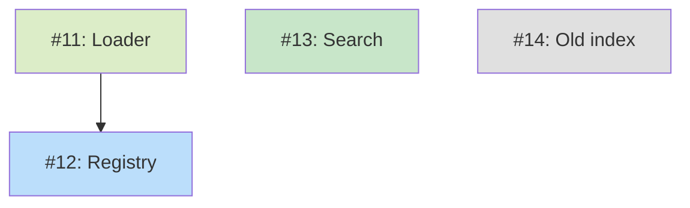

# ROADMAP: plugins

## Status

Active

## Theme

Plugins a maintainer can find.

## Milestones

### Milestone 1: Loader

**Outcome:** A maintainer who installed three plugins sees each one listed
by name with the version it loaded.

**Evidence:**
- A reviewer, from a clean install with three sample plugins, runs the list
  command and sees exactly those three names and versions.

**Left open:** None

**Dependencies:** None
**Status:** Completed

### Milestone 2: Registry

**Outcome:** A maintainer finds a plugin by name without reading the plugin
directory.

**Evidence:**
- A reviewer runs the find command for an installed plugin and sees its path.

**Left open:** None

**Dependencies:** Milestone 1
**Status:** Not started

### Milestone 3: Search

**Outcome:** A maintainer searches plugins by keyword and sees the matches.

**Evidence:**
- A reviewer searches for a keyword two sample plugins share and sees both.

**Left open:** None

**Dependencies:** None
**Status:** Verified

### Milestone 4: Old index

**Outcome:** A maintainer reads the old plugin index from the registry.

**Evidence:**
- A reviewer opens the old index and sees every plugin it lists.

**Left open:** None

**Dependencies:** None
**Status:** Dropped

## Sequencing Rationale

The loader comes first because the registry reads what it loads.

## Progress

The loader landed and search was verified.

## Implementation Issues

<!-- Populated by `shirabe roadmap populate`. Do not fill manually. -->

| Milestone | Issues | Dependencies | Status |
|-----------|--------|--------------|--------|
| Loader | [#11](https://example.com/11) | None | Completed |
| _A maintainer who installed three plugins sees each one listed by name with the version it loaded._ | | | |
| Registry | [#12](https://example.com/12) | Loader | Not started |
| _A maintainer finds a plugin by name without reading the plugin directory._ | | | |
| ~~Search~~ | ~~[#13](https://example.com/13)~~ | ~~None~~ | ~~Verified~~ |
| ~~_A maintainer searches plugins by keyword and sees the matches._~~ | | | |
| ~~Old index~~ | ~~[#14](https://example.com/14)~~ | ~~None~~ | ~~Dropped~~ |
| ~~_A maintainer reads the old plugin index from the registry._~~ | | | |

## Dependency Graph

<!-- Populated by `shirabe roadmap populate`. Do not fill manually. -->

**Legend**: Green = done, Blue = ready
