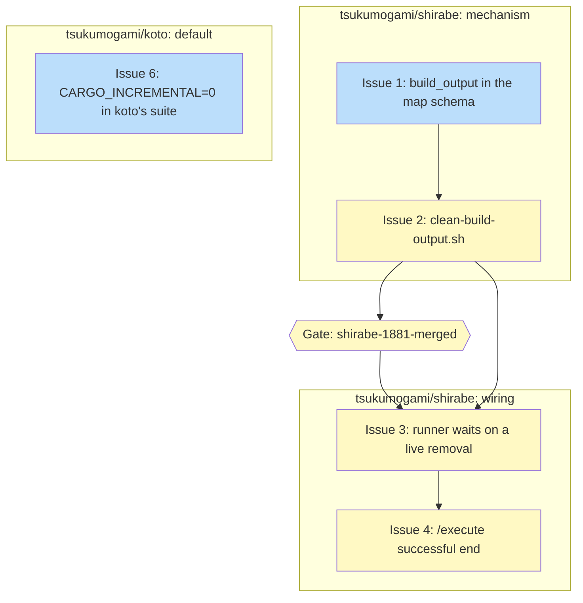

# PLAN: Build Output

## Status

Active

## Scope Summary

A repo declares its build output as a top-level `build_output` array in its
verification map, and a workspace turns an end-of-run cleanup on with
`## Build Output Cleanup: on` in its uncommitted `CLAUDE.local.md`. A new
`clean-build-output.sh` checks each declared path, renames the passing ones
into the worktree's git directory and deletes them detached; the verification
runner waits on a removal that's still running, and `/execute` calls the
script at its successful end. koto's suite
gets `env CARGO_INCREMENTAL=0` on its seven cargo commands as its own item,
against tsukumogami/koto#490.

The plan follows the design and the PRD's requirements R1 to R15.
It runs no measured build and adds no debug-information setting (R15), sends
no telemetry (R14), and builds no trim of idle trees and no instance remover:
those belong to another milestone, and this plan only supplies the
declaration such a remover reads (R10). The work-on run's own end, the fix
round's end and the multi-pr driver's item sessions are cut to
tsukumogami/shirabe#1903, with the script's pin-writing mode and the
plan-dispatched mark
(`docs/decisions/DECISION-build-output-convergence-2026-11-16.md`). The
first release cleans after `/execute`-driven runs only.

## Decomposition Strategy

**Horizontal decomposition.** The design fixes a layer order and the issues
keep it: the declaration (the map's schema reference and its test), then the
script, then the runner guard, then the callers. koto's suite change sits
apart from all of them.

That order follows from three of the design's decisions. Decision 1 puts the
declaration in the map and keeps its check out of `SELECT_JQ`, so the field
can land first: nothing reads it, and a malformed one can't make a map
invalid. Decision 3 makes the script own every check, the rename, the records
and the reaping, so the runner's change is a wait on a live record and the
`removal-running` result it writes when the wait runs out, and it can't be
written before the record format and `bo_record_live` exist. The runner is
verification code the tsukumogami/shirabe#1230 design also changes, so the
guard lands after that design's pull request, tsukumogami/shirabe#1881, or
rebased onto it. Decision 4 settles where a plan's parent cleans:
`/execute`'s successful end after CI is green, once per recorded worktree,
with the base the parent pinned when it recorded that worktree's branch. So
the caller comes last.

A walking skeleton wasn't used. Its first issue would be `/execute`'s end,
which needs the script and the runner's wait under it first.

The work lands in three pull requests. tsukumogami/shirabe splits into a
`mechanism` group (Issues 1 and 2), which can merge now, and a `wiring` group
(Issues 3 and 4), held on tsukumogami/shirabe#1881 by the gate below;
tsukumogami/koto has one group. Issue 5 was cut to
tsukumogami/shirabe#1903, and the remaining issues keep their numbers. Nothing is filed: the tracking level is `none`.

## Issue Outlines

### Issue 1: docs(work-on): document build_output in the verification map schema

**Repo**: tsukumogami/shirabe

**Group**: mechanism

**Goal**: The verification map's schema reference documents `build_output`
as an optional fifth top-level field, and the schema test proves the field
changes nothing about how a map is selected or validated (R1, R8, R10, R13).

**Acceptance Criteria**:
- [ ] `skills/work-on/references/verification-map.md` lists `build_output` beside `schema`, `commands`, `entries` and `default` as an optional array of literal repo-relative paths, with the normalization (a leading `./` and a trailing `/` dropped, duplicates collapsed, a path under another declared path handled with its parent) and no glob expansion.
- [ ] The same section names the refusal and outcome words in their fixed order (`absolute`, `outside`, then `gone` for a missing path, then `symlink`, `tracked`, `not-ignored`, `protected`) plus `malformed` and `failed`, and says the cleanup runs only when `## Build Output Cleanup: on` sits in an untracked, non-symlinked `CLAUDE.local.md`.
- [ ] The section says how a workspace turns the cleanup on: an operator, or a workspace manager's config, adds the `## Build Output Cleanup: on` line to each worktree's untracked `CLAUDE.local.md`; nothing in shirabe writes it.
- [ ] The section says an instance remover may read the field, and that the field isn't renamed or changed in meaning without a change to the schema string, which stays `shirabe-verification-map/v1`.
- [ ] The last shirabe release tagged before this change, with its `run-verification.sh` run against a map carrying `"build_output": ["target/"]`, against one whose `build_output` is a string, and against the same map without the field, selects the same invocations with the same verdicts in all three (R13).
- [ ] `verification-map-schema_test.sh` adds `build_output` to its documented-field loop, so the reference must document it. The selection cases live in `run-verification_test.sh`'s selection section, since the schema test never runs `SELECT_JQ`: a map with `"build_output": ["target/"]` and the same map without it select identical invocations.
- [ ] In the same selection section, a map whose `build_output` is a string, and one whose list holds a number and an empty string beside `"target/"`, each select the same invocations as the map without the field, and neither is reported invalid (R8).
- [ ] `SELECT_JQ` in `run-verification.sh` is byte-identical before and after this change.

**Dependencies**: None

**Type**: docs

### Issue 2: feat(work-on): add clean-build-output.sh to remove declared build output

**Repo**: tsukumogami/shirabe

**Group**: mechanism

**Goal**: `skills/work-on/scripts/clean-build-output.sh --base <sha> [--root
<dir>] [--switch-root <dir>] [--walk-budget <seconds>]` reads the switch at
`--switch-root` (default `--root`), reads `build_output` at the pinned base,
refuses each bad path by name in the fixed order, renames the passing ones
into numbered trash under the worktree's git directory, writes one
`removal-<stamp>.json` per removal, starts the detached deleter
(`clean-build-output.sh --delete <stamp>`) and exits 0 (R2 to R5, R8, R12,
R14). It lands the pieces later issues use, under the names the design's
"Names shared across the plan's issues" table gives:
`skills/work-on/scripts/build-output-lib.sh` (`bo_dir`, `bo_record_live`,
read by Issue 3), `scripts/lib/default-remote-ref.sh` (`default_remote_ref`,
read by Issue 4), the `build-output: removal recorded at <path>` line and
exit 0 on every outcome (relied on by Issue 4), and `claude_md_header_named`
in `scripts/lib/claude-md-header.sh`.

**Acceptance Criteria**:
- [ ] With no `CLAUDE.local.md`, a value other than `on` (trimmed, case-insensitive), a misspelled header, a wrongly cased name (`## build output cleanup: on`), a duplicate header, an unreadable `CLAUDE.local.md`, a `CLAUDE.local.md` git tracks, or one that is a symlink (dangling or not), the script prints one `build-output: cleanup off` line (naming symlink, tracked, unreadable or duplicate where that applies, each told apart by checks made in that order before the header is read), removes nothing and exits 0; `## Build Output Cleanup: on` only in the committed `CLAUDE.md` also leaves the declared path in place.
- [ ] `claude_md_header_named <name> <file>` prints `<name as written><TAB><value>`, and `scripts/lib/claude-md-header_test.sh` gains its cases; the existing callers' tests (`fix-kind_test.sh`, `test-change_test.sh`) pass unchanged.
- [ ] With `--switch-root` naming a work tree whose `CLAUDE.local.md` has the switch on, and `--root` naming a linked worktree with no `CLAUDE.local.md`, the declared path under `--root` is removed; with the switch off at `--switch-root` and on in a `CLAUDE.local.md` at `--root`, nothing is removed. A tracked or symlinked `CLAUDE.local.md` at `--switch-root` reads as off, as at `--root`.
- [ ] Two calls started in the same second get different stamps (each `<UTC time>-<pid>`) and neither prints `failed` for a stamp collision.
- [ ] With the switch on, no `build_output` field or an empty list, and no ended record to reap, the script prints no path line, removes nothing, writes no record and starts no deleter. With the same map and a `running` record that `bo_record_live` reads ended, it renames nothing, writes one record whose `paths` is empty and whose `reaped` names that trash, and starts a deleter on it.
- [ ] A `<git-dir>/shirabe-build-output` that is a symlink, or isn't a directory the current user owns, prints one `failed` line naming it, and nothing is renamed.
- [ ] A `removal-<stamp>.json`, `removal-<stamp>.log` or `trash-<stamp>` that already exists for the call's stamp, as a file, a directory or a symlink, prints one `failed` line naming it; nothing is reaped or renamed and no deleter starts. A record or log path made a symlink after that check fails the no-clobber write: one `failed` line, every entry renamed back to its path, no deleter, and the link's target untouched.
- [ ] A `--base` that isn't an ancestor of HEAD, or isn't an ancestor of or equal to the ref `default_remote_ref` resolves when it resolves one, or an unreadable base or map, prints `build-output: base unreadable, removed nothing` and removes nothing. With no ref resolved, a base that is an ancestor of HEAD passes, and the declared path is removed.
- [ ] `default_remote_ref <dir>` prints `refs/remotes/origin/HEAD`'s target when that symref is set, else `refs/remotes/origin/main` when it exists, else nothing with a non-zero exit; it never names a local branch. Its test covers a clone whose default is `master` with `origin/HEAD` set, and a single-branch clone with neither ref.
- [ ] The declaration is read only with `git show <base>:...`: a branch commit that adds a path to the map leaves that path in place, and one that removes the base's path still has it removed.
- [ ] Each of these is refused with one line of the path as written and its word, and none is touched: `/abs` (`absolute`); `../x`, `a/../../x` and `.` (`outside`); a symlinked path and a path under a symlinked directory (`symlink`, the link target unchanged); a tracked path and an ignored directory holding one tracked file (`tracked`); `Target/` against a tracked `target/` when `core.ignorecase` is true (`tracked`); a path git doesn't ignore (`not-ignored`), which is also what a declared `.git` itself reports, since git never reports `.git` as ignored and `not-ignored` comes first; and, with each fixture untracked and ignored so that only the last check can refuse it, an ignored directory holding a nested `.git`, an ignored mount, and each of `.claude`, `CLAUDE.md`, `CLAUDE.local.md`, `.env`, `.env.local` (`protected`). A tracked `CLAUDE.md` or `.claude` reports `tracked`, the earlier word.
- [ ] A path failing two checks reports only the first in the order absolute, outside, gone, symlink, tracked, not-ignored, protected; a missing path that passes the first two reports `gone`.
- [ ] A non-list `build_output` prints one `malformed` line and removes nothing; a number, an empty string, and a string holding a newline or another control character, each beside `target/`, is named `malformed` and `target/` is still removed; `target` and `./target/` together remove once with no error; `target` and `target/debug` together leave no error, print no line for `target/debug`, and leave `target` gone; `target*` removes nothing named `target1`.
- [ ] With `build_output` holding a tracked path and a valid ignored `target/`, the tracked path is named `tracked` and kept, and `target/` is removed (R3, R5).
- [ ] A `protected` walk that can't finish in its share of `--walk-budget` (a test passes a budget of 1 s over a tree too large to walk in it) reports that path `failed` and keeps it, and the script still returns inside the budget plus its fixed overhead; a call with no `--walk-budget` uses 20 s. The limit is a polling one with no `timeout` command, dev:inode is read with `stat -f '%d:%i'` on macOS and `stat -c '%d:%i'` on Linux, and `clean-build-output_test.sh` is added to `scripts/bash-floor/work-on.list` and passes on the bash 3.2 floor.
- [ ] Passing paths are renamed in declaration order to `trash-<stamp>/1`, `/2`, ... under `bo_dir <root>` (`git -C <root> rev-parse --path-format=absolute --git-path shirabe-build-output`), which the test asserts lies inside the worktree's own git directory in a linked worktree, and inside `<root>/.git` in a plain clone called with `--root` from a directory outside it; a pre-existing `trash-<stamp>` prints one `failed` line and renames nothing.
- [ ] A cross-device path, a failed symlink or dev:inode re-check before the rename, and a dev:inode mismatch after it (which renames the entry back) each print `<path> failed` and leave the path in place.
- [ ] `removal-<stamp>.json` holds exactly the design's fields: `schema` (`shirabe-build-output-removal/v1`), `started_at` (UTC ISO-8601 with `Z`), `pid` (the deleter's), `paths` (n to the path as written), `reaped` (trash directory names) and `status: running`; when the deleter exits it reads `done` or `failed` with `ended_at` in the same format, and a removal made to fail records `failed`. A call that writes a record prints `build-output: removal recorded at <absolute path>` once; one that writes none prints no such line.
- [ ] The deleter is `clean-build-output.sh --delete <stamp>`, started as a `set -m` job with stdin from `/dev/null`, output to `removal-<stamp>.log` and `KOTO_TICK_SESSION` unset: a test that kills the calling process group right after the script returns still finds the record at `done` with the trash gone.
- [ ] Every record write is atomic: a reader polling the record while the deleter rewrites it always parses it; a record replaced by a symlink before a rewrite is left alone and its target untouched; an unparsable `removal-*.json` is named `unreadable, left in place`, and neither it nor its trash is touched.
- [ ] A second call while a deleter is live leaves that record and its trash alone; a call that finds a `running` record that `bo_record_live` reads ended (a dead pid, or a live pid whose command line isn't `clean-build-output.sh --delete <that stamp>`) marks it `failed` and hands its trash (derived from the record's file name, never from a path inside it) to this call's deleter.
- [ ] On a declared tree of at least 9 GiB, the script returns within 30 seconds and the path is gone once the record says `done` (R12).
- [ ] Every outcome above exits 0, and the script calls no telemetry script and emits no telemetry event (R14).

**Dependencies**: Blocked by <<ISSUE:1>>

### Gate: shirabe-1881-merged

**After**: Issue 2

**Before**: Issue 3

**Condition**: tsukumogami/shirabe#1881, the pull request carrying the
tsukumogami/shirabe#1230 design, has merged, so
`verification-eligibility.sh`, its attempts ledger and the verification code
Issue 3 changes exist. Issue 4 waits on Issue 3.

### Issue 3: feat(work-on): wait on a running removal before verification builds

**Repo**: tsukumogami/shirabe

**Group**: wiring

**Goal**: `run-verification.sh`'s supervisor (`--supervise`), after it
takes `sup_start` and before its first command, reads every
`removal-<stamp>.json` in `bo_dir` and waits, inside its own budget, while
`bo_record_live` reads any of them live (both from Issue 2's
`build-output-lib.sh`, judged on the record's `status` and `pid`); it
removes nothing. Out of budget, it writes a `removal-running` result that
`check-verification.sh` holds on at exit 2. The new `--await-removals` mode
checks once, and the command gate `await_removals` on `context_injection`,
`post_research_validation` and `plan_context_injection` runs it, so a run
doesn't enter setup, where the baseline builds, while a removal in its
worktree is still running (R12).
The criteria on `skills/work-on/scripts/verification-eligibility.sh`, its attempts ledger, `--archive`, exit 5 and the per-head cap apply against the tree after tsukumogami/shirabe#1881 merges, since those come from the tsukumogami/shirabe#1230 design that pull request carries (`docs/designs/DESIGN-same-head-verification-rerun.md`); the `check-verification.sh` and `run-verification.sh` halves don't depend on it.

**Acceptance Criteria**:
- [ ] With a `removal-*.json` at `status: running` whose `pid` is a live `clean-build-output.sh --delete <stamp>`, a verification run starts no command until the record reads `done` or `failed`; the fixture's first command writes its own start time with `date -u +%Y-%m-%dT%H:%M:%SZ`, and the test shows it at or after the record's `ended_at`. `--start` still returns within a second while the record is live.
- [ ] A `running` record that `bo_record_live` reads ended (a dead `pid`, or a pid running another program) counts as ended: verification starts at once, and the record and its trash are left untouched for the script's next call.
- [ ] An unparsable `removal-*.json` counts as ended: verification starts at once, one stderr line names it, and `--await-removals` exits 0 for it.
- [ ] A record that stays live ends the wait inside the run's own budget, and the run's total time never passes its budget because of the wait. When the budget runs out with it still live, the runner starts no command and writes a `removal-running` result with `commands: []` whose `detail` names the record; `check-verification.sh` exits 2 on it with a message naming the record and saying to move the result aside or submit `blocked`, records no `verification_results.json` and prints no finding; a later `--start` keeps the result; `verification-eligibility.sh` reports it `ineligible` and `--archive` refuses it. `run-verification_test.sh` gains these cases beside its `supervisor-error` ones.
- [ ] `RULE_IDS`, `references/rule-registry.json` and the verification state's edges are unchanged; the exit-2 row of the verdict table in `skills/work-on/references/verification-map.md`, and `docs/designs/current/DESIGN-output-gates.md`, name `removal-running` beside `supervisor-error`.
- [ ] With no records, or only `done` and `failed` ones, the runner's selected invocations, verdicts and `result.json` match a run without this change.
- [ ] `run-verification.sh --await-removals` takes no `--session`, resolves no merge base and starts no command; it exits 0 with no `shirabe-build-output` directory, no records, or only ended or unparsable ones, 1 while a record reads live (naming it on stderr), and 2 only for a usage error. It exits 0 in a repo whose default branch doesn't resolve.
- [ ] A work-on run started in a worktree while a removal's record reads live holds at `context_injection`, `post_research_validation` or `plan_context_injection` (checked for each, and for a plan child with `SHARED_BRANCH` set), never enters a setup state while the record reads live, moves on the first tick after it reads `done`, and a person's override of `await_removals` lets it on; with no `shirabe-build-output` directory, or a `PLUGIN_ROOT` with no runner, the gate passes. The trailing unconditional edge in `context_injection` and in `plan_context_injection` is removed, and every edge into a setup state or `plan_validation` requires `gates.await_removals.exit_code: 0`; a `status: completed` without `context.md`, or with the gate failing, holds in the state. Each directive says a removal is running and to tick again.
- [ ] The changed `work-on.md` compiles under `koto template compile`, as `.github/workflows/validate-templates.yml` runs it, and on the floor release `.github/workflows/check-koto-entry-floor.yml` compiles against.
- [ ] `work-on.mermaid.md` is regenerated, and `terminal-retention_test.sh`, `step-detail-check_test.sh`, `record-changed-paths_test.sh`, `offload-canary-routes_test.sh` and `work-on-open_test.sh` pass unchanged.
- [ ] The runner deletes, renames and rewrites nothing under `shirabe-build-output`, and `SELECT_JQ` is unchanged.

**Dependencies**: Blocked by <<ISSUE:2>>

### Issue 4: feat(execute): clean each recorded worktree at the run's successful end

**Repo**: tsukumogami/shirabe

**Group**: wiring

**Goal**: `/execute` pins a base per worktree through the new
`skills/execute/scripts/build-output-pin.sh`, which computes `git merge-base
<head> <ref>` with Issue 2's `default_remote_ref` and writes it through the
new write-once verb `run-record.sh pin` as `run/cleanup/<worktree-id>`
holding `{"path", "pin"}`: in single-pr mode from `drift-facts.sh` right
after its fetch (`--id single`), in coordinated mode from `node-push.sh
node` on every push (`--id <node> --fetch`, computed in the node's clone).
`run-record.sh` and `run-record-lib.sh` gain the `cleanup` kind in all five
places a kind is known. `execute-open.sh` carries `run/cleanup/single`
across a single-pr replacement, as it already carries the coordinated
record. In both templates the call is made from
the `merged` and `ready_awaiting_merge` directives, after the exit lines, by
the new `build-output-end.sh`, which reads each worktree's CI itself (a node
on its own node PR), checks each recorded path, calls
`clean-build-output.sh` with that worktree's pin and the parent's checkout
root as `--switch-root`, writes its lines once as `build_output_cleanup`,
and exits 0; no state, edge or reason literal changes (R2, R4, R6, R8, R9).
Never at `plan_completion`, which runs before CI is watched.

**Acceptance Criteria**:
- [ ] A single-pr run with hosted CI green, and one in a repo with no hosted checks, each call the script exactly once, in the one worktree, whether it ends at `merged` or at `ready_awaiting_merge`; `plan_completion` calls nothing.
- [ ] A single-pr run that reaches `ready_awaiting_merge` while the owned pull request's CI is still pending calls the script nowhere, prints `build-output: single CI not green, removed nothing`, and the tree stays.
- [ ] A coordinated run with children in two worktrees, each holding its declared tree and each node PR green, calls the script once in each from the `ready_awaiting_merge` or `merged` directive, and the declared paths are gone from both afterwards; the run reaches its terminal before the call starts, and each `clean-build-output.sh` call uses the default walk budget.
- [ ] `build-output-end.sh` run against a session whose CI read fails, or with the script missing, prints its lines and exits 0, and the terminal's result (`koto status`) is byte-identical before and after.
- [ ] A coordinated run whose node worktrees were made by `node-cut.sh` and hold no `CLAUDE.local.md`, with the switch on in the parent checkout's `CLAUDE.local.md`, passes that checkout's root as `--switch-root` and has the declared paths removed from every node worktree; with the switch off in the parent checkout, every node tree stays.
- [ ] `run-record.sh` knows the `cleanup` kind in `RR_KEY_RE`, its verb-to-field table, `kind()`, `valid()` (`path` absolute and one line, `pin` 40 hex) and `required()` (`path`, `pin`). `run-record_test.sh` gains: a carry of `run/setup`, `run/node/x` and `run/cleanup/x` writes all three; a carry of a cleanup key with an unknown field refuses; `pin` writes an absent key, does nothing on an equal one, and on a different one keeps it, prints `kept=<key>` and exits 0, with no `run/setup` in the session.
- [ ] A coordinated replacement session opened by `execute-open.sh` holds the same `run/cleanup/*` keys with the same values. A single-pr replacement (resuming `paused_for_review`, or re-invoking after `ready_awaiting_merge`) holds the first session's `run/cleanup/single` with no new value written, the snapshot removed once carried, and a re-open over a session that already holds the key carries nothing and removes the snapshot; `execute-open_test.sh` gains these cases.
- [ ] A single-pr run routed to `ready_awaiting_merge` on a merge state of `DIRTY` while the head's checks are still pending reads CI itself and calls the script nowhere.
- [ ] A coordinated run that reaches `ready_awaiting_merge` while one node's hosted CI is still pending keeps that node's tree and cleans each node whose own PR's CI is green; a coordinated run in a repo with no hosted checks cleans each recorded worktree once at its successful end.
- [ ] A coordinated run that reaches `merged` with a node PR in the coordination checkout's repository whose only non-green checks are cancelled macOS floor runs cleans that node's tree; the same node in another repository keeps its tree and prints one line naming it.
- [ ] Every `/execute` pin is written by `build-output-pin.sh` through `run-record.sh pin`, and `execute-coordinated-structure_test.sh`'s check of which script calls each verb names `pin` for `build-output-pin.sh`. The end passes each pin unchanged as `--base` and never recomputes it.
- [ ] The pin passes the script's ancestry checks at the end, so the declared paths are removed, for a fresh branch, for an adopted branch that already carries its own commits, for a reused or attached node branch, and for a run whose `worktree_sync` took `sync_status: override`.
- [ ] A pin that can't be written (no ref resolved, as in a single-branch clone; a failed koto write) leaves `drift_facts`' result and the captured `SETTLED_BRANCH` unchanged, prints nothing on stdout, and the end prints `base unreadable` for that worktree. A node in another repository whose default branch is `master` is pinned against that clone's `origin/master`, fetched first, even when its worktree was reused.
- [ ] `build-output-pin.sh` writes nothing when the head is already an ancestor of the resolved ref: a single-pr PR merged with a merge commit and then re-invoked through `orchestrator_setup`'s `status: override`, with the snapshot removed, ends without reading the branch's declaration.
- [ ] A recorded path that isn't a work tree root on its recorded branch (`settled_branch`, or `impl/<plan-slug>-<node>`), or that no longer exists, prints `build-output: <id> worktree unverified, removed nothing` and is never cleaned; a node with `run/node/<node>` and no `run/cleanup/<node>` prints `build-output: <node> base unreadable, removed nothing`.
- [ ] A recovered coordinated run, with and without `--adopt-run`, has no `run/cleanup/*` key, pins nothing, prints `build-output: <node> base unreadable, removed nothing` per node, calls nothing, and keeps every tree.
- [ ] After the branch's pull request is merged and the default branch fetched, so that a recomputed merge base would be the branch head, the cleanup still leaves in place a path the branch added to the declaration (R2).
- [ ] A run that ends at `done_blocked` calls the script nowhere, and every tree stays.
- [ ] A single-pr run whose `ci_monitor` reports failing CI that's then fixed before the end cleans nothing while CI is failing, and cleans once, at the end.
- [ ] A coordinated run that reaches `paused_awaiting_merges` cleans nothing, and neither does one that ends at `done_blocked` or `done_error`.
- [ ] A script line of `failed`, `malformed` or `base unreadable` leaves the run's terminal unchanged.
- [ ] The parent's session carries exactly one `build_output_cleanup` key after the call, holding every recorded worktree's lines (each block led by `build-output: <id>`), including `build-output: removal recorded at <path>` from Issue 2's script wherever it removed something.
- [ ] The execute template's structure test and the coordinated template's structure test pass with no existing check changed, each gaining one check that only the `merged` and `ready_awaiting_merge` directives run `build-output-end.sh` (`execute-template-structure_test.sh` after its terminal checks, `execute-coordinated-structure_test.sh` after its last CHECKS entry); `owned-pr-callers_test.sh` passes with the new script in its scan, which needs `--run-id` on every `owned-pr.sh` line and an empty-selector guard. `execute.mermaid.md` and `execute-coordinated.mermaid.md` don't change.
- [ ] `skills/execute/SKILL.md`'s closed write-target set names the declared build output of each recorded worktree, removed only through `build-output-end.sh` and `clean-build-output.sh`.
- [ ] A search of the `wiring` group's diff (Issues 3 and 4) finds no call to shirabe's telemetry scripts and no new telemetry event name (R14).

**Dependencies**: Blocked by <<ISSUE:3>>

### Issue 6: chore(verification): build koto's suite with incremental compilation off

**Repo**: tsukumogami/koto

**Group**: default

**Goal**: Each of the seven cargo commands in koto's verification map runs
`env CARGO_INCREMENTAL=0` right after `scripts/without-session-env.sh`, and
koto's prose list of its suite commands matches the map, planned against
tsukumogami/koto#490 (R11). An exported variable never reaches the suite,
because koto runs a session's commands with a fixed environment
(tsukumogami/koto#578), so the setting goes on the commands.

**Acceptance Criteria**:
- [ ] `cargo-test`, `stability-tests`, `fmt`, `clippy`, `doc-names`, `plugin-hooks-shape` and `shipped-spec` in `.claude/shirabe-extensions/verification-map.json` each read `bash scripts/without-session-env.sh env CARGO_INCREMENTAL=0 cargo ...`, the same position on all seven, and the other five commands are unchanged.
- [ ] The diff leaves `scripts/without-session-env.sh` and every `.cargo/config.toml` byte-identical and carries no `pass_env` key, so a hand-run build reads the same configuration as before.
- [ ] koto's prose list of its suite commands in `.claude/shirabe-extensions/work-on.md` matches the map.
- [ ] A failing command still fails: with a deliberately failing test in the tree, the prefixed `cargo-test` exits non-zero and verification reports it failed, and a clippy warning makes the prefixed `clippy` fail the same way.
- [ ] On one host and one toolchain, `du -sk target` after the suite from a clean checkout is at most two thirds of the same figure before the change.
- [ ] A plain `cargo build` in a reviewer's own shell still writes `target/debug/incremental/`.
- [ ] The diff adds no `debug =` profile key and no `CARGO_PROFILE_*_DEBUG` setting (R15).

**Dependencies**: None

## Dependency Graph

**Legend**: Green = done, Blue = ready, Yellow = blocked, Purple = needsDesign, Light blue = needsPrd, Red = needsSpike, Indigo = needsDecision, Orange = tracksDesign/tracksPlan

The hexagon is the gate.

## Implementation Sequence

**Critical path:** Issue 1 -> Issue 2 -> gate (tsukumogami/shirabe#1881
merges) -> Issue 3 -> Issue 4. The gate's timing is outside this plan, so the
wiring group can't start until that pull request merges.

**Merge order:** the `mechanism` pull request and the koto pull request have
no predecessor and can merge in either order. The `wiring` pull request
merges after `mechanism` and after the gate.

**Recommended order:**
1. Issue 1, the declaration: safe to land first, since nothing reads it.
2. Issue 2, the script, with its own test suite.
3. Issue 6, koto's suite, any time: it touches nothing the other issues do.
4. Issue 3, the runner guard, once tsukumogami/shirabe#1881 has merged (or rebased onto it).
5. Issue 4, the `/execute` caller and its per-worktree pins, after Issue 3.
