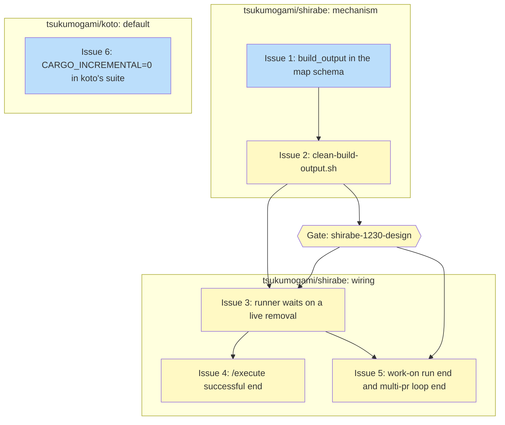

# PLAN: Build Output

## Status

Active

## Scope Summary

A repo declares its build output as a top-level `build_output` array in its
verification map, and a workspace turns an end-of-run cleanup on with
`## Build Output Cleanup: on` in its uncommitted `CLAUDE.local.md`. A new
`clean-build-output.sh` checks each declared path, renames the passing ones
into the worktree's git directory and deletes them detached; the verification
runner waits on a removal that's still running, and `/execute` and the
work-on template call the script at a run's successful end. koto's suite
gets `env CARGO_INCREMENTAL=0` on its seven cargo commands as its own item,
against tsukumogami/koto#490.

The plan follows the design and the PRD's requirements R1 to R15.
It runs no measured build and adds no debug-information setting (R15), sends
no telemetry (R14), and builds no trim of idle trees and no instance remover:
those belong to another milestone, and this plan only supplies the
declaration such a remover reads (R10). Which work-on state carries the
cleanup in a single run, and the name of the state that ends the multi-pr
item loop, stay open until the tsukumogami/shirabe#1230 design settles; the
declaration and the script aren't held by it.

## Decomposition Strategy

**Horizontal decomposition.** The design fixes a layer order and the issues
keep it: the declaration (the map's schema reference and its test), then the
script, then the runner guard, then the callers. koto's suite change sits
apart from all of them.

That order follows from three of the design's decisions. Decision 1 puts the
declaration in the map and keeps its check out of `SELECT_JQ`, so the field
can land first: nothing reads it, and a malformed one can't make a map
invalid. Decision 3 makes the script own every check, the rename, the records
and the reaping, so the runner's change is only a wait on a live record, and
it can't be written before the record format exists. The runner is
verification code the tsukumogami/shirabe#1230 design also changes, so the
guard lands after that design's pull request, tsukumogami/shirabe#1881, or
rebased onto it. Decision 4 settles where a plan's parent cleans
(`/execute`'s successful end after CI is green, once per recorded worktree,
with the base the parent pinned at its start, and the multi-pr driver when
its item loop ends) and leaves the single run's state to the same
design, so the callers come last and the work-on caller names no state.

A walking skeleton wasn't used. Its first issue would have to run the
cleanup from a work-on run's end, and that state doesn't exist until the
tsukumogami/shirabe#1230 design names it.

The work lands in three pull requests. tsukumogami/shirabe splits into a
`mechanism` group (Issues 1 and 2), which can merge now, and a `wiring` group
(Issues 3 to 5), which waits on the gate below; tsukumogami/koto has one
group. Nothing is filed: the tracking level is `none`.

## Issue Outlines

### Issue 1: docs(work-on): document build_output in the verification map schema

**Repo**: tsukumogami/shirabe

**Group**: mechanism

**Goal**: The verification map's schema reference documents `build_output`
as an optional fifth top-level field, and the schema test proves the field
changes nothing about how a map is selected or validated (R1, R8, R10, R13).

**Acceptance Criteria**:
- [ ] `skills/work-on/references/verification-map.md` lists `build_output` beside `schema`, `commands`, `entries` and `default` as an optional array of literal repo-relative paths, with the normalization (a leading `./` and a trailing `/` dropped, duplicates collapsed, a path under another declared path handled with its parent) and no glob expansion.
- [ ] The same section names the refusal and outcome words in their fixed order (`absolute`, `outside`, then `gone` for a missing path, then `symlink`, `tracked`, `not-ignored`, `protected`) plus `malformed` and `failed`, and says the cleanup runs only when `## Build Output Cleanup: on` sits in an untracked, non-symlinked `CLAUDE.local.md`.
- [ ] The section says an instance remover may read the field, and that the field isn't renamed or changed in meaning without a change to the schema string, which stays `shirabe-verification-map/v1`.
- [ ] `verification-map-schema_test.sh` accepts a map with `"build_output": ["target/"]` and the same map without it, and both select identical invocations.
- [ ] The schema test runs a map whose `build_output` is a string, and one whose list holds a number and an empty string beside `"target/"`; each selects the same invocations as the map without the field, and neither is reported invalid (R8).
- [ ] `SELECT_JQ` in `run-verification.sh` is byte-identical before and after this change.

**Dependencies**: None

**Type**: docs

### Issue 2: feat(work-on): add clean-build-output.sh to remove declared build output

**Repo**: tsukumogami/shirabe

**Group**: mechanism

**Goal**: `skills/work-on/scripts/clean-build-output.sh --base <sha> [--root
<dir>]` reads the switch, reads `build_output` at the pinned base, refuses
each bad path by name in the fixed order, renames the passing ones into
numbered trash under the worktree's git directory, writes one record per
removal, starts a detached delete and exits 0 (R2 to R5, R8, R12, R14).

**Acceptance Criteria**:
- [ ] With no `CLAUDE.local.md`, a value other than `on` (trimmed, case-insensitive), a misspelled header, a duplicate header, a `CLAUDE.local.md` git tracks, or one that is a symlink, the script prints one `build-output: cleanup off` line (naming tracked, symlink, duplicate or unreadable where that applies), removes nothing and exits 0; `## Build Output Cleanup: on` only in the committed `CLAUDE.md` also leaves the declared path in place.
- [ ] A `<git-dir>/shirabe-build-output` that is a symlink, or isn't a directory the current user owns, prints one `failed` line naming it, and nothing is renamed.
- [ ] A `--base` that isn't an ancestor of HEAD, or isn't an ancestor of or equal to the upstream default branch's remote ref when that ref exists, or an unreadable base or map, prints `build-output: base unreadable, removed nothing` and removes nothing.
- [ ] The declaration is read only with `git show <base>:...`: a branch commit that adds a path to the map leaves that path in place, and one that removes the base's path still has it removed.
- [ ] Each of these is refused with one line of the path as written and its word, and none is touched: `/abs` (`absolute`); `../x`, `a/../../x` and `.` (`outside`); a symlinked path and a path under a symlinked directory (`symlink`, the link target unchanged); a tracked path and an ignored directory holding one tracked file (`tracked`); `Target/` against a tracked `target/` when `core.ignorecase` is true (`tracked`); a path git doesn't ignore (`not-ignored`); a directory holding a nested `.git`, a mount, and each of `.git`, `.claude`, `CLAUDE.md`, `CLAUDE.local.md`, `.env`, `.env.local` (`protected`).
- [ ] A path failing two checks reports only the first in the order absolute, outside, gone, symlink, tracked, not-ignored, protected; a missing path that passes the first two reports `gone`.
- [ ] A non-list `build_output` prints one `malformed` line and removes nothing; a number or empty-string entry beside `target/` is named `malformed` and `target/` is still removed; `target` and `./target/` together remove once with no error; `target*` removes nothing named `target1`.
- [ ] Passing paths are renamed in declaration order to `trash-<stamp>/1`, `/2`, ... under `git rev-parse --git-path shirabe-build-output`, which the test asserts lies inside the worktree's own git directory in a linked worktree; a pre-existing `trash-<stamp>` prints one `failed` line and renames nothing.
- [ ] A cross-device path, a failed symlink or dev:inode re-check before the rename, and a dev:inode mismatch after it (which renames the entry back) each print `<path> failed` and leave the path in place.
- [ ] `removal-<stamp>.json` holds `started_at`, the n-to-path map, reaped trash directories, the deleter's pid and `status: running`; when the detached delete exits it reads `done` or `failed` with `ended_at`, and a removal made to fail records `failed`.
- [ ] A second call while a deleter is live leaves that record and its trash alone; a call that finds a `running` record with a dead pid marks it `failed` and hands its trash (derived from the record's file name, never from a path inside it) to this call's deleter.
- [ ] On a declared tree of at least 9 GiB, the script returns within 30 seconds and the path is gone once the record says `done` (R12).
- [ ] Every outcome above exits 0, and the script calls no telemetry script and emits no telemetry event (R14).

**Dependencies**: Blocked by <<ISSUE:1>>

### Gate: shirabe-1230-design

**After**: Issue 2

**Before**: Issue 3, Issue 5

**Condition**: tsukumogami/shirabe#1881, the pull request carrying the
tsukumogami/shirabe#1230 design, has merged, so the verification code that
design changes and the work-on states it names are settled.

### Issue 3: feat(work-on): wait on a running removal before verification builds

**Repo**: tsukumogami/shirabe

**Group**: wiring

**Goal**: Before it builds, `run-verification.sh` reads every removal record
and waits, inside its own budget, while any says `running` with a live pid;
it removes nothing (R12).

**Acceptance Criteria**:
- [ ] With a `removal-*.json` at `status: running` whose pid is live, a verification run starts no command until the record reads `done` or `failed`; the test shows the first command's start time after the record's `ended_at`.
- [ ] A `running` record whose pid is dead counts as ended: verification starts at once, and the record and its trash are left untouched for the script's next call.
- [ ] A record whose pid stays live (a reused pid) ends the wait inside the run's own budget, and the run's total time never passes its budget because of the wait; when the budget runs out with that record still `running`, the runner starts no command, reports the verification as not run, and prints one line naming the record.
- [ ] With no records, or only `done` and `failed` ones, the runner's selected invocations, verdicts and `result.json` match a run without this change.
- [ ] The runner deletes, renames and rewrites nothing under `shirabe-build-output`, and `SELECT_JQ` is unchanged.

**Dependencies**: Blocked by <<ISSUE:2>>

### Issue 4: feat(execute): clean each recorded worktree at the run's successful end

**Repo**: tsukumogami/shirabe

**Group**: wiring

**Goal**: `/execute` runs `clean-build-output.sh` once per recorded
worktree at the run's successful end, with the base the parent pinned at its
start (R2, R9). In single-pr mode that's after `ci_monitor` reports CI
green, on the routes from `merge_route` into `ready_awaiting_merge` or,
after `merge_confirm`, into `done`; never at `plan_completion`, which runs
before CI is watched. In coordinated mode it's when `coord_verdict` routes
to `ready_awaiting_merge` or `merged`. The implementer picks the exact state
in each template within those bounds.

**Acceptance Criteria**:
- [ ] A single-pr run calls the script exactly once, in its one worktree, after `ci_monitor` reports CI green, whether it ends at `ready_awaiting_merge` or at `done` after `merge_confirm`; `plan_completion` calls nothing.
- [ ] A coordinated run with children in two worktrees, each holding its declared tree, calls the script once in each when `coord_verdict` routes to `ready_awaiting_merge` or `merged`, and the declared paths are gone from both afterwards.
- [ ] The parent records one base per repository in its own session when its run starts, the commit the default branch's remote ref names at that moment, and passes that same base as `--base` for every worktree of that repository; it never recomputes it.
- [ ] After the branch's pull request is merged and the default branch fetched, so that a recomputed merge base would be the branch head, the cleanup still leaves in place a path the branch added to the declaration (R2).
- [ ] A run that ends at `done_blocked` calls the script nowhere, and every tree stays.
- [ ] A single-pr run whose `ci_monitor` reports failing CI that's then fixed before the end cleans nothing while CI is failing, and cleans once, at the end.
- [ ] A coordinated run that reaches `paused_awaiting_merges` cleans nothing, and neither does one that ends at `done_blocked` or `done_error`.
- [ ] A script line of `failed`, `malformed` or `base unreadable` leaves the run's terminal unchanged.
- [ ] The execute template's structure test, its owned-PR caller tests and the coordinated template's tests pass with the new step.

**Dependencies**: Blocked by <<ISSUE:3>>

### Issue 5: feat(work-on): clean at a run's successful end and at the multi-pr loop's end

**Repo**: tsukumogami/shirabe

**Group**: wiring

**Goal**: The work-on template calls `clean-build-output.sh` once at a run's
successful end and once when a multi-pr driver's item loop finds no next
item, in the states the tsukumogami/shirabe#1230 design names; this outline
names neither state (R6, R7, R9).

**Acceptance Criteria**:
- [ ] A run that reaches its successful end with hosted CI green, or its successful end in a repo with no hosted checks, removes the declared paths and leaves every other tracked and ignored file, and a sibling directory beside the worktree, unchanged.
- [ ] In the run's event log the cleanup comes after the closing step and the handoff brief, and no path of edges from the state that runs it reaches an implementation or verification state.
- [ ] A run's output carries exactly one cleanup record, however many verification rounds it took.
- [ ] The cleanup doesn't run on a passing verification, a return to implementation, the CI fix loop, a run blocked during verification or while waiting on CI, or `done_already_complete`; each case finds its tree in place.
- [ ] A child dispatched by a plan parent, and the `pr_creation` to `done` edge on `pr_status: shared`, never call the script; the next child in the same worktree finds the earlier child's tree.
- [ ] In a multi-pr PLAN the driver calls the script once, when its item loop finds no next item, in the one worktree the items share.
- [ ] A fix round started by `fix-round.sh` cleans again at its own successful end with CI green.
- [ ] The caller passes the run's pinned base as `--base`: verification's recorded `merge_base`, or `impl_base` for a run with no `result.json`.
- [ ] After the branch's pull request is merged and the default branch fetched, so that a recomputed merge base would be the branch head, the cleanup still leaves in place a path the branch added to the declaration (R2).
- [ ] A cleanup line of `failed`, `malformed`, `gone` or a refusal leaves the run's result successful.
- [ ] The state that runs the cleanup returns within 30 seconds of the tick that enters it, on a declared tree of at least 9 GiB.

**Dependencies**: Blocked by <<ISSUE:3>>

### Issue 6: chore(verification): build koto's suite with incremental compilation off

**Repo**: tsukumogami/koto

**Group**: default

**Goal**: Each of the seven cargo commands in koto's verification map runs
`env CARGO_INCREMENTAL=0` right after `scripts/without-session-env.sh`, and
koto's prose list of its suite commands matches the map, planned against
tsukumogami/koto#490 (R11). An exported variable never reaches the suite,
because koto runs a session's commands with a fixed environment
(tsukumogami/koto#578), so the setting goes on the commands.

**Acceptance Criteria**:
- [ ] `cargo-test`, `stability-tests`, `fmt`, `clippy`, `doc-names`, `plugin-hooks-shape` and `shipped-spec` in `.claude/shirabe-extensions/verification-map.json` each read `bash scripts/without-session-env.sh env CARGO_INCREMENTAL=0 cargo ...`, the same position on all seven, and the other five commands are unchanged.
- [ ] The diff leaves `scripts/without-session-env.sh` and every `.cargo/config.toml` byte-identical and carries no `pass_env` key, so a hand-run build reads the same configuration as before.
- [ ] koto's prose list of its suite commands in `.claude/shirabe-extensions/work-on.md` matches the map.
- [ ] A failing command still fails: with a deliberately failing test in the tree, the prefixed `cargo-test` exits non-zero and verification reports it failed, and a clippy warning makes the prefixed `clippy` fail the same way.
- [ ] On one host and one toolchain, `du -sk target` after the suite from a clean checkout is at most two thirds of the same figure before the change.
- [ ] A plain `cargo build` in a reviewer's own shell still writes `target/debug/incremental/`.
- [ ] The diff adds no `debug =` profile key and no `CARGO_PROFILE_*_DEBUG` setting (R15).

**Dependencies**: None

## Dependency Graph

**Legend**: Green = done, Blue = ready, Yellow = blocked, Purple = needsDesign, Light blue = needsPrd, Red = needsSpike, Indigo = needsDecision, Orange = tracksDesign/tracksPlan

The hexagon is the gate.

## Implementation Sequence

**Critical path:** Issue 1 -> Issue 2 -> gate (tsukumogami/shirabe#1881
merges) -> Issue 3 -> Issue 5. The gate's timing is outside this plan, so the
wiring group can't start until that pull request merges.

**Merge order:** the `mechanism` pull request and the koto pull request have
no predecessor and can merge in either order. The `wiring` pull request
merges after `mechanism` and after the gate.

**Recommended order:**
1. Issue 1, the declaration: safe to land first, since nothing reads it.
2. Issue 2, the script, with its own test suite.
3. Issue 6, koto's suite, any time: it touches nothing the other issues do.
4. Issue 3, the runner guard, once tsukumogami/shirabe#1881 has merged (or rebased onto it).
5. Issues 4 and 5, the callers, in parallel after Issue 3; Issue 5 names its states from the tsukumogami/shirabe#1230 design.
