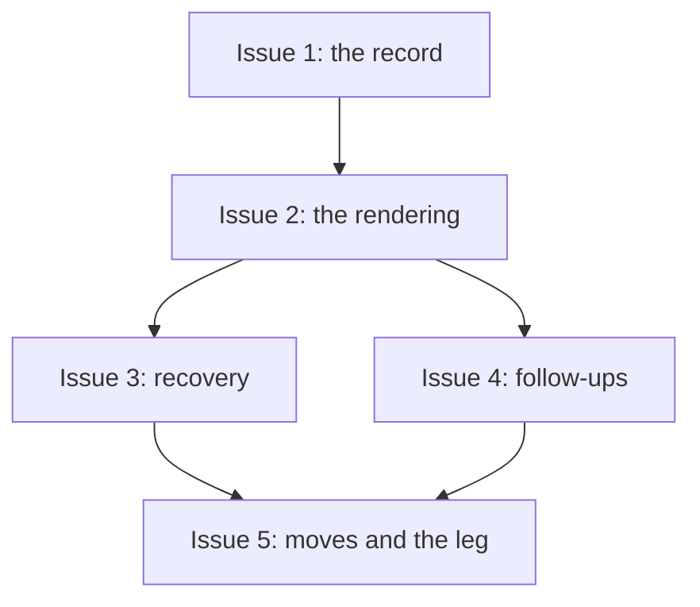

# PLAN: coordinated-run-session-record

## Status

Active

## Scope Summary

A coordinated `/execute` run stops keeping its control-plane facts in the coordination pull
request's body. The node map, pushed and merged heads, follow-ups, the cascade verdict, the
coordination pull request's number, the store and the run identity become `run/` keys in
`execute-<topic>`, written through one recorder and read through one reader. The body is
rendered from them at every transition, a start with no record recovers from the
rendering, pauses carry the record across koto's terminal replacement, the session moves by
the shared import with `/deliver`'s inner leg re-bound or reported, and every merge passes
the pull request's title and Part 1 as its squash message. Requirements are in
`docs/prds/PRD-coordinated-run-session-record.md`; the approach is the design.

## Decomposition Strategy

Horizontal, in the design's five phases, grouped into three pull requests by what each
needs. The record and its seam come first because every later item reads or writes through
them. The rendering and recovery share one codec and land together, which also keeps the
three phases the design says must ship in one release on consecutive merges with no release
between them. Follow-ups and moves extend `/execute`'s and `/deliver`'s surfaces and end in
the end-to-end engine test, which needs everything before it.

## Issue Outlines

### Issue 1: feat(execute): keep the coordinated run's record in its session

**Repo**: tsukumogami/shirabe

**Group**: record

**Goal**: Add the `run/` keys, `run-record.sh` with its verb-to-field ownership table,
`run-record-lib.sh`, a shared test helper that seeds a record, the opener's carry of `run/`
across `--replace-terminal` (lock, retained snapshot, verified flags cleared), the five
rebind variables (`STORE`, `COORDINATION_PR`, `FOLLOW_UP`, `FOLLOW_UP_REMOVE`, `ADOPT_RUN`),
setup's store seal, node list and handed pull request, `node-push.sh` writing heads through
the recorder, and `coord_compute` and `coord-merge.sh` reading the record, with every merge
pinned to the recorded head and every unverified head routed through `evaluate` (and
`run-record.sh verified`) before `merge` is ever printed for it (design Decisions 1 and 2; PRD R1-R4, R6 partly, R7, R13, R19,
R24).

**Acceptance Criteria**:
- [ ] After setup the record holds the node list, the store and the coordination pull
  request's number, and after the cascade deletes the PLAN the loop still lists every node.
- [ ] For every key, a write from a verb that doesn't own the field exits 65 `not-owner`
  and changes nothing; a push the stub rejects writes no head.
- [ ] The cascade verdict reads `not-run`, then `pushed` with the head, or `failed` with the
  step; a `failed` verdict makes the next invocation run the cascade again.
- [ ] With a node's `head=` edited in the body, the node's merge passes the recorded head
  to `--match-head-commit`; a live head that differs from the recorded one makes no merge
  call and reports `awaiting:head-moved`.
- [ ] A run stopped at `paused_awaiting_merges` and re-invoked continues with the same
  `run_id`, map and heads, every carried head unverified until the readiness check passes
  again, and its merge attempts empty; a crash between the replacement and the carry is
  recovered from the retained snapshot on the next open.
- [ ] A new run records store `github` without `--store` and `session` with `--store
  session`; a later invocation with the other value exits `store-mismatch` and changes no
  key.
- [ ] `--coordination-pr` is verified through the ownership lookup and its number recorded;
  a pull request from another author or branch, without the marker, or differing from the
  lookup's is refused with `coordination-pr-mismatch`; a later invocation reads the number
  from the record, and one whose recorded pull request is closed unmerged stops with
  `coordination-pr-closed`.
- [ ] `skills/execute/SKILL.md` names the run record as the run's store and lists the new
  keys in the closed write-target set.
- [ ] The execute script suites pass with the test helper's records in place of index
  bodies.

**Dependencies**: None

### Issue 2: feat(execute): render the coordination PR body from the run record

**Repo**: tsukumogami/shirabe

**Group**: render-recover

**Goal**: Add `scripts/lib/coordination-body.sh` (`cb_render`, `cb_parse`, the moved
index-entry grammar) and `coord-render.sh`, called after every listed transition and before
every terminal; observe merges there and record merged heads; keep a live Part 1 byte for
byte or compose the fixed sentence; drop the self row; cap at 60,000 bytes; re-read before
posting; require a fresh render before evaluating or merging the coordination pull request;
remove `node-push.sh`'s body surgery; move `squash-message.sh` to `scripts/lib/` and pass
its output on every `/execute` merge; amend `references/coordination-strategy.md` and the
sixth decision of `docs/designs/current/DESIGN-scope-then-execute.md` (design Decisions 3
and 6; PRD R5, R15, R17, R18, R21, R23).

**Acceptance Criteria**:
- [ ] Each listed transition and each terminal posts a body in its own test case; a
  live-state change alone posts nothing; two renders of an unchanged record and live state
  post once.
- [ ] A renderer test over nodes open, merged and closed with zero, one and two follow-ups
  checks exactly one top-level `---`, the marker and run lines below it, no line naming the
  coordination pull request's number, a clean `shirabe validate --coordination-body`, and
  `coordination-gate-refs.sh` listing exactly the nodes and follow-ups.
- [ ] A body with no top-level `---` gets exactly the composed Part 1; a body with a Part 1,
  including one holding a list, keeps it byte for byte; a Part 1 edited between render and
  post skips the post with `body=stale`.
- [ ] A state read the stub fails renders `unknown`; a post the stub fails reports
  `body=stale`, leaves the record unchanged, and the next transition posts; a render the
  stub fails just before the coordination merge makes no merge call and reports
  `merge-refused:body-stale`; a body over 60,000 bytes reports `body=full`.
- [ ] Each merge (node, follow-up, coordination, single-pr home) passes a message file whose
  subject is the title and whose body is Part 1; an empty Part 1, a multi-line title or AI
  attribution makes no merge call and reports `merge-refused:squash-message`; `rebase`
  passes no message.
- [ ] `/coordinate`'s land step uses `scripts/lib/squash-message.sh` and its suites pass
  unchanged.
- [ ] A private node under a public coordination pull request is refused with
  `execute:visibility` without naming the repository.
- [ ] `lifecycle.yml`'s merge-last step and `coordination-gate-refs.sh` are unchanged and
  their tests pass against rendered bodies.
- [ ] In the stub's request log every body post comes after the koto write of the keys it
  shows.

**Dependencies**: Blocked by Issue 1

### Issue 3: feat(execute): recover a coordinated run that has no record

**Repo**: tsukumogami/shirabe

**Group**: render-recover

**Goal**: In `record-coord-setup.sh`, when `run/setup` is absent: stop with
`session-absent` on the `session` store; otherwise find the coordination pull request,
parse the rendering with `cb_parse`, take the node list, resolve identity (carried
`run_id`, rendered run line, unanimous markers, minted), re-read heads live as unverified,
set the cascade from the PLAN's presence, write `run/recovered`, relying on Issue 1's
routing of unverified heads through `evaluate`; add `--adopt-run`; recover pre-feature runs once; add the structure
test that bans body parsing from `skills/execute/` (design Decision 4; PRD R3, R6, R8-R11,
R22).

**Acceptance Criteria**:
- [ ] On `session`, a start with no session stops with `session-absent` naming the import,
  and the stub records no body edit, comment or merge.
- [ ] On `github`, a start with no session whose rendered run line matches every node pull
  request's marker recovers, writes the recovery marker, reports `recovered=<url>` and
  continues; each recovered pull request's live head is read and the readiness check runs
  before any merge call, in that order in the stub's log.
- [ ] Identity comes from a carried `run_id`, else the run line, else unanimous markers,
  else a minted id; a node with another marker or none stops with `recovery-unproven`
  naming every such node; `--adopt-run <id>` re-stamps only those, records the login and
  time, and is refused elsewhere or with a malformed id.
- [ ] With the PLAN on the branch the node list comes from it and the cascade is `not-run`;
  with the PLAN gone the cascade is `pushed` at the live coordination head and re-verified.
- [ ] No coordination pull request stops with `coordination-pr-missing`, two with
  `coordination-pr-ambiguous`, a republished body with no index with
  `coordination-pr-missing`; an old-format self row is ignored; a body over the cap is
  refused.
- [ ] A pre-feature run recovers once keeping its `run_id` and records store `github`; the
  next invocation writes no recovery marker.
- [ ] With a node removed from the rendered index by hand and the PLAN gone, a recovered run
  doesn't list that node (the PRD's Known Limitation, pinned).
- [ ] The structure test fails on any non-test file under `skills/execute/` that defines or
  calls `RE_COORD_ENTRY`, `coord_index_entries`, `coord_parse_entry` or `coord_find_entry`,
  holds a pattern containing `head=`, or adds or removes a `run/` key outside
  `run-record.sh`, and passes on the tree.

**Dependencies**: Blocked by Issue 2

### Issue 4: feat(execute): record follow-up pull requests against a node

**Repo**: tsukumogami/shirabe

**Group**: follow-up-move

**Goal**: Map `--follow-up <node>=<url> [--remove]` to the rebind variables, check and
record follow-ups at setup with their live head unverified, add them to `coord_compute` as
`<node>/follow-up-<n>` after their node, merge them with `--merge`, render their lines, and
hold the merge-last gate until they merge (design Decision 7; PRD R16).

**Acceptance Criteria**:
- [ ] An open and a merged follow-up are recorded with their live heads; recording again
  updates the head; `follow-up-node`, `follow-up-repo`, `follow-up-base`,
  `follow-up-author` and `follow-up-closed` refuse the five cases, each changing nothing.
- [ ] Two follow-ups on one node render as two lines named by number, and the gate's
  extraction counts both.
- [ ] With an open follow-up the merge-last gate fails until it merges; with `--merge` it
  merges after its node, and not without `--merge`; one recorded against a node already
  merged merges on the next invocation.
- [ ] A follow-up closed unmerged holds the gate and is reported `follow-up-closed:<url>`;
  `--remove` drops it; a replacement recorded and the closed one removed lets the gate pass
  once the replacement merges.

**Dependencies**: Blocked by Issue 2

### Issue 5: feat(deliver): move a coordinated run between workspaces with its leg

**Repo**: tsukumogami/shirabe

**Group**: follow-up-move

**Goal**: Add the `execute` and `deliver` import sets (compiling the shipped templates
first), pass `--coordination-pr` and `--store` from `/deliver` to `/execute`, read
`/scope`'s intent and pull request from its leg in `deliver-probe.sh scoped`, route a
missing request or a refused attach to `execute-leg-lost:<code>`, and add the end-to-end
engine test of a run stopped after its first node merges, imported into a second workspace
on the same host and resumed to its merge (design Decision 5; PRD R12, R14, R19, R20).

**Acceptance Criteria**:
- [ ] The engine test: two node pull requests, `--merge`, stopped at
  `paused_awaiting_merges` after the first merges, imported with `skill-session.sh import
  execute`, resumed with the same `run_id`, no recovery marker, ending `merged`, with the
  stub serving a body with no index or run lines to every read; the last posted body shows
  both nodes merged at the stub's merge sha, a recorded follow-up after the first node, and
  no self row; the source workspace's tick answers `session_migrated`.
- [ ] `import execute` and `import deliver` compile the shipped templates and import under
  the session's own name; an unknown set is refused; an import onto a live session of that
  name is refused and leaves both sessions unchanged.
- [ ] A new `/deliver` run after the import gets `/execute`'s promoted result on its new leg
  and the old request reads `abandoned`; a `/deliver` session resumed in place on the same
  host gets the result on its original leg.
- [ ] A refused attach resolves the leg `outcome: error`, `reason:
  execute-leg-lost:<code>`, naming the execute session's state; a `/deliver` session moved
  between two simulated hosts with separate request stores ends with
  `execute-leg-lost:request_not_found`, and a new `/deliver` there gets the result.
- [ ] `/deliver` passes `/scope`'s pull request as `--coordination-pr` and `--store` when
  given; its start gate passes with the body's `intent=` removed or contradicting the leg,
  and fails when the leg's intent is `stop`.

**Dependencies**: Blocked by Issue 3, Issue 4

## Dependency Graph

## Implementation Sequence

The three PR groups land in order: `record` (Issue 1), then `render-recover` (Issues 2
and 3), then `follow-up-move` (Issues 4 and 5), and the coordination pull request merges
last. No release is cut until `render-recover` has merged, since a release holding the
record without recovery would strand runs started before it.
