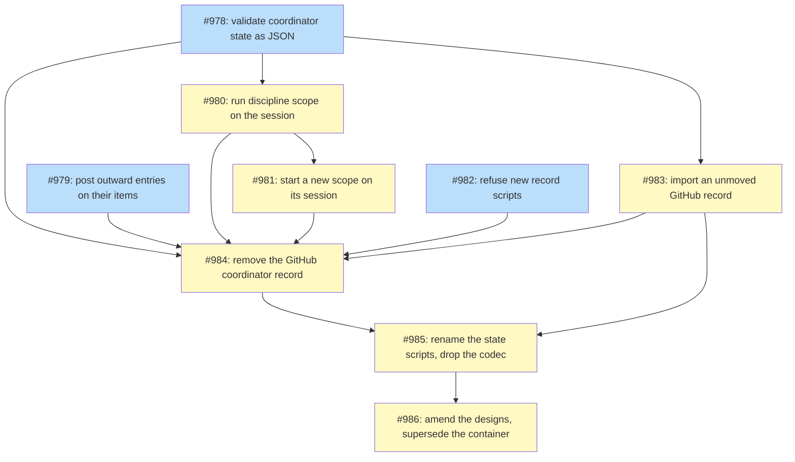

# PLAN: Coordinator record teardown

## Status

Active

## Scope Summary

Remove the coordinate skill's GitHub coordinator record, so the coordinator's
koto session is its only store, as `DESIGN-coordinator-record-teardown.md`
decides and `PRD-coordinator-record-teardown.md` requires. Every write-core
guarantee is kept on JSON, discipline scope moves onto the session, outward
entries move to GitHub items of their own, and the work is ordered so no live
coordinator is touched.

## Decomposition Strategy

**Horizontal, around one gate.** The design's eight steps become nine
issues, each landing as its own pull request in this repository. Design steps 1
to 5 are #978 to #982 and design step 6 is #984, the backend removal. #983 is,
by the owner's ruling, a one-way importer for a GitHub record nobody
moved: it lands before #984, dormant, and #984 adds its one call when it
removes the GitHub find, so no release removes the record without the
importer. Design step 7 is #985 and design step 8 is #986.

The first five items are additive: each adds the session path beside the
GitHub one and chooses between them by the run's sealed store, so a
coordinator still on its GitHub record keeps today's behaviour, which its
unchanged suites prove. They may land in any order their dependencies allow.
#978 and #982 create files with the `state-` prefix before #985 renames the
rest; that is deliberate, so the new files never need renaming. The gate
`no-record-coordinators` then holds everything that removes a reader or writer
of the GitHub record until no coordinator runs on one. After it, the backend
comes out with the importer already in place, then the old record scripts are
renamed and the markdown codec deleted (#985), and last the documents are amended
and the record container design superseded (#986), so each amendment
describes code that has landed.

**The precondition, in public terms.** No item that removes a reader or a
writer of the GitHub record merges while any coordinator still runs on that
record. A coordinator runs on the GitHub record while its roadmap's coordinator
issue is open and not in the moved shape, or while a discipline's rotation pull
request is open. Its owner ends that by moving it to its session at its next
start (never mid-run), by letting a rotation end, or by closing the issue or
pull request. The gate below gives the commands that check it, and each removal
issue states the precondition in its body.

Value of each item, landed alone:

- #978: every write is validated as JSON by one module.
- #979: a session-store coordinator's cost, goal-fit, verdict and failure
  entries reach the pull requests they concern.
- #980: a discipline coordinator can run on its session.
- #981: a new scope starts on its session with nothing to choose.
- #982: no new `record-*` script can be added.
- #983: a record nobody moved has an importer ready for the release that
  removes the GitHub path.
- #984: the skill no longer creates, reads or writes a GitHub record in its
  normal path, and calls the importer for a record nobody moved.
- #985: no script sources a record library or parses a record body.
- #986: the shipped documents name the store that is there.

**The gate, `no-record-coordinators`.** It stands between the additive issues and #983 on one
side and #984 on the other: #984 merges only when it holds. No coordinator
runs on a GitHub record when, for every organization a coordinator writes to, run with a token that can read every repository in it:
every open roadmap record the first search lists passes the moved-shape test
below it, and the second search lists nothing.

```bash
gh search issues --owner <org> --state open --match title "Coordinator record:" --limit 1000 \
  --json repository,number --jq '.[] | "\(.repository.nameWithOwner) \(.number)"'
# for each <repo> <n> it lists, from a checkout of main before #984 merges:
gh issue view <n> --repo <repo> --json body --jq .body \
  | bash skills/coordinate/scripts/record-parse.sh --container issue - \
  | jq -e '([.holdings, .deferrals, .side_effects, .reversals, .holds, .standing, .work] | all(. == null or . == []))
           and (has("decisions") | not)
           and ([(.run // [])[] | "\(.key)=\(.value)"] == ["store=session"])'
gh search prs --owner <org> --state open --match title "rotation" --limit 1000 \
  --json repository,number,title \
  --jq '.[] | select(.title | test("^docs\\(coordinate\\): .+ rotation [0-9]{4}-[0-9]{2}-[0-9]{2} to ")) | "\(.repository.nameWithOwner)#\(.number)"'
```

A record with the `store session` row but state still in its sections fails the
test: it moves at its next start, not before.

Every discipline whose last rotation ran on GitHub has started a rotation on
its session, or its owner has retired it. A search error, a result count at the
limit or an organization the token can't read leaves the gate shut. Both
searches run again immediately before #984 merges, at least an hour after the
last owner closed or moved a record. The gate is spent once #984
merges; its moved-shape test stops being runnable once #985 deletes the
parser it uses. The searches' output, which can name private repositories, goes
in a report, not in a public pull request or issue.

## Implementation Issues

| Issue | Dependencies | Complexity |
|-------|--------------|------------|
| [#978: refactor(coordinate): validate coordinator state as JSON](https://github.com/tsukumogami/shirabe/issues/978) | None | testable |
| _Splits the codec's checks into `state-schema.jq` and validates every session write as JSON, while the GitHub path renders from the same checks. First, because the discipline keys and the importer are validated by it._ | | |
| [#979: feat(coordinate): post outward entries on the items they concern](https://github.com/tsukumogami/shirabe/issues/979) | None | critical |
| _Moves cost and goal-fit entries to the pull request they concern and verdict and failure entries to the roadmap pull request, for session-store runs only; a GitHub-store run keeps posting on its issue until the removal._ | | |
| [#980: feat(coordinate): run discipline scope on the session](https://github.com/tsukumogami/shirabe/issues/980) | [#978](https://github.com/tsukumogami/shirabe/issues/978) | critical |
| _Brings discipline scope onto the session: `record/rotation` and `record/reasoning`, the window rule that tells a restart from a new rotation, the predecessor find and carry, and a one-time bridge from a committed handoff file._ | | |
| [#981: feat(coordinate): start a new scope on its session by default](https://github.com/tsukumogami/shirabe/issues/981) | [#980](https://github.com/tsukumogami/shirabe/issues/980) | testable |
| _Makes the session the default store for a scope with no record, so every new coordinator starts on its session while existing GitHub records stay where they are._ | | |
| [#982: test(coordinate): refuse new record scripts](https://github.com/tsukumogami/shirabe/issues/982) | None | simple |
| _Adds the transitional structure test, which allows today's `record-*` matches by name and refuses any new one, so the list can only shrink._ | | |
| [#983: feat(coordinate): import an unmoved GitHub record into the session](https://github.com/tsukumogami/shirabe/issues/983) | [#978](https://github.com/tsukumogami/shirabe/issues/978) | critical |
| _Adds the owner's one-way importer under `skills/coordinate/legacy-import/`, dormant until the removal calls it, so no release removes the GitHub record without it. Not held by the precondition._ | | |
| [#984: refactor(coordinate)!: remove the GitHub coordinator record](https://github.com/tsukumogami/shirabe/issues/984) | [#978](https://github.com/tsukumogami/shirabe/issues/978), [#979](https://github.com/tsukumogami/shirabe/issues/979), [#980](https://github.com/tsukumogami/shirabe/issues/980), [#981](https://github.com/tsukumogami/shirabe/issues/981), [#982](https://github.com/tsukumogami/shirabe/issues/982), [#983](https://github.com/tsukumogami/shirabe/issues/983) | critical |
| _Removes every reader and writer of the GitHub record and the store choice, and wires the importer's one call into the opener. Held by the precondition: merges only when the gate's searches, run again, come back clean._ | | |
| [#985: refactor(coordinate): rename the state scripts and drop the markdown codec](https://github.com/tsukumogami/shirabe/issues/985) | [#984](https://github.com/tsukumogami/shirabe/issues/984), [#983](https://github.com/tsukumogami/shirabe/issues/983) | testable |
| _Converts the writers to `--state-file`, deletes the markdown codec and renames every surviving record script to `state-*`, with its callers, tests, registries and CI filters, and empties the structure test's allow list._ | | |
| [#986: docs(coordinate): amend the designs and supersede the record container design](https://github.com/tsukumogami/shirabe/issues/986) | [#985](https://github.com/tsukumogami/shirabe/issues/985) | simple |
| _Supersedes the record container design and appends a dated amendment to each document the design lists, describing what has landed._ | | |

## Dependency Graph



**Legend**: Green = done, Blue = ready, Yellow = blocked

#984 also waits on the gate above, which the graph doesn't draw. #983's importer
stays after #986; a later cleanup feature removes it once no GitHub coordinator
record and no coordination pull request is open anywhere in the organization.

## Implementation Sequence

**Critical path**: #978, #980, #981, then the gate, #984, #985 and #986.

**Before the gate**: #978, #979 and #982 can start at once, and #979 is
independent of the others. #980 follows #978, #981 follows #980, and #983
follows #978. Each lands as its own pull request; whichever of #978 and #982
merges second keeps the structure test's allow list in step with the other.
#983 lands before #984 and isn't held by the precondition.

**The gate**: #984 may be built and reviewed while the gate is shut, but it
merges only after the gate's searches, run again, come back clean.

**After the gate**: #984, then #985, then #986, one pull request each. The
rename touches every caller only once nothing reads the old names, and the
amendments describe what has landed.
