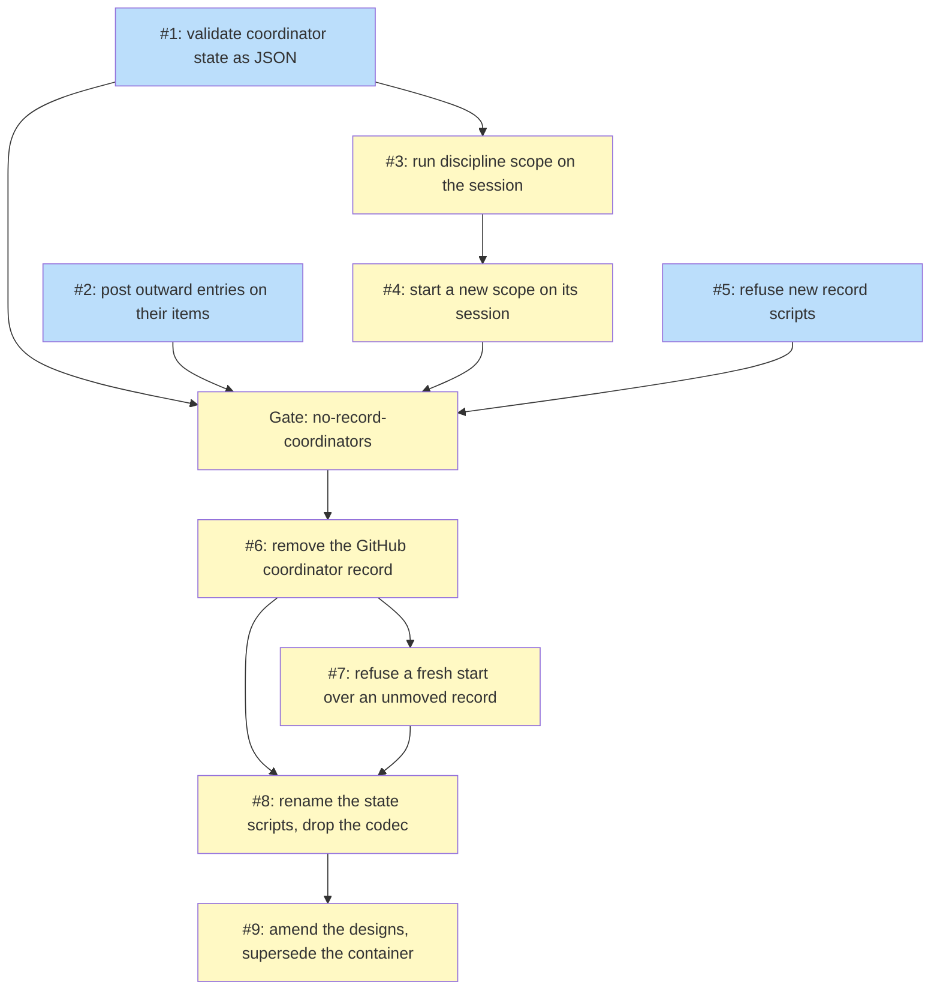

# PLAN: Coordinator record teardown

## Status

Active

## Scope Summary

Remove the coordinate skill's GitHub coordinator record, so the coordinator's
koto session is its only store, as `DESIGN-coordinator-record-teardown.md`
decides and `PRD-coordinator-record-teardown.md` requires. Every write-core
guarantee is kept on JSON, discipline scope moves onto the session, outward
entries move to GitHub items of their own, and the work is ordered so no live
coordinator is touched.

## Decomposition Strategy

**Horizontal, around one gate.** The design's eight steps become nine work
items in six pull request groups (the ninth, a one-release start-up guard,
waits on the owner's call and can be dropped), all in this repository. The first five items
are additive: each adds the session path beside the GitHub one and chooses
between them by the run's sealed store, so a coordinator still on its GitHub
record runs exactly the code it runs today. They may land in any order their
dependencies allow. The gate `no-record-coordinators` then holds everything that
removes a reader or writer of the GitHub record until no coordinator runs on
one. After it, the backend comes out, then the survivors are renamed and the
markdown codec deleted, and last the documents are amended and the record
container design superseded, so each amendment describes code that has landed.
The scripts come out last, when nothing reads them.

**The precondition, in public terms.** No item that removes a reader or a
writer of the GitHub record merges while any coordinator still runs on that
record. A coordinator runs on the GitHub record while its roadmap's coordinator
issue is open and not in the moved shape, or while a discipline's rotation pull
request is open. Its owner ends that by moving it to its session at its next
start (never mid-run), by letting a rotation end, or by closing the issue or
pull request. The gate below gives the commands that check it.

Value of each group, landed alone:

- `validation` (Issues 1 and 5): every write is validated as JSON by one module,
  and no new `record-*` script can be added.
- `outward` (Issue 2): a session-store coordinator's cost, goal-fit, verdict and
  failure entries reach the pull requests they concern.
- `discipline` (Issues 3 and 4): a discipline coordinator can run on its session,
  and a new scope starts on its session with nothing to choose.
- `removal` (Issues 6 and 7): the skill no longer creates, reads or writes a
  GitHub record, and for one release a missed record stops its start instead of
  starting empty.
- `rename` (Issue 8): no script sources a record library or parses a record body.
- `documents` (Issue 9): the shipped documents name the store that is there.

## Issue Outlines

### Issue 1: refactor(coordinate): validate coordinator state as JSON

**Repo**: tsukumogami/shirabe

**Group**: validation

**Goal**: Split `record-codec.jq`'s checks into a JSON validation module,
`state-schema.jq`, that the write core runs on the next state before any key is
written, and that the renderer calls for the GitHub path, so the GitHub path is
unchanged.

**Acceptance Criteria**:
- [ ] `skills/coordinate/scripts/state-schema.jq` holds the field, row, cell,
      worker, pull request link, Holds, stored-set and Decisions checks and the
      private-repository, home-path and token checks, each taking JSON and
      refusing with the `refused: ` message the codec gives today.
- [ ] `record-write-core.sh` validates the next state's JSON with
      `state-schema.jq` before writing; `record-codec.jq`'s renderer calls the
      same functions, so every GitHub-store suite passes unchanged.
- [ ] Each refusal case in `record-codec_test.sh` has a JSON counterpart in a new
      `state-schema_test.sh` that feeds the state's JSON and gets the same
      refusal: a disallowed top-level field, a control character, an empty
      required column, a recomputable column, a malformed worker, a malformed
      pull request link, a malformed hold or illegal hold change, an unknown Run
      key, a stored-set row breaking its rules, an illegal Decisions state,
      transition or stamp, a private repository name, a home-directory path and a
      token-shaped string.
- [ ] The private-repository, home-path and token scan walks every string in the
      state recursively, and a test fails when a state with a new string-bearing
      field is not scanned.
- [ ] `state-schema.jq` accepts a `store` Run row reading `session` (which every
      session on the store holds) and refuses any other `store` value.
- [ ] On the session store, through `record-write.sh` and the core: a next state
      that breaks a schema rule is refused with its `refused: ` message and
      exit 65, and a listing of the session's keys and values taken before and
      after shows nothing changed; a write built from a stale read is refused as
      `record-changed` (exit 12) with no key written; a write that changes a
      section owned by another writer flag is refused (exit 65) with no key
      written.
- [ ] `run-tests.sh` and the bash-floor leg pass.

**Dependencies**: None

**Type**: code
**Files**: `skills/coordinate/scripts/state-schema.jq`, `skills/coordinate/scripts/record-codec.jq`, `skills/coordinate/scripts/record-write-core.sh`

### Issue 2: feat(coordinate): post outward entries on the items they concern

**Repo**: tsukumogami/shirabe

**Group**: outward

**Goal**: For a session-store run, post `cost` and `goal-fit` entries on the
pull request (or issue) they concern and `milestone-verdict` and
`milestone-failure` entries on the roadmap pull request that records them, with
today's marker line and text, while a GitHub-store run keeps posting on its
issue.

**Acceptance Criteria**:
- [ ] `record-append.sh --on <owner/repo#n>` posts an outward entry on that item,
      checking the value against `^[A-Za-z0-9_.-]+/[A-Za-z0-9_.-]+#[1-9][0-9]*$`
      and refusing a repository that is not the run's host or a holding's.
- [ ] A suite writes a `cost` entry for a unit with a pull request, one for a unit
      that is an issue, and one for a unit with neither: the first two are posted
      on that pull request or issue with today's marker line and text, and the
      third is posted nowhere and `unit-cost.sh`'s output says so.
- [ ] A `goal-fit` entry is posted on the pull request its text names, and one
      whose `--on` differs from the named pull request, or that names none, is
      refused and posted nowhere.
- [ ] `roadmap-status.sh --verdict` and `--reopen` take `--entry <n>` for a
      session-store run: they open the roadmap pull request with the entry in
      its body, post the entry on it through `record-append.sh --repost <n> --on`,
      then push a commit adding the `## Progress` line with the comment's URL and
      hash; a suite checks the line names the posted comment.
- [ ] When the post or the progress commit fails after the pull request opened,
      the command exits 14 with the Side effects row naming the pull request, and
      a re-run with the same entry reposts once and pushes the missing commit;
      no second pull request is opened.
- [ ] `roadmap-status.sh --confirm` accepts a progress line citing a comment on
      the roadmap pull request its Side effects row names, by the coordinator's
      login, and still accepts one citing a comment on a coordinator issue; it
      refuses a comment whose marker, kind, text or hash differs, and a new-form
      comment by another login. The issue or pull request a comment sits on is
      read from the API's `issue_url`.
- [ ] The text scan of an outward entry runs against the destination's
      visibility read at post time: an entry naming a private repository is
      refused for a public destination, a destination whose visibility can't be
      read counts as public, a named repository whose visibility can't be read
      counts as private, and a refused cost entry stays in the session.
- [ ] A `milestone-verdict` or `milestone-failure` entry posted with
      `record-append.sh --on` directly, rather than by `roadmap-status.sh
      --verdict` or `--reopen`, is refused and posted nowhere.
- [ ] An `@` in an entry's text reaches the posted comment escaped, as
      `record-append.sh` escapes it today, when `roadmap-status.sh` posts through
      `--repost`.
- [ ] A retry posts nothing when `record/posted/<n>` exists or the target holds
      the same marker and text by the coordinator's login (compared without
      case) at or after the entry's stamp and not already claimed by another
      entry's `record/posted/<n>`; it posts when the match is by another login,
      older, or already claimed; and it exits 2, posting nothing, when
      `gh api user` can't answer.
- [ ] A GitHub-store run's suites (`roadmap-status_test.sh`,
      `record-append_test.sh`, `unit-cost_test.sh`) pass unchanged.
- [ ] `references/unit-cost.md` gives a command that lists a scope's cost entries
      from the units' pull requests, filtered on the marker and the coordinator's
      login, and names no coordinator issue for a session-store run.

**Dependencies**: None

**Type**: code
**Files**: `skills/coordinate/scripts/record-append.sh`, `skills/coordinate/scripts/roadmap-status.sh`, `skills/coordinate/scripts/unit-cost.sh`, `skills/coordinate/references/unit-cost.md`

### Issue 3: feat(coordinate): run discipline scope on the session

**Repo**: tsukumogami/shirabe

**Group**: discipline

**Goal**: A new discipline rotation runs on its session: its window, host and
reasoning live in `record/rotation` and `record/reasoning`, it finds and carries
its predecessor's session, and it ends without committing a file or opening a
pull request, while a rotation already on GitHub keeps its machinery until it
ends.

**Acceptance Criteria**:
- [ ] The `store-discipline` refusals are lifted for a new rotation; a second
      live session of the same discipline on one host is refused with
      `session-live`; a discipline session imported with
      `coordinate-open.sh --import` into a fresh workspace resumes there
      (`resumed=1`) and its `record/rotation` reads the same as on the source.
- [ ] `record-state.sh` writes `record/rotation` (`{start, end, host_repo,
      predecessor}`) and `record/reasoning` under `STATE_WRITER`; an accepted
      write reads back as the same JSON; reasoning of 16 KiB plus one byte, a
      rotation row missing `start`, `end` or `host_repo`, and a `predecessor`
      that doesn't match the session-name pattern are each refused (exit 65)
      with no key written.
- [ ] The start-up find seals `found`, `predecessor <session>`, `first` or
      `unreadable <session>`. One scenario per refusal starts from an earlier
      session that breaks exactly one rule (a name not matching
      `coordinate-<slug>-<YYYYMMDDTHHMMSSZ>`, a failed `coord-log.sh provenance`,
      a different `DISCIPLINE`, a different `HOST_REPO`, a still-live run with
      an open window, a predecessor another session's `record/rotation` already
      names, two candidates at one stamp); each ends `unreadable <session>`,
      stops at `record_conflict`, and carries nothing.
- [ ] A third rotation after a carried second one carries the second, never
      the first.
- [ ] A suite starts a second rotation after a first that wrote a hold, a Standing
      row, a Work row, a deferral, an unsettled decision, a next decision number
      and reasoning text; `predecessor_carry` carries each into the second
      rotation's session, and reconcile classifies the reasoning `present`.
- [ ] A rotation with no earlier session and no committed handoff file gets
      `first`; one whose predecessor's `record/meta` is malformed gets
      `unreadable` and stops at `record_conflict`; one whose predecessor's window
      ended without a `record/reasoning` carries it with reasoning
      `not_recorded`.
- [ ] A first session rotation of a discipline whose last rotation ran on GitHub
      carries the committed `docs/disciplines/<name>.md` once through today's
      handoff reader (`predecessor handoff:<sha>`). Whichever of this item and
      Issue 5 merges second adds any file this item introduces that matches a
      structure-test pattern to Issue 5's allow list by name, and the structure
      test passes; Issue 6 removes the entry with the bridge.
- [ ] The carry reports the holds and Standing rows it carried, and the handover
      gate lists `carry-unacknowledged` until a Standing go-ahead set after this
      run's start exists; a carried go-ahead does not clear it
      (`handover_engine_test.sh`).
- [ ] The new `rotation_end` state writes `record/reasoning` and ends the run; a
      session rotation's suite records no `gh pr create`, `gh pr ready`, contents
      write, ref deletion or `git push`.
- [ ] The template's new states and edges are in `coordinate.mermaid.md` and the
      rule-coverage rows, and `coordinate-template-structure_engine_test.sh`
      passes.

**Dependencies**: Blocked by <<ISSUE:1>>

**Type**: code
**Files**: `skills/coordinate/scripts/coordinate-open.sh`, `skills/coordinate/scripts/record-find.sh`, `skills/coordinate/scripts/record-open.sh`, `skills/coordinate/scripts/record-state.sh`, `skills/coordinate/scripts/record-handover.sh`, `skills/coordinate/koto-templates/coordinate.md`

### Issue 4: feat(coordinate): start a new scope on its session by default

**Repo**: tsukumogami/shirabe

**Group**: discipline

**Goal**: A roadmap or discipline scope with no record starts on its session
without `--store`, while a start that finds a GitHub record keeps it on GitHub
until its owner moves it.

**Acceptance Criteria**:
- [ ] A suite starts a roadmap coordinator with no record and no `--store`: it
      opens a session-store record (the moved-shape issue and the session's
      keys, as `--store session` does today).
- [ ] A suite starts a discipline coordinator with no record and no `--store`:
      it starts on its session.
- [ ] A start that finds an existing GitHub record with no `store` row stays on
      the GitHub store and its suites pass unchanged.
- [ ] `--store github` still opens a GitHub record until Issue 6 removes the
      option, and an unknown `--store` value exits 64 naming it.
- [ ] A found GitHub record that fails today's declaration or authority check
      stops with today's refusal (`malformed` or `unauthorized`) and opens no
      session record.
- [ ] A start that finds a record already moved to the session resumes its
      session rather than opening a new one.
- [ ] A discipline whose last rotation ran on GitHub, started with no
      `--store`, carries that rotation's handoff file (Issue 3's bridge) and is
      not reported as a first rotation.

**Dependencies**: Blocked by <<ISSUE:3>>

**Type**: code
**Files**: `skills/coordinate/scripts/coordinate-open.sh`, `skills/coordinate/scripts/record-find.sh`, `skills/coordinate/SKILL.md`

### Issue 5: test(coordinate): refuse new record scripts

**Repo**: tsukumogami/shirabe

**Group**: validation

**Goal**: Add the transitional structure test that refuses any new file under
`skills/coordinate/scripts/` or `koto-templates/` matching the removal's
patterns, while allowing the files that match today by name, so the list can
only shrink.

**Acceptance Criteria**:
- [ ] The test lists the patterns: a file named `record-*.sh` or
      `record-codec.jq`, or naming `record-(common|source|parse|render)\.sh`,
      `record-codec`, `Coordinator record:`, `collaborators/`,
      `docs/disciplines/` or `store-(malformed|unverified|conflict|moved|discipline)`.
- [ ] It fails on one fixture per pattern and passes on the skill's files at the
      change's base commit, with the existing matches allowed by name.
- [ ] Adding a new `record-*.sh` file, or a new mention of a pattern in a file
      not on the allow list, fails it.

**Dependencies**: None

**Type**: code
**Files**: `skills/coordinate/scripts/state-structure_test.sh`

### Gate: no-record-coordinators

**After**: Issue 1, Issue 2, Issue 3, Issue 4, Issue 5

**Before**: Issue 6

**Condition**: No coordinator runs on a GitHub record. For every organization
a coordinator writes to, run with a token that can read every repository in it,
both of these return nothing:
`gh search issues --owner <org> --state open --match title "Coordinator record:" --limit 1000 --json repository,number,body --jq '.[] | select(.body | test("\\| store \\| session \\|") | not) | "\(.repository.nameWithOwner)#\(.number)"'`
and
`gh search prs --owner <org> --state open --match title "rotation" --limit 1000 --json repository,number,title --jq '.[] | select(.title | test("^docs\\(coordinate\\): .+ rotation [0-9]{4}-[0-9]{2}-[0-9]{2} to ")) | "\(.repository.nameWithOwner)#\(.number)"'`.
Every discipline whose last rotation ran on GitHub has started a rotation on its
session, or its owner has retired it. A search error, a result count at the
limit or an organization the token can't read leaves the gate shut. Both
searches run again immediately before Issue 6 merges, at least an hour after the
last owner closed or moved a record, and their output, which can name private
repositories, goes in a report, not in a public pull request or issue.

### Issue 6: refactor(coordinate)!: remove the GitHub coordinator record

**Repo**: tsukumogami/shirabe

**Group**: removal

**Goal**: Remove every reader and writer of the GitHub record and the per-run
choice of store, so the skill creates, reads and writes no coordinator issue,
comment, rotation pull request or committed handoff file.

**Acceptance Criteria**:
- [ ] A grep over the non-test scripts under `skills/coordinate/scripts/` for
      `lib_open_issues`, `lib_discipline_read`, `lib_authority`,
      `lib_has_write_access`, `collaborators/`, an issue create, edit or close,
      a pull request create, edit or ready, and an issue comment listing finds
      nothing outside Issue 7's guard, and `record-move.sh` no longer exists.
- [ ] `record-state.sh --run store session` is refused as an unknown Run key
      (exit 65), and a write carrying a new `store` row is refused while the
      legacy row an existing session holds is accepted.
- [ ] `coordinate-open.sh --store session <roadmap>` exits 64 naming `--store`,
      and the template declares no `STORE` variable; with a koto stand-in that
      lacks `session import`, a start is refused with `store-unsupported`.
- [ ] A suite starts a new roadmap coordinator and runs it through dispatch, land
      and merge; its `gh` stand-in, which fails on any call the test didn't
      expect, records no issue create, edit, view, close or list of a
      coordinator issue, no comment list, and no collaborator-permission read,
      other than the one open-issue search Issue 7's guard makes on a fresh
      start when Issue 7 lands in the same pull request.
- [ ] `state-schema.jq` allows the crash-set Run rows (`rules`, `briefs`,
      `friction`, `reports-to`) with no `store` row, and a suite opens a fresh
      session and writes each of them.
- [ ] `roadmap-status.sh --entry-url` exits 64 as an unknown option;
      `coord-log.sh run-store` exits 64; `coord-log.sh run-facts` prints
      `{scope, name, repo}` with no `ref`; `record-write.sh --close` exits 64;
      `quiet-check.sh` and `holding-link.sh` given `--scope --name --repo --ref`
      exit 64; and the handoff-file bridge's `handoff:<sha>` seal is refused.
- [ ] The template declares no `rotation_close`, `rotation_step`,
      `rotation_done`, `predecessor_*` or `record_move` state (a grep of its
      state headings finds none); `rotation-close.sh`, `predecessor-handoff.sh`
      and `docs/disciplines/performance.md` no longer exist; and
      `coordinate.mermaid.md`, the decider declarations
      (`coordinate.*.decider.jsonl`, with `check-decider-declarations` passing)
      and the rule-coverage rows name no removed state.
- [ ] The eval fixture that committed a discipline handoff now starts from a
      predecessor session, and its eval scenario passes.
- [ ] Named session-only tests cover what GitHub-only suites tested: the
      handover gate listing a stored-set gap (a holding with no next step), a
      Decisions state transition, a hold and a pause re-read before a merge, and
      a rotation's carry (Issue 3's suite).
- [ ] On a session holding a hold and a pause, `land-check.sh` and
      `land-merge.sh` refuse the merge with the reasons their suites check
      today; the board, panel-evidence, merge-confirm and teardown-handoff suites
      pass unchanged in what they assert about GitHub.
- [ ] A fixture of a session-store coordinator's keys from the release before
      the removal, committed with the tests, resumes and imports, and a diff of
      key names and JSON before and after the resume shows no change.
- [ ] No suite's stand-in records a close, edit or delete of an issue, comment,
      pull request or branch set up as an existing coordinator record.
- [ ] The gate's searches, run again before merging, return nothing.

**Dependencies**: Blocked by <<ISSUE:1>>, <<ISSUE:2>>, <<ISSUE:3>>, <<ISSUE:4>>, <<ISSUE:5>>

**Type**: code

### Issue 7: feat(coordinate): refuse a fresh start over an unmoved GitHub record

**Repo**: tsukumogami/shirabe

**Group**: removal

**Goal**: For the one release that carries Issue 6, a roadmap coordinator's
start with no session state refuses when its roadmap's repository still has an
open coordinator issue that isn't in the moved shape, naming the issue and
telling the owner to move it on the earlier release, so a missed record never
starts empty. This item is droppable: it lands only if the owner chooses a
one-release guard, and dropping it changes no other item except its edge to
Issue 8 and the clause it adds there.

**Acceptance Criteria**:
- [ ] A fresh roadmap start (no `record/meta` for the scope on this host) makes
      one open-issue search by the record title in the roadmap's repository and
      refuses with `record-unmoved <owner/repo#n>` when an open one's body isn't
      in the moved shape; it writes nothing and opens no session state.
- [ ] A fresh start with no such issue, or with one in the moved shape, proceeds;
      a resume or import makes no search.
- [ ] A failed search refuses the start rather than proceeding, naming the
      failure.
- [ ] The guard recognises the moved shape with its own check on the body (a
      `store` Run row reading `session`, the same test the gate's search uses),
      without the codec Issue 8 removes.
- [ ] The guard lives in one function in
      `skills/coordinate/scripts/unmoved-guard.sh`, and this item adds that file
      to the transitional structure test's allow list as a named exception that
      Issue 8 removes; the structure test passes.
- [ ] Dropping this item removes it, its edge to Issue 8, Issue 8's clause about
      it, and the guard exceptions in Issue 6's grep and stand-in criteria,
      which then hold with no exception.

**Dependencies**: Blocked by <<ISSUE:6>>

**Type**: code
**Files**: `skills/coordinate/scripts/unmoved-guard.sh`, `skills/coordinate/scripts/coordinate-open.sh`, `skills/coordinate/scripts/state-structure_test.sh`

### Issue 8: refactor(coordinate): rename the state scripts and drop the markdown codec

**Repo**: tsukumogami/shirabe

**Group**: rename

**Goal**: Delete `record-parse.sh` and `record-render.sh`, rename every surviving
record script to its `state-*` name with its callers, tests and registries, and
make the structure test refuse every match.

**Acceptance Criteria**:
- [ ] `ls skills/coordinate/scripts/record-*.sh skills/coordinate/scripts/record-codec.jq`
      finds nothing.
- [ ] `grep -rlE 'record-(common|source|parse|render)\.sh|record-codec|Coordinator record:|collaborators/|docs/disciplines/|store-(malformed|unverified|conflict|moved|discipline)' skills/coordinate/scripts skills/coordinate/koto-templates`
      lists only the structure test's fixtures, each named in that test.
- [ ] The write core takes `--state-file`: a test checks the file a writer hands
      it is mode 0600 inside the writer's private directory and is gone after
      the write. No write renders or parses a markdown body; a state whose
      rendered body would exceed 60,000 bytes is written, and an outward entry
      over 60,000 bytes is refused.
- [ ] Issue 1's session write-core scenarios pass unchanged through
      `--state-file` and the renamed scripts: schema refusal with no key
      changed, `record-changed` (exit 12) with no key written, a second writer
      refused.
- [ ] `record-decision.sh --archive` and `decision-next.sh`'s archive move are
      gone; restoring an archived row from a `decisions` entry still works.
- [ ] `state-read.sh --show` exits 64 as an unknown option, and `skills/coordinate/SKILL.md` names
      koto's session view (`koto context` over the coordinator's session) as the
      way a person reads its state and names no coordinator issue as a place to
      read or write state; the report scripts' output and the template's
      terminal results name the session.
- [ ] `coordinate-template-structure_engine_test.sh` holds each session key to
      the one writer the design's key table names.
- [ ] Every path named in `.github/workflows/`, `scripts/bash-floor/coordinate.list`,
      the check-skill rows, `scripts/testdata/rule-coverage.tsv` and
      `skills/coordinate/scripts/requires.tsv` exists; the reconcile workflow's
      `record-*` path filter names `state-*`; `requires.tsv` raises no koto floor.
- [ ] `references/record-template.md` is replaced by `references/state-keys.md`
      (each key's JSON and its writer), and a grep of `skills/coordinate/SKILL.md`
      and `skills/coordinate/references/` for `record-*.sh`, `record-codec`,
      `record_move`, the removed `rotation_*` and `predecessor_*` states and
      `--store` finds nothing.
- [ ] `run-tests.sh`, `run-tests.sh --engine` and the bash-floor leg pass.
- [ ] When Issue 7 landed, this item removes `unmoved-guard.sh` and its allow
      list entry, and merges only after a release carrying Issues 6 and 7 has
      shipped, so the guard ships in exactly one release. When Issue 7 was
      dropped, this clause and the Issue 7 dependency drop with it.

**Dependencies**: Blocked by <<ISSUE:6>>, <<ISSUE:7>>

**Type**: code

### Issue 9: docs(coordinate): amend the designs and supersede the record container design

**Repo**: tsukumogami/shirabe

**Group**: documents

**Goal**: Supersede `DESIGN-coordinate-record-container.md` and give every
document the design lists a dated amendment that keeps its logic and records
that the storage moved to the session.

**Acceptance Criteria**:
- [ ] `DESIGN-coordinate-record-container.md` has status `Superseded`, sits in
      `docs/designs/archive/`, and names the removal design in `superseded_by`
      (through `shirabe transition ... Superseded --superseded-by`).
- [ ] Each document in the design's amendment table (ten designs, seven PRDs and
      `BRIEF-coordinate-record.md`) ends with a `## Amendment — <date>` section
      whose first paragraph names the removal design and reads "The original text
      above is left unedited; this section records what no longer holds.", and
      names, for that document, the moved surface the design's amendment table
      lists for it; `git diff` of each against this item's base commit adds
      lines only at the end; each keeps its status.
- [ ] `shirabe validate` passes over every changed document.

**Dependencies**: Blocked by <<ISSUE:8>>

**Type**: docs

## Dependency Graph

**Legend**: Green = done, Blue = ready, Yellow = blocked

The edge from #7 to #8 holds only while Issue 7 is kept; dropping Issue 7 drops
it.

## Implementation Sequence

**Critical path**: Issue 1, Issue 3, Issue 4, the gate, Issue 6, Issue 7,
Issue 8, Issue 9.

**Parallel before the gate**: Issues 1, 2 and 5 can start at once. Issue 2 is
independent of the others. Issues 1 and 5 land together as the `validation` pull
request, and Issues 3 and 4 together as the `discipline` pull request, after
`validation`.

**The gate**: nothing after it starts merging until the precondition holds.
Issue 6 may be built and reviewed while the gate is shut, but it merges only
after the gate's searches, run again, return nothing.

**After the gate**: Issues 6 and 7 land together as the `removal` pull request;
then Issue 8 (`rename`) and Issue 9 (`documents`), one pull request each: the
rename touches every caller only once nothing reads the old names, and the
amendments describe what has landed. Issue 7 is the owner's call: with it, the
rename waits for a release carrying the removal, so the guard ships in exactly
one release; without it, drop Issue 7 and Issue 8's clause about it.
