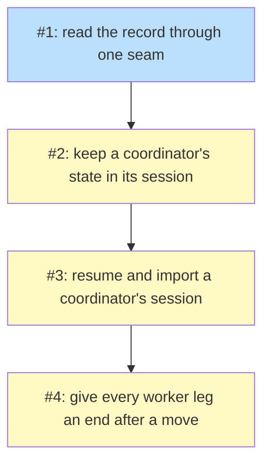

# PLAN: coordinator-session-record

## Status

Active

## Scope Summary

Carry out `docs/designs/DESIGN-coordinator-session-record.md` in the coordinate
skill: one read seam for the record's state, the session store behind it, the
resume and import path, and the fate of each worker leg after a host move, with
every record on GitHub working as today.

## Decomposition Strategy

Horizontal, by layer, in the design's order. The layers have interfaces the
design fixes (the seam's functions, the keys and their owners, the opener's
outputs, the leg table), and each depends on the one below it: the store needs
the seam to be read through, the start path needs the store to resume, and the
leg classification needs both the store's leg keys and an import to move them.
A walking skeleton would cut across the seam's delivery rule, which says the
readers switch first and alone (PRD R20).

## Issue Outlines

### Issue 1: feat(coordinate): read the record through one seam

**Repo**: tsukumogami/shirabe

**Group**: seam

**Goal**: Every script that reads the record's state reads it through
`record-source.sh`, the run's state source is decided per record, probed and
sealed, and the session source is refused wherever it would be chosen.

**Acceptance Criteria**:
- [ ] `skills/coordinate/scripts/record-source.sh` gives `rs_source`, `rs_probe`,
      `rs_record` (the `gh issue view`/`gh pr view` read), `rs_record_api` (the `gh
      api` read under `board-lib.sh`'s deadline) and `rs_facts <topic>`, GitHub
      backend only; `bl_record_parsed` is removed and `board-lib.sh`,
      `land-check.sh` and `land-merge.sh` call `rs_record_api` (design Decision 1).
- [ ] The ten whole-body readers, `reconcile-deps.sh`, the five section readers and
      the write core's live read call the seam. A structure test in
      `record-source_test.sh` fails when a script other than `record-source.sh`,
      `record-find.sh`, `record-open.sh`, `record-write-core.sh`,
      `record-parse.sh`, `record-render.sh` and `record-append.sh` calls
      `record-parse.sh`, `lib_parse` or `bl_record_parsed`, or reads an issue or
      pull request body with `gh`, or when any script but `record-source.sh` and the
      writers reads a `record/` key; the test includes a fixture script that does each and is
      refused (PRD R19).
- [ ] `rs_facts` on a fixture record with two holdings, a hold on one's pull
      request and a pause on the other's unit returns the exact JSON the test
      fixes, including the go-ahead rows pause-read consumes.
- [ ] `record-find.sh` reads a `store` Run row; `store` reading `bogus`, or two
      `store` rows, stops with `store-malformed`; it seals the source in
      `RECORD_FIND` and writes `coord/source.json` `{source, reason, probe}` on
      every start (R1, R2).
- [ ] `rs_probe` reports `context list --prefix` and `session import` by feature; a
      `github` start on a koto stand-in lacking both reaches reconcile, and the
      probe result is in `coord/source.json` (R2).
- [ ] The codec accepts a `store` Run row reading `github` or `session` and still
      refuses any other unknown Run key; the template gains `STORE`;
      `coordinate-open.sh --store` is refused at discipline scope and reported
      ignored when a record exists (R1, R4).
- [ ] `--store session`, a `store session` row and `record-state.sh --run store
      session` each stop with `store-unavailable`, and the stand-in `gh` call log and
      the session's keys show no write afterwards (R20).
- [ ] Every existing suite passes with no change to its fixtures or expected output,
      except the template-structure test's list of variables.
- [ ] `SKILL.md` and `references/record-template.md` name the `store` row, its
      values and its one writer, and the seam as the one reader, each with a row in
      `testdata/rule-coverage.tsv` that `rule-coverage_test.sh` checks.

**Dependencies**: None

**Type**: code
**Files**: `skills/coordinate/scripts/record-source.sh`, `skills/coordinate/scripts/record-source_test.sh`, `skills/coordinate/scripts/record-find.sh`, `skills/coordinate/scripts/record-find_test.sh`, `skills/coordinate/scripts/record-codec.jq`, `skills/coordinate/scripts/record-codec_test.sh`, `skills/coordinate/scripts/record-common.sh`, `skills/coordinate/scripts/record-write-core.sh`, `skills/coordinate/scripts/record-state.sh`, `skills/coordinate/scripts/record-holding.sh`, `skills/coordinate/scripts/record-decision.sh`, `skills/coordinate/scripts/record-hold.sh`, `skills/coordinate/scripts/record-open.sh`, `skills/coordinate/scripts/roadmap-status.sh`, `skills/coordinate/scripts/board-lib.sh`, `skills/coordinate/scripts/land-check.sh`, `skills/coordinate/scripts/land-merge.sh`, `skills/coordinate/scripts/deferral-check.sh`, `skills/coordinate/scripts/record-confirm.sh`, `skills/coordinate/scripts/closeout-read.sh`, `skills/coordinate/scripts/predecessor-handoff.sh`, `skills/coordinate/scripts/reconcile-read.sh`, `skills/coordinate/scripts/reconcile-deps.sh`, `skills/coordinate/scripts/record-handover.sh`, `skills/coordinate/scripts/decision-next.sh`, `skills/coordinate/scripts/rotation-close.sh`, `skills/coordinate/scripts/coordinate-open.sh`, `skills/coordinate/scripts/coordinate-open.wording.tsv`, `skills/coordinate/scripts/coordinate-open_engine_test.sh`, `skills/coordinate/scripts/coordinate-template-structure_engine_test.sh`, `skills/coordinate/scripts/testdata/rule-coverage.tsv`, `skills/coordinate/scripts/testdata/koto`, `skills/coordinate/koto-templates/coordinate.md`, `skills/coordinate/koto-templates/coordinate.mermaid.md`, `skills/coordinate/requires.tsv`, `skills/coordinate/SKILL.md`, `skills/coordinate/references/record-template.md`

### Issue 2: feat(coordinate): keep a coordinator's state in its session

**Repo**: tsukumogami/shirabe

**Group**: session-store

**Goal**: A roadmap coordinator whose record's owner chose the session store
keeps its state, its account and its outward entries as the design lays them out,
with every write guarantee, on one host.

**Acceptance Criteria**:
- [ ] The seam's session backend assembles the record from `record/` keys; a test
      that leaves `record/meta` marked `pending` gets three re-reads and exit 12
      (design Decision 4).
- [ ] Against real koto, each refusal of PRD R7 leaves every key byte-identical:
      not the live run (10), after `koto next --to` (10), a stale written time (12),
      a state rendering past 60,000 bytes (13), a non-owner (65).
- [ ] For each of `record/meta`, `holdings`, `deferrals`, `side-effects`,
      `reversals`, `holds`, `run`, `standing`, `work`, `decisions`, `entries/<n>`
      and `posted/<n>`, a test writes through its writer and reads back through the
      seam; `record-hold.sh` changing `record/run` exits 65 (R5).
- [ ] A worker shaped like a session id, a path or a job id, a status column, a
      private repository on a public host, and a cell with a pipe, a newline and a
      backtick each behave on the session source exactly as on GitHub (R6).
- [ ] For the same state written to GitHub and to the session, `rs_record` and
      `rs_facts` return identical JSON (R19).
- [ ] `record-append.sh`: two entries with a frozen clock list in sequence order; a
      taken number moves to the next, at most three times; each outward kind lands
      in the session and on GitHub with `record/posted/<n>` set; with the post
      failing, exit 14 and the session entry kept; `--repost <n>` posts once, a
      second `--repost` posts nothing, and an identical comment created before the
      entry's stamp, or by an author without write access, doesn't stop the post;
      `record/posted/<n>` refuses a URL off the record's repository (R9, R10).
- [ ] `record-hold.sh` on the session source posts a `hold` entry for each add and
      lift.
- [ ] `record-open.sh --store session` opens a GitHub record whose body is the
      moved shape and a session holding `record/meta` (R8).
- [ ] The move: after `record-state.sh --run store session --by alice`, the next
      start enters `record_move`; `record-move.sh` copies every section, posts one
      `moved` entry and rewrites the body; killed after step 1 and restarted, it
      finishes with one `moved` entry; without the `run` entry it stops
      `store-unverified`; afterwards `record-write.sh` on the GitHub body exits 65
      `store-moved` and `--run store github` is refused (R3).
- [ ] `record-find.sh` stops `store-conflict` on a body reading `store github`, or
      holding state tables without the `store session` row, while a session of the
      scope holds `record/meta`; a body with the row and its tables resumes the move.
- [ ] A structure test holds the move's and the carry-across's write paths to
      `record-move.sh` and `coordinate-open.sh`.
- [ ] On a session record holding a hold and a pause, `land-check.sh` and
      `land-merge.sh` both refuse, and `record-handover.sh` reads the stored set from
      the keys (R18, R20).
- [ ] `record-source.sh --show` prints a body that `record-parse.sh` parses back to
      the session's state, and it holds no `record/host` value (R11).
- [ ] The three `store-unavailable` refusals are removed, and every existing suite
      still passes unchanged on the GitHub source.
- [ ] A session-source start on a koto stand-in without `session import` stops
      before reconcile naming the missing feature, writes no key and no GitHub
      change, and `coord/source.json` still reads `session` (R2).
- [ ] At discipline scope, `coordinate-open.sh --store session`,
      `record-state.sh --run store session` and a `store` row found on the record
      are each refused (R4).
- [ ] The account lists in the GitHub reader's JSON shape (author the coordinator's
      address, edited false); writing an existing entry key exits `entry-exists`;
      `roadmap-status.sh --verdict` accepts the URL of a verdict entry posted from
      the session source (R9, R10).
- [ ] `requires.tsv` declares every new koto call and the load-time check passes
      (R23).

**Dependencies**: Blocked by <<ISSUE:1>>

**Type**: code
**Files**: `skills/coordinate/scripts/record-source.sh`, `skills/coordinate/scripts/record-source_test.sh`, `skills/coordinate/scripts/record-write-core.sh`, `skills/coordinate/scripts/record-write_test.sh`, `skills/coordinate/scripts/record-append.sh`, `skills/coordinate/scripts/record-append_test.sh`, `skills/coordinate/scripts/record-state.sh`, `skills/coordinate/scripts/record-hold.sh`, `skills/coordinate/scripts/record-hold_test.sh`, `skills/coordinate/scripts/record-open.sh`, `skills/coordinate/scripts/record-move.sh`, `skills/coordinate/scripts/record-move_test.sh`, `skills/coordinate/scripts/record-find.sh`, `skills/coordinate/scripts/coordinate-open.sh`, `skills/coordinate/scripts/session-store_engine_test.sh`, `skills/coordinate/scripts/coordinate-template-structure_engine_test.sh`, `skills/coordinate/scripts/roadmap-status.sh`, `skills/coordinate/scripts/testdata/rule-coverage.tsv`, `skills/coordinate/scripts/testdata/koto`, `skills/coordinate/koto-templates/coordinate.md`, `skills/coordinate/koto-templates/coordinate.mermaid.md`, `skills/coordinate/requires.tsv`, `skills/coordinate/SKILL.md`, `skills/coordinate/references/record-template.md`

### Issue 3: feat(coordinate): resume and import a coordinator's session

**Repo**: tsukumogami/shirabe

**Group**: resume-import

**Goal**: A session-store coordinator resumes its own session on a restart,
carries its keys into a new run on a template change, and continues on another
host after `koto session import`, carrying what a replacement needs after a crash;
`handover_engine_test.sh` runs from an imported session.

**Acceptance Criteria**:
- [ ] A second start on the same host prints the first run's name, opens and
      cancels nothing and keeps the stamp; a session failing the name pattern,
      provenance or a `session` source is not resumed; with the template hash
      changed it opens a new run holding every `record/` and `legs/` key and the old
      log stays readable; with no session here it stops `session-absent` (R12).
- [ ] `coordinate-open.sh --import <session> --from <path>`, with koto's cloud
      backend on `testdata/fake-s3.py`, imports every key; the source then exits 2
      `session_migrated`; the run keeps the stamp; `record/host` holds the source
      path, session name and template hash; `session-live` and `session-name` refuse
      first; a child source, or no compiled template, is refused with koto's code
      and leaves no session; `--trust-template` reaches koto only when passed, and a
      template hash differing from the shipped one is refused (R14).
- [ ] `record-state.sh` takes `rules`, `briefs`, `friction` and `reports-to` Run rows
      and `--host` on the session source and refuses each on a `github` run;
      `pushed_head` is written when `holding-link.sh` or `report-facts.sh` reads a
      head, refused unless 40 hex or empty, and never reaches GitHub; with the
      `reports-to` row removed the gate lists `no-reports-to` (R17).
- [ ] `handover_engine_test.sh` writes the state through the writers on one
      simulated host (its own `HOME`), imports it on a second through the opener,
      and passes its five cases: the stored set read back, the gate holding until
      each worker is told, the relay duty, the cap of one reaching pick, and a
      missing next step holding the gate (R21, R22).
- [ ] `run-tests.sh` gives the engine suites `python3`; a suite skips without it as
      it skips without koto, and `--engine` turns that skip into a failure.
- [ ] After an import, the next entry appended numbers one above the last imported
      entry (R9).
- [ ] On the session source the reconcile report and `coordinate-report.sh` print the
      source workspace path, session name and template hash, so a report up can name
      them (R14).
- [ ] `requires.tsv` declares `koto session import` and the template compile, and
      the load-time check passes (R23).

**Dependencies**: Blocked by <<ISSUE:2>>

**Type**: code
**Files**: `skills/coordinate/scripts/coordinate-open.sh`, `skills/coordinate/scripts/coordinate-open.wording.tsv`, `skills/coordinate/scripts/coordinate-open_engine_test.sh`, `skills/coordinate/scripts/record-state.sh`, `skills/coordinate/scripts/record-state_test.sh`, `skills/coordinate/scripts/record-codec.jq`, `skills/coordinate/scripts/record-write-core.sh`, `skills/coordinate/scripts/record-append.sh`, `skills/coordinate/scripts/record-holding.sh`, `skills/coordinate/scripts/holding-link.sh`, `skills/coordinate/scripts/report-facts.sh`, `skills/coordinate/scripts/record-handover.sh`, `skills/coordinate/scripts/handover_engine_test.sh`, `skills/coordinate/scripts/testdata/fake-s3.py`, `skills/coordinate/scripts/run-tests.sh`, `skills/coordinate/scripts/coordinate-report.sh`, `skills/coordinate/scripts/reconcile-report.sh`, `skills/coordinate/requires.tsv`, `skills/coordinate/SKILL.md`, `skills/coordinate/references/record-template.md`

### Issue 4: feat(coordinate): give every worker leg an end after a host move

**Repo**: tsukumogami/shirabe

**Group**: legs

**Goal**: Each worker's leg is a key the import carries, written on both sources,
and after a move every open leg is re-legged, sent to the message path, or later
stranded and redispatched, with a read leg never stranding a worker's later
reports.

**Acceptance Criteria**:
- [ ] `dispatch-worker.sh` writes `legs/<request>/<leg>` (`open`, the topic) at
      dispatch on either source; `wait-target.sh` records the bound child's name and
      writes the result and `taken`; an engine test stopped at `take_report` finds
      the key already `taken` with the result (R13).
- [ ] After an import, against real koto and the S3 stand-in: an imported worker
      bound to no leg is attached to a new request and its terminal result resolves
      it, and the holding's return path names the new leg; a worker left on the old
      host, one bound to another leg, a leg with no recorded child, and a holding
      dispatched before leg keys existed each move to `message`; a leg whose request
      this host holds is watched as before; the gate lists `leg-unclassified` until
      each is decided (R15).
- [ ] `--releg-imported` refuses when the holding's Worker isn't the key's topic,
      when the child's template or `TOPIC` differs from the declaration recomputed
      from the holding, or when the child's name fails the grammar; killed after
      `releg-pending` is written, a re-run finishes with one binding.
- [ ] `record-holding.sh --strand` is refused off the message path; a stranded
      unit's re-dispatch uses a new topic whose brief names the old branch and last
      pushed head, and a later report from the retired topic is refused as today
      (R15; shirabe#732).
- [ ] A message from a worker whose leg is `taken` or unwatchable is accepted as a
      message report from `worker <topic>`, and its `Questions:` part opens a
      decision with that source (R16).
- [ ] `requires.tsv` declares `koto request attach`, and the load-time check passes
      (R23).

**Dependencies**: Blocked by <<ISSUE:3>>

**Type**: code
**Files**: `skills/coordinate/scripts/dispatch-worker.sh`, `skills/coordinate/scripts/dispatch-worker_test.sh`, `skills/coordinate/scripts/dispatch-common.sh`, `skills/coordinate/scripts/wait-target.sh`, `skills/coordinate/scripts/wait-target_test.sh`, `skills/coordinate/scripts/report-source.sh`, `skills/coordinate/scripts/reconcile-pass.sh`, `skills/coordinate/scripts/reconcile-check.sh`, `skills/coordinate/scripts/record-handover.sh`, `skills/coordinate/scripts/record-holding.sh`, `skills/coordinate/scripts/record-codec.jq`, `skills/coordinate/scripts/legs-move_engine_test.sh`, `skills/coordinate/koto-templates/coordinate.md`, `skills/coordinate/references/loop.md`, `skills/coordinate/requires.tsv`, `skills/coordinate/SKILL.md`

## Dependency Graph

**Legend**: Green = done, Blue = ready, Yellow = blocked

## Implementation Sequence

**Critical path:** Issue 1 -> Issue 2 -> Issue 3 -> Issue 4, one group at a time.

**Parallelization:** none. Each group reads through or writes into what the one
before it lands, and the seam merges before the writers move.
