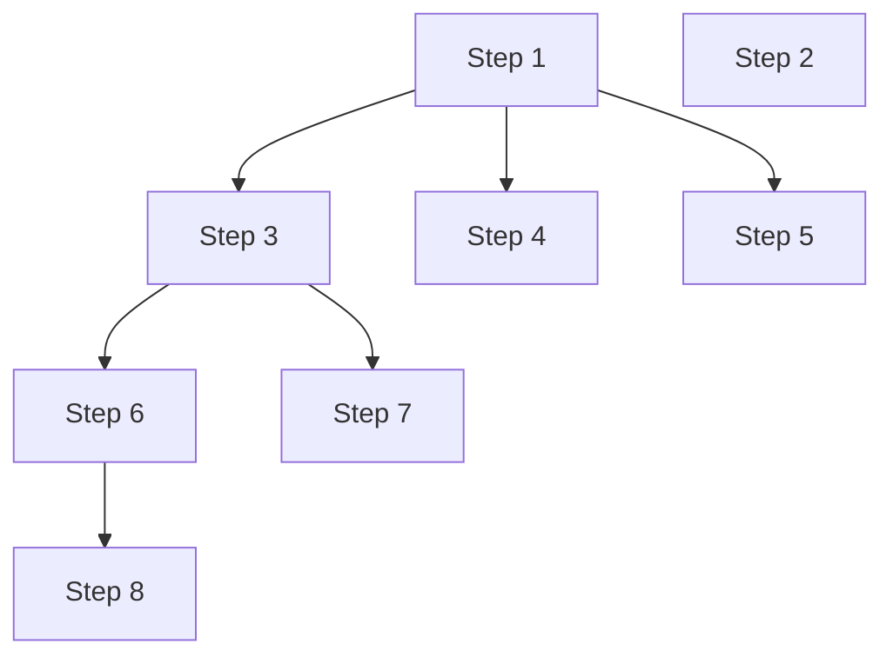

# PLAN: Handoff brief

## Status

Active

The plan files no GitHub issue and no milestone. Every step lands in one pull
request.

## Scope Summary

This plan builds the handoff brief from `docs/designs/DESIGN-handoff-brief.md`:
`scripts/handoff-brief.sh`, which writes a stopping session's reasoning and
named files as `handover/` keys in its koto session and records the one file
list in a keep record under the instance's `.niwa/`, along with its refusals,
the park hold, the closing step and context reader, the successor's takeover
copy, and the compaction note and hook, shipped off. It also records the
session-id read that compaction as a worker default waits on (#1527). It turns
compaction on for no role and places nothing inside a work-on run.

## Decomposition Strategy

Walking skeleton. Step 1 crosses the brief's whole path on one real scratch
file in a temporary test instance: `handoff-brief.sh write --event end` hashes
the file, stores the brief and the file's bytes as `handover/` keys in the
calling koto session, and writes `<instance>/.niwa/keep.json`. Then
`handoff-brief.sh read --session <name>` from a second shell prints the brief
with the file's hash verified. That run touches the script, koto context
storage and the keep record at once. Each later step adds one behaviour to
that path: the refusals, the park hold, the closing step and context reader,
the takeover copy, the compaction note and hook, and adoption by later roles.

The design's first phase is the session-id read, but here it's step 2 with no
dependency. It builds nothing. It only gates compaction as the worker default,
and this plan never turns that on. A step plan keeps step 1 for the skeleton,
so the read sits beside it and can run at the same time.

Several things stay held, and nothing in this plan releases them:

- Nothing places the closing step or the brief step in a work-on run while the
  design for #1230 is in progress. Step 5 ships the closing step and the
  context reader as scripts only, and step 8 waits on the place #1230's design
  names.
- The fallback continuation is #1785's route. Step 6 drives the takeover
  directly first and calls it from #1785's `handover.sh open` only once that
  route lands.
- Compaction as the worker default waits on the session-id read in step 2, on
  the remaining arms of the worker trial and on the owner's ruling. Nothing
  here turns it on: step 7 ships the hook with a passthrough example that no
  workspace config enables.
- Nothing builds a coordinator or seat successor brief beyond what the design
  states. The design's Decision 5 records both rulings: every session,
  coordinators and seats included, writes the one brief this plan builds, and
  coordinators don't compact; they keep handing over. No step turns compaction
  on for a coordinator, and step 8 adopts the brief in /coordinate's handover
  only after steps 3 and 6.

The plan files no issue.

## Steps

### Step 1: A brief written at a run's end reads back from another session with its file verified

**Goal**: A session ending its run calls `handoff-brief.sh write --event end` with one named scratch file. The brief and the file's bytes go into its koto session as `handover/` keys, and the keep record goes under the instance's `.niwa/`. A second shell then runs `handoff-brief.sh read --session <name>` and gets the brief back with that file's hash checked. This crosses the script, koto context storage and the instance's keep record, and it runs on one real scratch file in a temporary test instance.

**Acceptance Criteria**:

- [ ] In a temporary instance, `handoff-brief.sh write --event end --reasoning <file> --file <scratch file> --instance <root>` exits 0, and `koto context get <session> handover/brief.md` then prints a brief with `event: end`, the reasoning text under `## Reasoning`, and `## Pointers`, `## Files` and `## Standing rules` sections in that order
- [ ] The brief's `## Files` section has exactly one line for the named file, with four tab-separated fields in order: `scratch:` or `instance:` followed by the relative path, `sha256:<hex>`, `bytes:<n>` and `inline:yes`. The hex and byte count equal `shasum -a 256` and `wc -c` of the file on disk
- [ ] `koto context get <session> handover/files/<sha256>` returns bytes identical to the scratch file (`cmp` reports no difference)
- [ ] `<instance>/.niwa/keep.json` parses as JSON with `written_by` set to `handoff-brief.sh`, `brief.key` set to `handover/brief.md`, `brief.koto_session` set to the session name, one `files` entry holding the file's absolute path, the same sha256 and byte count and `inline: true`, and `protects` equal to `["files", "transcript"]`
- [ ] From a second shell that doesn't share the writer's `KOTO_SESSION`, `handoff-brief.sh read --session <name>` exits 0 and prints the brief with its Files section after the free text and the named file reported as hash-verified
- [ ] Failure: `write --event end` with a reasoning file holding only spaces, tabs and newlines exits 1 and names empty reasoning as the cause. Afterwards the session has no `handover/brief.md` and no `handover/files/` key, and `<instance>/.niwa/keep.json` doesn't exist
- [ ] Failure: when the stored `handover/files/<sha256>` bytes are replaced with different content after a successful write, `read --session <name>` exits non-zero and its output names the file and a hash mismatch rather than reporting the file as verified

**Check**: Run a script test in `scripts/tests/` that builds a temporary instance holding one scratch file, runs `write --event end` and then, in a separate shell with `KOTO_SESSION` unset, `read --session <name>`. It passes when the printed Files line's sha256 and bytes and the `keep.json` `files` entry all match the file's own sha256 and size, `cmp` shows the stored key equal to the file, the whitespace-only reasoning run exits 1 with no `handover/` key and no `keep.json`, and the altered-bytes read exits non-zero naming the hash mismatch.

**Dependencies**: None

**Files**: `scripts/handoff-brief.sh`, `scripts/tests/`

### Step 2: The job's sessionId is read before and after one compaction and the result is recorded

**Goal**: In a test instance, the job state file's `sessionId` (`.claude/jobs/<id>/state.json` under the home directory) is read once before and once after a single compaction of that job's session, and the compaction section of `references/handoff-brief.md` says whether it changed. Nothing is built, and compaction is turned on for no role: making it the worker default still waits on this read, on the remaining arms of the worker trial and on the owner's ruling.

**Acceptance Criteria**:

- [ ] The compaction section of `references/handoff-brief.md` shows the job id, the `sessionId` value read before the compaction and the value read after it, each with the time it was read
- [ ] The before-read time is earlier than the compaction boundary's timestamp in that session's transcript and the after-read time is later, and the section shows the boundary timestamp next to the two read times so a reader can see the two reads bracket the one compaction
- [ ] The section states one verdict: `unchanged` when the two values are equal, `changed` when they differ
- [ ] When either read finds no state file, no `sessionId` field or a null value, the verdict reads `not determined` with the reason (which read failed and what it found), and no value is filled in as if it had been read
- [ ] After the step, the workspace config and the test instance's settings hold no new dispatch passthrough entry and no installed PreCompact hook: `git diff` on the workspace config shows nothing, and compaction is on for no role
- [ ] The section says that compaction as the worker default still waits on the remaining arms of the worker trial and the owner's ruling, whatever the verdict

**Check**: A written walkthrough in the compaction section of `references/handoff-brief.md`: in a test instance, read `sessionId` from the job's state file and note the time, trigger one compaction of that session, read `sessionId` again and note the time, then find the compaction boundary in the session transcript. The section shows both values, both read times, the boundary timestamp between them, and the verdict (`unchanged`, `changed`, or `not determined` with its reason).

**Dependencies**: None

**Files**: `references/handoff-brief.md`

### Step 3: write refuses an unsafe brief and writes nothing

write refuses, with a named cause and nothing stored, a path outside scratch, a credential-shaped name or token, a copied transcript, a control, tab or Unicode format character, a heading in the reasoning, a watch with a shell operator, and a brief or record over its cap.

### Step 4: A park holds the instance until resume voids the hold

write --event park records a hold in the keep record under its lock, and resume voids it, replacing only the script's own fields.

### Step 5: The closing step blocks a run with unpushed or stray work, and the context reader prints the size since the last compaction

closing-step.sh prints closing=pass or closing=blocked with one cause per line, and context-size.sh prints the newest input-token total after the latest compaction boundary; neither is placed in a work-on run.

### Step 6: A successor's takeover copies and hash-checks every named file before the fence

handoff-brief.sh takeover copies and checks each named file, driven directly first and then from the one call in #1785's handover.sh open once that route lands, and with no run leaves an advisory handover/taken-by mark.

### Step 7: A compaction note is written when the PreCompact hook fires, with compaction still off

handoff-brief.sh note stores handover/compaction-note.md and hooks/pre-compact-note.sh tells the session to write it, shipped with a documented passthrough example that no workspace config enables.

### Step 8: Later roles write their brief through the script in the ruled order

workers write the brief at a run's end at the place #1230's design names once it settles, then /coordinate's handover, then the two top-level sessions, none of them before steps 3 and 6 ship.

## Implementation Sequence

The steps run in order, and the dependencies below say which can run beside
another.

| Step | Depends on |
|------|-----------|
| Step 1: A brief written at a run's end reads back from another session with its file verified | None |
| Step 2: The job's sessionId is read before and after one compaction and the result is recorded | None |
| Step 3: write refuses an unsafe brief and writes nothing | Step 1 |
| Step 4: A park holds the instance until resume voids the hold | Step 1 |
| Step 5: The closing step blocks a run with unpushed or stray work, and the context reader prints the size since the last compaction | Step 1 |
| Step 6: A successor's takeover copies and hash-checks every named file before the fence | Step 3 |
| Step 7: A compaction note is written when the PreCompact hook fires, with compaction still off | Step 3 |
| Step 8: Later roles write their brief through the script in the ruled order | Step 6 |

**Critical path**: Step 1 -> Step 3 -> Step 6 -> Step 8.

Steps 1 and 2 have no dependency and can start together. After step 1, steps
3, 4 and 5 don't depend on each other. After step 3, steps 6 and 7 don't
depend on each other.

The plan's owner details step 3 after step 2's work reaches its terminal, and
each later step the same way, in a commit that touches only the plan.
