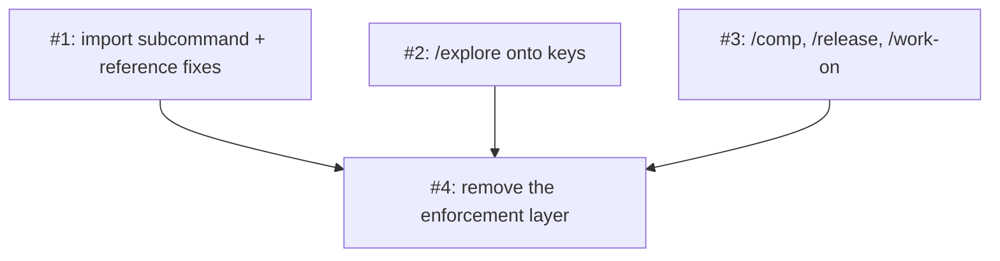

# PLAN: Leaf skills off the staging folder

## Status

Active

## Scope Summary

Implement `docs/designs/DESIGN-leaf-skills-off-folder.md`: the shared import
subcommand and the convention's reference corrections, then /explore, then
/comp, /release and /work-on's fallback off the staging folder, and last the
enforcement layer that exists only because of the folder, in four pull
requests.

## Decomposition Strategy

Horizontal, following the design's four implementation phases. The shared
pieces change no skill's behavior and are what the moves cite, so they land
first; each move is one skill's writer and every reader of its files; the
enforcement removal is a separate layer that depends on all of them. A walking
skeleton has nothing to cut across: the moves don't interact at runtime.

## Issue Outlines

### Issue 1: feat(skill-session): import a topic's sessions by set and correct the convention's stale references

**Repo**: tsukumogami/shirabe

**Group**: shared

**Goal**: Add `skill-session.sh import <set> <topic> --from <path>` with its
tests, add `comp` and `release` to `KNOWN_SKILLS`, document the import and the
leaf sessions in the convention reference, and make the three corrections
tsukumogami/shirabe#747 lists (PRD R8 to R10).

**Acceptance Criteria**:
- [ ] `skill-session.sh import` walks the design's fixed name lists for
      `tactical`, `strategic`, `explore`, `comp` and `release`, in order, and
      prints exactly one `imported=`, `skipped=<name> reason=not-found` or
      `failed=<name> code=<code>` line per name it reached.
- [ ] Against a stand-in `koto` first on `PATH` (recording its arguments and
      returning scripted JSON and exit codes), `skill-session_test.sh` shows:
      two of six tactical names present gives two `imported=`, four
      `skipped=`, exit 0; none present gives exit 3; a third name refused with
      `import_name_taken` prints that `failed=` line, makes no further koto
      call, and exits 1; output that isn't JSON gives
      `failed=<name> code=unparseable` and exit 1; a re-run after a partial
      import reports the earlier names `imported` and exits 0; a relative
      `--from`, an unknown set and topic `-x` each exit 64 with the stand-in
      never called; a stand-in whose `session import --help` fails gives exit
      69; and no recorded invocation carries `--as` or `--trust-template`.
- [ ] The stand-in's scripted outputs are koto's documented success object
      and error codes for `session import`, and the test cites where they are
      documented; a case against real koto with the local backend shows the
      subcommand turning koto's own `import_requires_cloud` refusal into
      `failed=<name> code=import_requires_cloud` and exit 1.
- [ ] A case runs against a real bucket only when `SKILL_SESSION_IMPORT_FROM`
      is set and reports a skip otherwise.
- [ ] `skill-session.sh reclaimable comp-<t>` and `release-<t>` answer from the
      rule (a finished session with no `chain/parent` prints `yes`), tested.
- [ ] `references/skill-session-convention.md` names the `import` subcommand in
      "Finding a session after an import", lists the leaf sessions in Session
      sets, and its Closing section says the exits that record `exit:` close a
      parent and its children while a clean cancel, a refusal or an error
      terminal closes nothing.
- [ ] `references/parent-skill-security.md`'s Slot 7 example names
      `handoff/<child>.md` in `explore-<topic>` and no staging file;
      `git grep -n '<<ISSUE:' -- skills/charter` prints nothing, each
      placeholder replaced by a citation of
      `references/parent-skill-state-schema.md`.
- [ ] No skill's behavior changes: `git diff --stat origin/main` touches only
      `scripts/skill-session.sh`, its test, the two references, the /charter
      phase file and `.github/workflows/check-skill-session.yml` if its paths
      need it.
- [ ] `scripts/ablation/check-public-content.sh --diff origin/main` exits 0.

**Dependencies**: None

**Type**: code

### Issue 2: feat(explore): keep /explore's working state in explore-<topic>

**Repo**: tsukumogami/shirabe

**Group**: explore

**Goal**: /explore keeps its scope, findings, decisions, crystallize verdict,
/decision brief and research leads as keys in `explore-<topic>`, resumes from
them through `explore-state.sh`, and clears or closes its session at Phase 5
as the design says (PRD R1 to R3, R6).

**Acceptance Criteria**:
- [ ] `skills/explore/scripts/explore-state.sh` implements `resume-phase`,
      `ingest-leads` and `finish-handoff` as the design specifies, and
      `explore-state_test.sh` drives them against real koto in a store
      isolated by `KOTO_SESSIONS_BASE`, reading results back with
      `koto context get`.
- [ ] The test opens `explore-<topic>` with `skill-session.sh open`, writes the
      scope with `put` and one round's lead files through `ingest-leads`, then
      reads `work/scope.md` and `research/r1_lead-<name>.md` back; a lead file
      with a bad name is reported `rejected=` and no key exists for it; `git
      status --porcelain` in the test repository shows no `wip/` entry.
- [ ] `resume-phase` prints `2` with only `work/scope.md`; `3` with lead keys
      and no findings; `3` with findings lacking the marker; `4` when the
      findings hold `## Decision: Crystallize`; `5` with `work/crystallize.md`;
      `none` for an absent session.
- [ ] `finish-handoff` refuses when no non-empty handoff key exists and removes
      nothing; with `handoff/scope.md` present it leaves exactly that key and
      `session/branch`; after the test removes the handoff and closes the
      session as /scope does, `skill-session.sh status` prints `finished`.
- [ ] The handoff body carries everything /scope and /charter read from it,
      with no pointer to a `work/` or `research/` key; the PR body records a
      search of main for any reader of /explore's `work/` or `research/` keys
      after a handoff, the command run and its result.
- [ ] A test of a non-handoff arm closes the session and reads a `work/` key
      from the finished session.
- [ ] The /decision arm writes `work/decision-brief.md` with `put` before it
      invokes /decision and closes `explore-<topic>` only after /decision
      returns; the suite checks that order in the arm's phase file, and checks
      that no research-lead prompt in Phase 2 or the scope file's adversarial
      lead names a `koto` command.
- [ ] /explore's open with no koto on `PATH` exits 127 and with a stand-in
      below the floor exits 69, creating no `wip/` entry.
- [ ] SKILL.md, every phase file and `references/quality/crystallize-framework.md`
      name keys, not staging files; the lead prompt and the adversarial lead's
      embedded prompt pin output to the scratch directory; the handoff's
      provenance points at no key; the /decision brief's research references
      are `koto context get explore-<topic> research/<name>` reads and its
      commit step is gone; `git grep -nE 'wip/[A-Za-z0-9_<]' -- skills/explore
      ':!*/evals/*'` prints only lines the PR body lists as folder-not-used
      prose or guards, and `git grep -nE 'explore_(<topic>|<t>)_' -- skills
      ':!*/evals/*'` prints nothing.
- [ ] `explore-state_test.sh` also reads SKILL.md and the phase files and fails
      unless the resume section calls `explore-state.sh resume-phase`, Phase 2
      calls `ingest-leads`, the handoff arm calls `finish-handoff`, and every
      call names the script by its `${CLAUDE_PLUGIN_ROOT}` path.
- [ ] `references/skill-session-convention.md` gains /explore's working-key
      rows; `skills/explore/requires.tsv` declares `koto context
      add|get|exists|remove` and `list --prefix`, and
      `scripts/check-skill-requires_test.sh` passes; a workflow runs
      `skills/explore/scripts/*_test.sh` and the bash-floor suite covers it.
- [ ] Explore eval scenarios 1, 4, 5, 6 and 7 are updated to the keys; only
      the ones the change bears on run, once, and the PR body names them.
- [ ] `scripts/ablation/check-public-content.sh --diff origin/main` exits 0.

**Dependencies**: None

**Type**: code

### Issue 3: feat(comp,release,work-on): move /comp and /release onto keys and remove /work-on's fallback file

**Repo**: tsukumogami/shirabe

**Group**: leaves

**Goal**: /comp keeps its scope and jury verdicts in `comp-<topic>` and drops
its dead parent read; /release keeps its range, membership, unattributed
commits and notes in `release-<topic>`; `extract-context.sh` writes no file
(PRD R4 to R7).

**Acceptance Criteria**:
- [ ] /comp's phase files contain no read of a parent state file and its topic
      check is `^[a-z0-9][a-z0-9-]*$`; `comp-state.sh jury-resume` prints
      `aggregate` with all three verdict keys and, with two present, removes
      them and prints `fresh`; `comp-state_test.sh` shows this against real
      koto after writing the scope with `put` and the verdicts through
      `ingest`, and shows the session `finished` after the finalize close; a
      topic `-x` is refused.
- [ ] `release-state.sh topic` prints `tsukumogami-shirabe` for this
      repository from a stubbed `gh repo view` and refuses an empty result;
      `membership` against a test repository with tagged history writes
      `work/range`, `work/prs` and `work/unattributed` that read back matching
      the tag range; a second run after a new commit replaces them; a range
      with no `(#N)` subjects reads back as an empty `work/prs`; a leftover
      `work/notes.md` is removed by `membership`; `read` of an absent key exits
      1 naming Phase 1.
- [ ] /release's Phase 4 prose writes the notes with `put`, passes `gh release
      create --notes-file` a file under a `scratch` directory, and removes the
      directory; the test extracts that bash block from
      `skills/release/SKILL.md` at run time and runs it against a stubbed `gh`,
      showing the file was passed and no longer exists, so a change to the
      shipped block changes what the test runs.
- [ ] /release closes `done` after Phase 4 or a dry run and `abandoned` on an
      earlier stop, and its prose tells the author how to recover from
      `refused=branch_mismatch`; a test shows the abandoned close.
- [ ] `extract-context.sh` run without `--session`, and with `--session` and no
      koto on `PATH`, prints `"status": "failed"` and `"context_available":
      false`, names koto in a warning, creates no file, and its output and
      header carry no `context_file`; a test in `skills/work-on/scripts/`
      shows both; `skills/work-on/references/koto-context-conventions.md` no
      longer tells anyone to use the folder.
- [ ] /comp's and /release's opens with no koto on `PATH` exit 127 and below
      the floor exit 69, creating no `wip/` entry.
- [ ] `git grep -nE 'wip/[A-Za-z0-9_<]' -- skills/comp skills/release
      skills/work-on ':!*/evals/*'` prints only lines the PR body lists as
      folder-not-used prose or guards; `git grep -nE
      'comp_(<topic>|<t>)_|release-(range|prs|unattributed)\.txt|IMPLEMENTATION_CONTEXT'
      -- skills ':!*/evals/*'` prints nothing; the two suites fail unless
      /comp's Phase 4 calls `comp-state.sh jury-resume` and /release's Phase 1
      calls `release-state.sh membership` by `${CLAUDE_PLUGIN_ROOT}` path; the convention reference gains /comp's
      and /release's rows; both `requires.tsv` files declare the koto commands
      and `scripts/check-skill-requires_test.sh` passes; workflows run the two
      new script suites and the bash-floor suite covers them.
- [ ] Comp eval scenario 8 still asserts the visibility warning before anything
      is created; only scenarios the change bears on run, once, and the PR body
      names them.
- [ ] `scripts/ablation/check-public-content.sh --diff origin/main` exits 0.

**Dependencies**: None

**Type**: code

### Issue 4: refactor: remove the staging-folder enforcement layer

**Repo**: tsukumogami/shirabe

**Group**: enforcement

**Goal**: With no skill writing the folder, remove the node-push sweep, the
leftover-files rule and its gates, /scope's untrack step and `wip_paths`, and
/deliver's relay of it, and bring CLAUDE.md and `references/wip-hygiene.md` in
line (PRD R11 to R15).

**Acceptance Criteria**:
- [ ] Entry gate, recorded in the PR body: on a local merge of Issues 1 to
      3's pushed heads with this branch, `git grep -nE 'wip/[A-Za-z0-9_<]' -- skills scripts
      koto-templates ':!*/evals/*'` lists no line a skill or script follows to
      write or read a file; each remaining hit is listed with its kind.
- [ ] `node-push.sh` has no `git rm` of the folder and no post-push `ls-tree`
      check; its header and exit-69 causes no longer mention them;
      `node-push_test.sh` passes and still pushes a node branch.
- [ ] `references/rule-registry.json` has no `branch/no-wip-files`;
      `check-branch-output.sh --wip` is refused as an unknown option; no gate
      in `skills/work-on/koto-templates/work-on.md`,
      `skills/execute/koto-templates/execute.md` or
      `execute-coordinated.md` checks the folder; `check-branch-output_test.sh`,
      `check-rule-registry_test.sh` and the template routing and structure
      tests pass.
- [ ] `publish-scoping-pr.sh` makes no untrack commit, prints no `wip_paths=`,
      writes no `wip_paths` context key and runs no private-marker scan over
      staging files; `print-scope-exit.sh` and `record-scope-exit.sh` carry no
      `wip_paths`; /scope's template and SKILL.md no longer mention them;
      `publish-scoping-pr_test.sh` and `print-scope-exit_test.sh` pass with a
      publish case still exercised.
- [ ] `skills/deliver/koto-templates/deliver.md` has no `wip_paths`;
      `deliver-report.sh` never prints `wip_paths=`; `deliver-report_test.sh`,
      `deliver-engine_test.sh` and `deliver-template-structure_test.sh` pass.
- [ ] CLAUDE.md's Intermediate Storage section tells no workflow to use the
      folder; `references/wip-hygiene.md` keeps the no-staging-path rule for
      committed documents and drops the rows for removed checks; the guards
      the design keeps (upstream checks, finalize greps, the public-content
      check, the scope-gate lint) are unchanged.
- [ ] `git grep -n 'wip' -- skills/execute/scripts/node-push.sh
      references/rule-registry.json skills/work-on/scripts/check-branch-output.sh
      skills/scope/scripts/publish-scoping-pr.sh
      skills/scope/scripts/print-scope-exit.sh skills/deliver ':!*/evals/*'`
      prints nothing.
- [ ] The PR body names Issues 1 to 3's pull requests as dependencies that
      must merge first, and the branch is cut from main and carries none of
      their commits. If the entry gate finds another writer, that writer's move
      is added to this pull request before it is marked ready.
- [ ] The PR body states that the workspace rule governing the folder lives
      outside this repository and is not edited here, and that its retirement
      is proposed separately.
- [ ] Eval scenarios that assert `wip_paths` or the sweep are updated; only
      those run, once, and the PR body names them.
- [ ] `scripts/ablation/check-public-content.sh --diff origin/main` exits 0.

**Dependencies**: Blocked by <<ISSUE:1>>, <<ISSUE:2>>, <<ISSUE:3>>

**Type**: code

## Dependency Graph

## Implementation Sequence

Critical path: 1, 2 and 3 in parallel, then 4. Issues 1, 2 and 3 all edit
the convention reference, in different sections, so whichever lands later
merges main in once; none needs another's code. Issue 4 is built after 2 and 3 are pushed, since its entry gate
reads their heads merged together, and it merges last.
