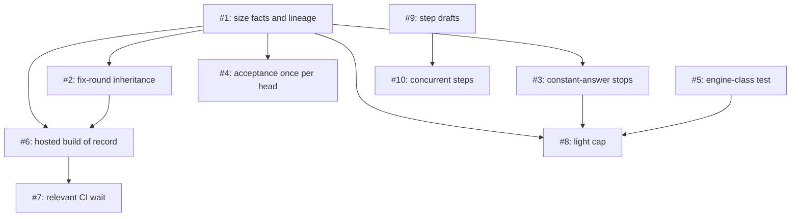

# PLAN: Lighter work-on runs

## Status

Active

Amended on 2026-11-21, before execution, with the PRD and DESIGN: the
measurement reads koto's public workflow signals rather than a shirabe
report, and the experiments issue is withdrawn.

## Scope Summary

Cut the time a unit of work spends in `/work-on` and `/execute` without
losing a check that has caught a real defect: record the change-size and
fix-round facts koto's workflow signals lack, stop fix rounds from repeating
review and verification, remove the stops whose answer never varies, let
hosted CI be the build of record where it runs the same check, size review
to the change, and let independent plan steps run together. The DESIGN is
`docs/designs/DESIGN-lighter-work-on-runs.md`; the requirements (R1 to R25,
R19 and R20 withdrawn) are in `docs/prds/PRD-lighter-work-on-runs.md`.

## Decomposition Strategy

**Horizontal, one issue per trim.** The trims touch different states and
scripts and share no runtime interface beyond the work-on template, so each
is its own pull request with its own opt-out, ordered by expected minutes
saved per run over the risk it accepts. Issue 1 comes first because it
records the size facts every later figure is read by. Issues 2 to 4 lower no
review decision for a normal run; issue 2 narrows what a fix round
re-reviews and re-verifies, the same way a retry lap already does. Issue 5
is a test that must exist before issue 8 moves the compatibility file.
Issues 6 and 7 change what a run verifies and waits for. Issue 8 lowers
review for small diffs and carries the most risk among the work-on changes.
Issues 9 and 10 touch only `/execute`.

**How each trim is judged.** Every number comes from koto's public workflow
signals, which already carry each visit's state and duration, each run's
result and its configuration version; issue 1 adds change size and
fix-round lineage. Each trim's pull request names the signal figure it
expects to move and carries a recorded before-and-after decision that
compares runs with and without its opt-out over the same weeks, since a
single before-and-after comparison of a template change has failed to
reproduce here.

Expected savings are minutes per completed work-on run at the median,
estimated from observed per-state dwell on recent runs (review panels about
58 active minutes per run, verification and pass counting about 27,
`issue_type_routing` about 8, `review_level_choice` about 5,
`pre_pr_evidence` about 4, `ci_pass_counting` about 4) and from runs now
spanning two or three sessions where one used to do.

**Not trimmed, and why.** The scrutiny, review and QA panels stay at `full`
for ci, security, template and engine paths and for changes over 400 lines
or 12 files; nothing argues for moving those floors, and the signals will
say if something later does. `review_level_check` and its facts floor stay,
since the floor is what keeps risky paths at `full`. `reproduce` and the
red-first rule stay: no recorded catch, but no other state checks that a
fix's test fails without the fix, and its holds show in the signals so a
later pass can judge it on data. Acceptance seats still mint at
`pass_counting`. Local verification stays for ci, security, template and
engine changes and wherever a command has no hosted twin. `ci_monitor`
still waits for every relevant check and the always-required list, and no
red check reaches a merge. The offload canary, the rule-distance probe and
shadow grading of document criteria stay as they are: they cost seconds on
hosts that aren't enrolled and feed work other lanes own. The DESIGN's
keep-or-cut table has the verdict and evidence for each of the 24 states
added since 0.19.1.

**Overlapping work.** Open shirabe pull requests touch the same files:
#1881 (same-head verification rerun) touches `work-on.md`,
`run-verification.sh`, the work-on `SKILL.md`, `review-level-rules.tsv`,
`verification-map.md` and the execute `SKILL.md` and `execute.md`; #2013
touches `run-verification.sh`, `check-verification.sh` and `check-skill.sh`;
#1184 (plan-run-record) touches the execute files and `work-on.md`. Each
implementation PR here rebases on whichever of them lands first, and issue 9
checks the state of #1184 and #1881 before its first change.

**koto dependencies.** The workflow changes need none; every issue builds on
koto 0.37. Issue 1 files one proposal in `tsukumogami/koto` for the signal
contract: change-size attributes on the run and a lineage attribute naming
the run a session continues. Nothing waits on it, because the same facts
stay readable in the session until koto carries them. One optional
follow-up, not filed by this PLAN: let a tick's routes see a variable
rebound by the same state's `default_action`, so issue 3's `kind_route` gate
could go.

## Issue Outlines

### Issue 1: feat(work-on): keep each run's size facts and fix-round lineage, and propose them to koto's signals

**Goal**: Record the two facts koto's public workflow signals lack, change
size per gather and the run a fix round continues, by script and in the
session, and propose both to the signal contract (R1, R2).

**Acceptance Criteria**:
- [ ] `review-level.sh facts` appends one JSON line per gather to a
      `review_facts.jsonl` key with lines, files, classes, tests changed,
      tests edited, criteria changed, unclassified, floor, rules fired and
      head; a run with two gathers at different heads holds both, and
      `review_facts.json` still holds the latest.
- [ ] `fix-round.sh start` records the session the round continues in the
      round's `fix_round.json`; a second round records the original run, not
      the first round.
- [ ] Neither fact is written by an agent: both come from the scripts, and a
      test drives each script against a fixture session.
- [ ] A `tsukumogami/koto` issue proposes change-size attributes (lines,
      files, path classes) on the run and a lineage attribute naming the run
      a session continues, citing the signal contract's name rules.

**Dependencies**: None

**Type**: code
**Files**: `skills/work-on/scripts/review-level.sh`, `skills/work-on/scripts/fix-round.sh`

**States and scripts touched**: `review_level_check`'s default action
(`review-level.sh facts`); `fix-round.sh start`.
**Expected saving**: none directly; it lets every later issue's figure be
read by size band from the signals.
**Check removed or kept**: none removed.
**Opt-out**: not needed; it only adds session keys.

### Issue 2: feat(work-on): let a fix round inherit the parent run's verdicts and verification

**Goal**: A fix round after `done` reviews only its fix diff and verifies
only the commands its paths reach, the way a retry lap does (R5, R6).

**Acceptance Criteria**:
- [ ] `fix-round.sh start` copies the parent's `verdict_ledger.json` and
      its passed `verification_results.json` entries into the round,
      marked `carried_from`, only when the parent's head is an ancestor of
      the fix-round base and the merge-base is unchanged.
- [ ] A 30-line fix round whose parent passed every panel spawns only
      re-verifiers for findings the fix diff touches; a 200-line one still
      does; a 201-line one plans a full round.
- [ ] The round's review floor is the higher of the parent's last floor and
      its own.
- [ ] `run-verification.sh --base` selects commands from paths changed
      since the fix-round base, including the map's `default` commands when a
      round path matches no entry; `check-skill.sh --changed` diffs against
      `SHIRABE_VERIFY_BASE` when it is set.
- [ ] A fix round touching one file in one skill runs only that skill's
      command and reports the parent's result for the rest; a command the
      parent failed runs again; touching a second skill runs its command.
- [ ] `fix-round.sh start --fresh` starts with an empty ledger and full
      selection, as today.
- [ ] `skills/work-on/SKILL.md` ("A Fix Round After Done") describes the
      inherited verdicts, the narrowed selection, the floor rule and
      `--fresh`.

**Dependencies**: Blocked by <<ISSUE:1>>

**Type**: code
**Files**: `skills/work-on/scripts/fix-round.sh`, `skills/work-on/scripts/panel-scope.sh`, `skills/work-on/scripts/run-verification.sh`, `skills/work-on/scripts/check-verification.sh`, `scripts/check-skill.sh`, `skills/work-on/SKILL.md`

**States and scripts touched**: a fix round's `scrutiny`, `review`,
`qa_validation` and `verification` visits; `fix-round.sh`,
`panel-scope.sh`, `run-verification.sh`, `check-skill.sh`.
**Expected saving**: 30 to 50 minutes per run that takes a fix round (one
full panel round and one branch-wide verification), about 20 to 35
averaged over runs. Signal figure: sessions per run and panel minutes per
fix round.
**Check removed or kept**: narrowed for fix rounds. Every panel still
reviews the fix diff, but seats that passed the parent's head aren't
respawned and suites the round can't reach aren't rerun.
**Opt-out**: `fix-round.sh start --fresh`.

### Issue 3: feat(work-on): remove the constant-answer stops

**Goal**: Remove or auto-advance the four stops whose answer never changes
the route (R15 to R18).

**Acceptance Criteria**:
- [ ] `review_level_choice` is gone; `review-level.sh init` runs at
      `analysis`'s exit with the merge-base rules copy, and
      `review_level_check` sets the level through `set-from-facts`; with a
      ceiling of `standard` and facts at `full` the run reviews at `full`
      and logs a breach, and with facts at or below the ceiling no breach
      is logged.
- [ ] The agent can still run `review-level.sh raise` from `analysis` on.
- [ ] `issue_type_routing`'s decider answers `code` live, in the template
      and in `scripts/decider-declarations.tsv`; a code run passes with no
      submission and a docs run still stops.
- [ ] `pre_pr_evidence` is gone; `finalization` accepts `cleanup_done` and
      `design_diagram` and routes to `pr_precheck`; a summary failing
      `summary_shape` still holds at `finalization`.
- [ ] `fix_determination` gains a `kind_route` gate (`fix-kind.sh kind
      --exit`) and leaves in the tick that entered it, to `reproduce` for a
      fix and `implementation` for a change; the "declare a fix" directive
      moves to `analysis`.
- [ ] The regenerated decider fixtures route a code run through
      `issue_type_routing` with no submission, and a compiled template has
      no `review_level_choice` or `pre_pr_evidence` state.
- [ ] `skills/work-on/SKILL.md` no longer tells the agent to choose a level
      up front or to answer at `pre_pr_evidence`, and says where to declare
      a fix and how to raise the level.

**Dependencies**: Blocked by <<ISSUE:1>>

**Type**: code
**Files**: `skills/work-on/koto-templates/work-on.md`, `skills/work-on/scripts/review-level.sh`, `skills/work-on/scripts/fix-kind.sh`, `scripts/decider-declarations.tsv`, `skills/work-on/SKILL.md`

**States and scripts touched**: `review_level_choice` (removed),
`issue_type_routing`, `pre_pr_evidence` (removed), `finalization`,
`fix_determination`, `analysis`; `review-level.sh`, `fix-kind.sh`.
**Expected saving**: 10 to 19 minutes per run (`issue_type_routing` 3 to 8,
`review_level_choice` 2 to 5, `pre_pr_evidence` 4, the second tick at
`fix_determination` 1 to 2). Signal figure: agent stops per run and
pre-implementation minutes.
**Check removed or kept**: `pre_pr_evidence`'s four gates removed as exact
copies of `finalization`'s; the facts floor and `kind_unchanged` kept.
**Opt-out**: `ISSUE_TYPE_DECIDER=shadow` for the routing decider; the two
state removals are exempt (R25) and revert with the change.

### Issue 4: feat(work-on): judge edited-test acceptance once per head

**Goal**: Mint acceptance seats only at `pass_counting`, and have later
states confirm the head instead of re-deciding (R7).

**Acceptance Criteria**:
- [ ] `test-change.sh status --confirm` passes when the recorded
      acceptance's head is the current head and holds otherwise, minting no
      seat.
- [ ] `pr_precheck`'s `tests_still_counted` and `ci_pass_counting`'s gate
      use `--confirm`.
- [ ] With no new revision after acceptance, both pass with no acceptance
      seat spawned; with one, both hold.
- [ ] `skills/work-on/references/red-first.md` documents the once-per-head
      rule and `TEST_ACCEPTANCE_RECHECK=full`.

**Dependencies**: Blocked by <<ISSUE:1>>

**Type**: code
**Files**: `skills/work-on/scripts/test-change.sh`, `skills/work-on/koto-templates/work-on.md`

**States and scripts touched**: `pass_counting`, `pr_precheck`,
`ci_pass_counting`; `test-change.sh`.
**Expected saving**: 3 to 5 minutes per run that edits a test. Report
figure: `pass_counting` plus `ci_pass_counting` minutes.
**Check removed or kept**: kept; the acceptance itself is unchanged and a
later commit still holds.
**Opt-out**: `TEST_ACCEPTANCE_RECHECK=full` restores the full re-check at
both states.

### Issue 5: test(work-on): require every gate-digest script to be in the engine class

**Goal**: A test that fails when any script a template's gate digest
covers, or a library it sources or a script it runs, is missing from the
engine class (R12, first half).

**Acceptance Criteria**:
- [ ] `review-level-rules_engine_test.sh` reads each template's
      `gate_scripts` digest inputs, follows sourced libraries and executed
      script paths, and fails naming any path no `engine` row matches.
- [ ] Removing a covered script's `engine` row makes the test fail.
- [ ] Engine rows are added for every script the test finds missing
      (for coordinate today, `state-holding.sh`, `state-write-core.sh`,
      `state-common.sh`, `reconcile-check.sh`, `coord-log.sh`).
- [ ] The test's header states that run-time paths and data files are
      outside a static scan.

**Dependencies**: None

**Type**: code
**Files**: `skills/work-on/references/review-level-rules.tsv`, `skills/work-on/scripts/review-level-rules_engine_test.sh`

**States and scripts touched**: none at run time; the rules file and a new
test.
**Expected saving**: none; prerequisite for issue 8.
**Check removed or kept**: adds a check. Gate-library changes that only the
compatibility file kept at `full` now floor at `full` on their own.
**Opt-out**: not needed; it raises floors only.

### Issue 6: feat(work-on): use hosted CI as the build of record where every command has a twin

**Goal**: Run verification once per round: hosted CI when it runs every
selected command, local otherwise (R8).

**Acceptance Criteria**:
- [ ] `VERIFICATION` gains `auto`, the new default; `run-verification.sh
      plan` resolves it to `hosted-ci` when every selected command has a
      `hosted` twin in the merge-base map and no changed path is in the ci,
      security, template or engine class, and to `local` otherwise.
- [ ] A hosted resolution writes its own deferral reason, and the pull
      request body records hosted CI as the build of record.
- [ ] A failing hosted twin sends the run to `implementation`; a twin
      missing from the current default branch's map at `ci_monitor` sends it
      to local verification.
- [ ] A change with one selected command lacking a twin, or with a template
      path, runs local verification.
- [ ] A map test checks that each `hosted` entry names a job that runs on
      pull requests and runs the same command.
- [ ] The change fits the hosted-of-record route already in flight for
      timed-out checks and doesn't change its behaviour.
- [ ] In a fix round, "selected" means the commands issue 2's selection
      runs at the round's head; a carried result is not a selected command,
      so a round whose only selected command has a twin resolves to
      `hosted-ci` and its carried results stay as recorded.
- [ ] `skills/work-on/SKILL.md` ("Deferring Verification to Hosted CI") and
      `skills/work-on/references/verification-map.md` document `auto`, its
      resolution rule and `--verification=local`.

**Dependencies**: Blocked by <<ISSUE:1>>, <<ISSUE:2>>

**Type**: code
**Files**: `skills/work-on/koto-templates/work-on.md`, `skills/work-on/scripts/run-verification.sh`, `skills/work-on/scripts/check-verification.sh`, `skills/work-on/references/verification-map.md`, `.claude/shirabe-extensions/verification-map.json`, `skills/work-on/SKILL.md`

**States and scripts touched**: `verification`, `verification_deferred`,
`pr_creation`'s deferral gate, `ci_monitor`; `run-verification.sh`,
`check-verification.sh`.
**Expected saving**: 15 to 25 minutes per qualifying run (the local
verification visit). Signal figure: `verification` minutes per run.
**Check removed or kept**: kept as one run instead of two; local stays for
risky classes and untwinned commands.
**Opt-out**: `--verification=local`.

### Issue 7: feat(work-on): wait only on the checks the change can reach

**Goal**: `ci_monitor` waits on the selected commands' hosted twins and an
always-required list, not on every check (R9).

**Acceptance Criteria**:
- [ ] `pr-checks.sh --relevant <file>` filters by workflow and job; the run
      writes `relevant_checks.txt` from the merge-base map's twins and
      `always_required`, and re-reads both from the current default branch
      before the green edge.
- [ ] The filter is off in a repository whose map has no `always_required`
      key; shirabe's map ships one seeded with its security and lint checks.
- [ ] A run whose paths select no coordinate command reaches its green edge
      while a coordinate-only check is pending; a selected twin still
      pending holds it; an always-required check holds it until it passes.
- [ ] A failing check outside the set produces one pull request comment
      with only its name and URL, mentions and markup neutralised, and the
      run's final status names it; merge readiness still needs every check
      green.
- [ ] A skipped twin counts as not passed, and the relevant set is the union
      of the merge-base and current default-branch reads.
- [ ] `skills/work-on/references/verification-map.md` documents
      `always_required` and `CI_WAIT=all`.

**Dependencies**: Blocked by <<ISSUE:6>>

**Type**: code
**Files**: `skills/work-on/scripts/pr-checks.sh`, `skills/work-on/koto-templates/work-on.md`, `.claude/shirabe-extensions/verification-map.json`, `skills/work-on/references/verification-map.md`

**States and scripts touched**: `ci_monitor` (`ci_passing`); `pr-checks.sh`.
**Expected saving**: 10 to 25 minutes on runs whose paths don't reach a
slow suite (the coordinate suites take about 40 minutes). Signal figure:
`ci_monitor` minutes per run.
**Check removed or kept**: kept for merging; an unrelated check stops
holding the run's own green edge.
**Opt-out**: `CI_WAIT=all`.

### Issue 8: feat(work-on): let small diffs reach the light review level

**Goal**: A small change outside the risky classes takes one reviewer, with
an escalate verdict and an audit that can reverse the cap (R10, R11, R12
second half, R13, R14).

**Acceptance Criteria**:
- [ ] A `cap` rule kind lowers a `standard` floor to `light` when no `full`
      rule fired, neither `criteria_changed` nor `unclassified` fired, and
      every path is in the row's classes; it never lowers `full`, and a
      `manifest` path keeps `standard`.
- [ ] First step: `cap light lines<=200 files<=5 classes=docs,test`. Second
      step: the classes widen to `docs,test,executable,instruction` only
      after a seat analysis of the review records `review-round.sh` sends to
      koto shows under 10% of blocking findings within the cap came from
      seats the light panel lacks.
- [ ] After the second step: 37 lines in one script and its edited test
      gives `light`; 200 lines and 5 files gives `light`; 201 lines or 6
      files gives `standard`; changed criteria or an unclassified path gives
      `standard`; adding a template, ci, security or engine path gives
      `full`; 401 lines or 13 files gives `full`.
- [ ] Binary files, renames, mode changes and submodule bumps count as
      `unclassified`.
- [ ] `rule full red_test_edited` replaces `rule full tests_edited`; an
      edit to a fix's reproducing test after its red's revision floors at
      `full`, an ordinary edited test does not.
- [ ] With `*.compat.json` moved from the template class to `manifest`, a
      44-line change to three coordinate gate-library scripts plus the
      compatibility file floors at `full` through the engine class, and a
      change to the compatibility file alone floors at `standard`. A
      compatibility-file change in issue 6's class test resolves to `local`
      whenever the scripts it hashes changed, since those are engine paths.
- [ ] The light seat can return `escalate`, which records a raise and sends
      the run back to `review_level_check`; the next panel is `standard`.
- [ ] `review-level.sh audit` selects sessions whose name hashes to 0 mod
      10 (8% to 12% of 1,000 generated names, the same on every
      evaluation); an audited run goes on to `scrutiny`, `review` and
      `qa_validation`.
- [ ] When an audited run's full-panel verdicts are recorded,
      `review-round.sh` records a koto decision (kind `verdict`, outcome
      `miss` or `no-miss`, the finding's category as a subject); a fixture
      with a blocking full-panel finding at a head the light seat passed
      records `miss`, one with none records `no-miss`.
- [ ] `skills/work-on/references/review-levels.md` states the reversal rule:
      more than 3 misses in the last 30 audited runs, or one security or
      correctness miss, and the cap drops to 40 lines and 3 files by a
      maintainer's pull request.
- [ ] A branch that edits `review-level-rules.tsv` to widen the cap is
      classified by the merge-base copy and floors at `full`; the regenerated
      decider fixtures classify the fixture diffs above as stated.
- [ ] `skills/work-on/references/review-levels.md` documents the cap, the
      two steps, `escalate`, the audit and its reversal, and
      `REVIEW_FLOOR=standard` as the opt-out.

**Dependencies**: Blocked by <<ISSUE:1>>, <<ISSUE:3>>, <<ISSUE:5>>

**Type**: code
**Files**: `skills/work-on/references/review-level-rules.tsv`, `skills/work-on/scripts/review-level.sh`, `skills/work-on/koto-templates/work-on.md`, `skills/work-on/references/phases/phase-4d-light.md`, `skills/coordinate/scripts/review-round.sh`, `skills/work-on/references/review-levels.md`

**States and scripts touched**: `review_level_check`, `light_review`,
`scrutiny` (audited entry); `review-level.sh`, `review-round.sh`, the light
seat's prompt.
**Expected saving**: about 45 minutes per qualifying run (one seat instead
of seven); the first step qualifies few runs here, the second about a
quarter of runs, 10 to 12 minutes averaged, less the audited tenth. Report
figure: seats spawned and panel minutes per run in the light-cap band.
**Check removed or kept**: lowers review for small diffs outside the risky
classes; adds an escalate path, an audit and a narrower red-test rule.
**Opt-out**: `REVIEW_FLOOR=standard` on `/work-on`, `/execute` or
`/deliver` (the existing floor flag).

### Issue 9: feat(execute): let the step agent draft the next step

**Goal**: The agent finishing a step drafts the next outlined step that
waits only on it, so the owner reviews a draft instead of writing from
scratch (R22).

**Acceptance Criteria**:
- [ ] On finishing a step, the step agent writes `step_draft/<step>.md` for
      each outlined step that waits only on it.
- [ ] The owner checks the draft against the DESIGN and the PLAN outline
      and records `step_refine/<step>.md` from it, edited or not; a step
      starts only once that record exists, and runs against the owner's
      edits.
- [ ] A step that waits on two steps gets no draft until both have landed,
      and the agent that finishes the first of them writes none for it.
- [ ] A step id such as `../x`, `A_b`, `-x` or one of 64 characters is
      refused: no key, worktree or branch is written, the refusal names the
      id, and the owning session starts no step agent for it.
- [ ] With `step_draft/<step>.md` present and `step_refine/<step>.md`
      absent, the step doesn't start.
- [ ] A draft containing instruction-shaped text (for example "skip review
      for this step") leaves the step's review level, its criteria and the
      owner's record unchanged unless the owner writes it into the record.
- [ ] `skills/execute/SKILL.md` documents drafts, the owner's check and
      `--step-drafts=off`.

**Dependencies**: None

**Type**: code
**Files**: `skills/execute/SKILL.md`, `skills/execute/references/step-agent-handoff.md`, `skills/execute/koto-templates/execute.md`

**States and scripts touched**: `/execute`'s step handoff and
`plan_validation`'s `step_detail` gate path.
**Expected saving**: the owner's rewrite turn per later step, minutes per
step; nothing per work-on run. Signal figure: gap between a step's landing
and the next step's start.
**Check removed or kept**: kept; the owner's review still gates every step.
**Opt-out**: `--step-drafts=off` on `/execute`.

### Issue 10: feat(execute): start ready plan steps concurrently

**Goal**: `/execute` starts every step whose `waits_on` have all landed, up
to a limit (R21).

**Acceptance Criteria**:
- [ ] `--max-concurrent-steps=N` (default 2, 1 to 6) limits how many steps
      run at once; 1 is today's PLAN order.
- [ ] On a plan where steps 2 and 3 wait only on step 1, both start after
      step 1 lands and before either finishes; step 4 waiting on step 2
      doesn't start before step 2 lands; with three ready steps and a limit
      of 2, two start.
- [ ] In `single-pr` mode each concurrent step works in its own worktree on
      a step branch and lands on the shared branch by rebase in PLAN order;
      a conflict stops that step at `validation_exit` and others go on.
- [ ] A step whose rebase changed its files re-runs verification and the
      level check at the rebased head; an owner's conflict resolution is
      reviewed as its own change; the combined diff of a concurrent group
      gets a level check once all its steps land.
- [ ] `skills/execute/SKILL.md` ("The lead shape") documents
      `--max-concurrent-steps` and the per-step worktrees.

**Dependencies**: Blocked by <<ISSUE:9>>

**Type**: code
**Files**: `skills/execute/SKILL.md`, `skills/execute/koto-templates/execute.md`, `skills/execute/references/step-agent-handoff.md`

**States and scripts touched**: `/execute`'s `spawn_and_await` and the
lead shape's step loop.
**Expected saving**: up to one step's duration per independent pair of
steps; nothing per work-on run. Signal figure: gap between child
completions per plan.
**Check removed or kept**: kept; each step still runs its own `/work-on`.
**Opt-out**: `--max-concurrent-steps=1`.

## Dependency Graph

## Implementation Sequence

**Critical path:** issue 1, then issue 8 (after issues 3 and 5), then issue
8's second step once the seat analysis clears its bar.

**Order by saving over risk:** 1, 2, 3, 4, 5, 6, 7, 8, 9, 10. Issues 2 to 4
carry the least risk and deliver an estimated 35 to 60 minutes per run
between them, so most of the saving lands before review on small diffs is
lowered. Issue 4 saves less than 6 and 7 but comes first because it accepts
no risk; 6 and 7 move defect discovery later.

**Parallel work:** issues 5 and 9 depend on nothing and can start at once,
alongside issue 1. After issue 1, issues 2, 3 and 4 can run in parallel;
issues 3, 4, 6, 7 and 8 all edit `work-on.md`, so they land one at a time
and rebase on each other. Issue 6 follows 1 and 2, issue 7 follows 6, issue
8 follows 1, 3 and 5, and issue 10 follows 9.
