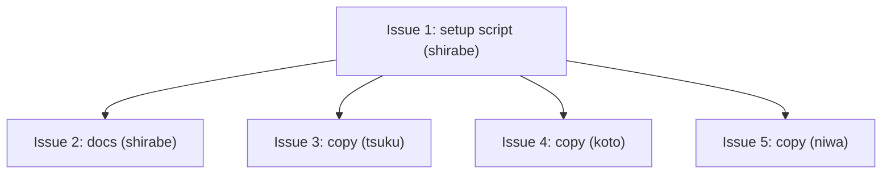

# PLAN: sr8-workspace-engine

## Status

Active

## Scope Summary

Deliver shirabe's pre-commit hook into every product repository clone during
`niwa apply` by committing one guarded setup script,
`scripts/setup/shirabe-pre-commit.sh`, to shirabe, tsuku, koto and niwa, and
point contributors at `tsuku install tsukumogami/shirabe`. Each product
repository the private overlay adds takes the same file in its own pull
request, outside this plan.

## Decomposition Strategy

Horizontal. Issue 1 builds and proves the canonical script in shirabe,
including an isolated niwa demonstration with the script copied into each
product clone of a throwaway instance. Issue 2 lands the README install line and
the contract guide section in the same shirabe pull request. Issues 3 to 5 copy
the settled script, byte for byte, into tsuku, koto and niwa, one pull request
per repository. Shirabe lands first; the three copies follow in any order.

## Issue Outlines

### Issue 1: feat(setup): add the guarded pre-commit setup script for niwa apply

**Repo**: tsukumogami/shirabe

**Group**: default

**Type**: code

**Complexity**: testable

**Goal**: Add the guarded `scripts/setup/shirabe-pre-commit.sh` (mode 0755) to
shirabe, with a `_test.sh` that asserts every case in the design's output table,
CI wiring for that test, and a recorded niwa 0.40.0 demonstration in the pull
request description.

**Context**: niwa 0.40.0 runs every executable file in a repository's
`scripts/setup/` on each create, apply and provisioning run. The script wraps
`shirabe install-hooks`, which can't change, and decides each case before calling
it. The test lives at `scripts/shirabe-pre-commit_test.sh`, outside
`scripts/setup/`, because niwa runs every executable file in that directory.
`.github/workflows/build-and-test.yml` already builds `target/release` and runs
a hook test against it, so the new test runs there; `scripts/check-mktemp-guards.sh`
(CI: `.github/workflows/check-mktemp-guards.yml`) checks every `mktemp` use.
Design: `docs/designs/DESIGN-sr8-workspace-engine.md`; requirements:
`docs/prds/PRD-sr8-workspace-engine.md`.

**Acceptance Criteria**:

The script and its file:
- [ ] `scripts/setup/shirabe-pre-commit.sh` exists, `git ls-files -s` shows
      `100755`, it starts with `#!/usr/bin/env bash` and sets `set -euo pipefail`.
- [ ] It unsets `GIT_DIR`, `GIT_WORK_TREE`, `GIT_COMMON_DIR` and `GIT_INDEX_FILE`
      before any git call.
- [ ] The checks run in the design's order: shirabe lookup, hooks-directory
      comparison, foreign-hook test, no-hook install, refresh comparison.
- [ ] Every `install-hooks` call runs the resolved `"$bin"`, never `shirabe` by
      name.
- [ ] The script reads no `NIWA_*` variable and nothing that identifies the
      repository it runs in, so the same bytes work in every product repository.
- [ ] `bash scripts/check-mktemp-guards_test.sh` exits 0 and
      `scripts/check-mktemp-guards.sh` passes on the script and its test.
- [ ] `scripts/setup/` holds only `shirabe-pre-commit.sh`; the test and any helper
      live elsewhere.

Output cases. Each asserts the exact stdout line, the exit status, empty stderr
unless stated, and the bytes (`cmp`) of every file involved before and after:
- [ ] shirabe not on PATH: stdout is exactly
      `shirabe not on PATH; pre-commit hook not installed (install it with: tsuku install tsukumogami/shirabe)`,
      exit 0, no `pre-commit` created.
- [ ] `shirabe` found only through an in-clone PATH directory, and separately
      through a relative or empty PATH entry resolving into the clone: the same
      line, exit 0, no `pre-commit` created, and the in-clone `shirabe` is never
      executed.
- [ ] Absolute `core.hooksPath` outside the clone: stdout is exactly
      `hooks directory <resolved path> is not this clone's own hooks directory; shirabe pre-commit hook not installed`,
      exit 0, nothing written in that directory or in `.git/hooks`.
- [ ] In-tree `core.hooksPath` (`.githooks`): the same line naming the resolved
      directory, exit 0, nothing written in it.
- [ ] Symlinked hooks directory: the same line, exit 0, nothing written through
      the link.
- [ ] Symlinked `pre-commit` pointing at a tracked file (the tsuku and koto
      layout): stdout is exactly
      `a pre-commit hook is already present; shirabe pre-commit hook not installed`,
      exit 0, the symlink and the tracked target byte-unchanged, `git status`
      clean.
- [ ] Dangling symlink `pre-commit`: the foreign-hook line, exit 0, the link
      unchanged and nothing created at its target.
- [ ] Symlink whose target contains the `shirabe install-hooks` marker: the
      foreign-hook line, exit 0, link and target byte-unchanged.
- [ ] Regular foreign hook without the header line, and one that mentions
      `shirabe install-hooks` but lacks the exact header line: the foreign-hook
      line, exit 0, bytes unchanged, in each case.
- [ ] Pre-commit framework hook: the foreign-hook line, exit 0, bytes unchanged.
- [ ] `pre-commit` that is not a regular file (a directory or a FIFO): the
      foreign-hook line, exit 0, nothing read or written.
- [ ] No hook: stdout is exactly `installed shirabe pre-commit hook`, exit 0, and
      `.git/hooks/pre-commit` is executable and byte-identical to the hook
      `shirabe install-hooks` writes in a scratch repository.
- [ ] Stale shirabe hook (regular file with the exact header line and a
      different body): stdout is exactly `refreshed shirabe pre-commit hook`,
      exit 0, and the file is byte-identical to the current generated body.
- [ ] Current shirabe hook: two runs both print nothing and exit 0; the file's
      bytes and mtime are unchanged after the second run.
- [ ] Inherited `GIT_DIR` pointing at another repository: that repository's hooks
      and config are byte-unchanged and the clone gets the result it gets without
      the variable.
- [ ] Linked worktree of the clone: run from the worktree, the script installs
      once into the clone's shared `<common dir>/hooks` and creates no `hooks`
      entry under the worktree's private git directory; committing a valid design
      doc in the worktree succeeds and a doc with `status: Bogus` is refused.
- [ ] Install error: with the hooks directory read-only, the script exits
      non-zero, passes `install-hooks`' stderr through, and prints nothing on
      stdout. The case skips itself, saying so, when the test runs as root.
- [ ] Every case prints at most one line on stdout.

The test and CI:
- [ ] `scripts/shirabe-pre-commit_test.sh` runs each case in throwaway
      repositories under a checked `mktemp -d`, with the `shirabe` built from the
      same commit on PATH, and exits 0 only when every case passes.
- [ ] The test never touches the caller's repository or global git config (it
      pins `HOME`, `GIT_CONFIG_GLOBAL` and `GIT_CONFIG_NOSYSTEM`).
- [ ] `.github/workflows/build-and-test.yml` runs it after the release build as
      `PATH="$PWD/target/release:$PATH" bash scripts/shirabe-pre-commit_test.sh`,
      and that job passes on the pull request.

Demonstration, recorded in the pull request description. Run an isolated
`niwa create` of the tsukumogami workspace into a new temporary workspace root
with niwa 0.40.0 (quote `niwa --version`), leaving other instances untouched.
Copy the script into each of the shirabe, tsuku, koto and niwa clones (or check
out a pull request branch only after reading its `scripts/setup/` diff), then run
`niwa apply`:
- [ ] With `shirabe` on PATH, each of the four clones has an executable
      `.git/hooks/pre-commit` byte-identical to the current hook body (record the
      `cmp` results and modes), and apply reports no setup failure.
- [ ] In one clone, committing a valid design doc succeeds and committing one with
      `status: Bogus` is refused; both results are recorded.
- [ ] The workspace configuration clone and the org health-files clone have no
      `.git/hooks/pre-commit`, and no setup notice names them.
- [ ] Missing-shirabe run: niwa invoked by absolute path with a PATH that leaves
      shirabe out prints one setup notice per product repository containing
      `tsuku install tsukumogami/shirabe`, writes no `pre-commit`, and reports no
      setup failure; with `shirabe` back on PATH, the next `niwa apply` installs
      the hook in each clone.
- [ ] Re-apply silence: a second `niwa apply` right after a successful one leaves
      every product clone's `pre-commit` byte-identical (hash and mtime recorded)
      and adds no setup output line.
- [ ] Apply output shows each line prefixed `[<repo>/shirabe-pre-commit.sh]` and at
      most one setup line per product repository in every recorded run.
- [ ] Neither the pull request text nor the diff names a private repository.

Downstream deliverables:
- [ ] Must deliver: the final script at `scripts/setup/shirabe-pre-commit.sh`,
      mode 0755, with its test passing in CI, for the copies (required by
      Issue 3, Issue 4, Issue 5).
- [ ] Must deliver: the canonical path and the exact notice wording, for the
      contract guide (required by Issue 2).

**Dependencies**: None

### Issue 2: docs: point contributors at tsuku and document apply-time hook delivery

**Repo**: tsukumogami/shirabe

**Group**: default

**Type**: docs

**Complexity**: simple

**Goal**: Make `tsuku install tsukumogami/shirabe` the README's first install
route and document, in the contract guide, how the pre-commit hook is delivered
at apply time and what each skip case means.

**Context**: The hook only works with `shirabe` on PATH, and the README's only
install route today (`install.sh`, into `$HOME/.shirabe/bin`) puts the binary where
the hook doesn't look. The README "Requirements" bullet for the `shirabe` binary
already links to `#local-install`; that link stays. Files: `README.md`
("## Requirements", "### Local install") and
`docs/guides/multi-consumer-cli-contract.md` ("## Installing the local hook").
Design: `docs/designs/DESIGN-sr8-workspace-engine.md`.

**Acceptance Criteria**:
- [ ] The first fenced command block under "### Local install" is
      `tsuku install tsukumogami/shirabe`.
- [ ] The `install.sh` curl command stays in "### Local install" as the second
      fenced command.
- [ ] "### Local install" says the pre-commit hook resolves `shirabe` on PATH
      only (not `$HOME/.shirabe/bin` unless that directory is on PATH).
- [ ] The "## Requirements" bullet for the `shirabe` binary links to
      `#local-install`.
- [ ] Under "## Installing the local hook", one paragraph covers apply-time
      delivery: niwa's setup runs `scripts/setup/shirabe-pre-commit.sh` on every
      apply, that path is the canonical copy other repositories must match byte
      for byte, and git 2.31 is the minimum.
- [ ] One paragraph covers the missing-shirabe case: a notice naming
      `tsuku install tsukumogami/shirabe`, no setup failure, and the next apply
      installs the hook.
- [ ] One paragraph covers the foreign-hook case: a pre-commit hook without
      shirabe's header line, or a symlink, is left unchanged and reported, and
      removing the header line is how a contributor keeps a customized hook.
- [ ] One paragraph covers a hooks directory that isn't the clone's own (a
      global, local or in-tree `core.hooksPath`, or a symlinked hooks directory):
      nothing is written and the resolved directory is reported.
- [ ] `shirabe validate` exits 0 on `README.md` and
      `docs/guides/multi-consumer-cli-contract.md`.
- [ ] Neither file names a private repository.

**Dependencies**: Blocked by Issue 1

### Issue 3: chore(setup): install shirabe's pre-commit hook during niwa apply (tsuku)

**Repo**: tsukumogami/tsuku

**Group**: default

**Type**: code

**Complexity**: testable

**Goal**: Add shirabe's pre-commit setup script, byte-identical to the canonical
copy, at `scripts/setup/shirabe-pre-commit.sh` in tsuku so niwa installs the hook
during apply.

**Context**: tsuku has no `scripts/setup/` directory today, so the pull request
creates it. `scripts/install-hooks.sh` symlinks `.git/hooks/pre-commit` to the
tracked formatter hook `scripts/pre-commit`; the script treats that symlink as a
foreign hook. Copy only after Issue 1's test passes in CI.
Design: `docs/designs/DESIGN-sr8-workspace-engine.md`.

**Acceptance Criteria**:
- [ ] `cmp scripts/setup/shirabe-pre-commit.sh <shirabe's scripts/setup/shirabe-pre-commit.sh at Issue 1's commit>`
      returns 0.
- [ ] `git ls-files -s scripts/setup/shirabe-pre-commit.sh` shows mode `100755`.
- [ ] `git diff --name-only <base>...HEAD` lists only
      `scripts/setup/shirabe-pre-commit.sh`.
- [ ] Run from the clone root with `shirabe` on PATH and no pre-commit hook, the
      script prints `installed shirabe pre-commit hook` and exits 0.
- [ ] After `scripts/install-hooks.sh` has run, the script prints
      `a pre-commit hook is already present; shirabe pre-commit hook not installed`,
      exits 0, and leaves the symlink and `scripts/pre-commit` byte-unchanged.
- [ ] Repository CI passes on the pull request.

**Dependencies**: Blocked by Issue 1

### Issue 4: chore(setup): install shirabe's pre-commit hook during niwa apply (koto)

**Repo**: tsukumogami/koto

**Group**: default

**Type**: code

**Complexity**: testable

**Goal**: Add shirabe's pre-commit setup script, byte-identical to the canonical
copy, at `scripts/setup/shirabe-pre-commit.sh` in koto so niwa installs the hook
during apply.

**Context**: koto has no `scripts/setup/` directory today, so the pull request
creates it. `scripts/install-hooks.sh` symlinks `.git/hooks/pre-commit` to the
tracked formatter hook `scripts/pre-commit`; the script treats that symlink as a
foreign hook. Copy only after Issue 1's test passes in CI.
Design: `docs/designs/DESIGN-sr8-workspace-engine.md`.

**Acceptance Criteria**:
- [ ] `cmp scripts/setup/shirabe-pre-commit.sh <shirabe's scripts/setup/shirabe-pre-commit.sh at Issue 1's commit>`
      returns 0.
- [ ] `git ls-files -s scripts/setup/shirabe-pre-commit.sh` shows mode `100755`.
- [ ] `git diff --name-only <base>...HEAD` lists only
      `scripts/setup/shirabe-pre-commit.sh`.
- [ ] Run from the clone root with `shirabe` on PATH and no pre-commit hook, the
      script prints `installed shirabe pre-commit hook` and exits 0.
- [ ] After `scripts/install-hooks.sh` has run, the script prints
      `a pre-commit hook is already present; shirabe pre-commit hook not installed`,
      exits 0, and leaves the symlink and `scripts/pre-commit` byte-unchanged.
- [ ] Repository CI passes on the pull request.

**Dependencies**: Blocked by Issue 1

### Issue 5: chore(setup): install shirabe's pre-commit hook during niwa apply (niwa)

**Repo**: tsukumogami/niwa

**Group**: default

**Type**: code

**Complexity**: testable

**Goal**: Add shirabe's pre-commit setup script, byte-identical to the canonical
copy, at `scripts/setup/shirabe-pre-commit.sh` in niwa so niwa installs the hook
during apply.

**Context**: niwa has no `scripts/setup/` directory today (its `scripts/` holds
only `docker-test.sh`), so the pull request creates it. It has no repository
hook installer, so there is no formatter-symlink case here. Copy only after
Issue 1's test passes in CI. Design: `docs/designs/DESIGN-sr8-workspace-engine.md`.

**Acceptance Criteria**:
- [ ] `cmp scripts/setup/shirabe-pre-commit.sh <shirabe's scripts/setup/shirabe-pre-commit.sh at Issue 1's commit>`
      returns 0.
- [ ] `git ls-files -s scripts/setup/shirabe-pre-commit.sh` shows mode `100755`.
- [ ] `git diff --name-only <base>...HEAD` lists only
      `scripts/setup/shirabe-pre-commit.sh`.
- [ ] Run from the clone root with `shirabe` on PATH and no pre-commit hook, the
      script prints `installed shirabe pre-commit hook` and exits 0.
- [ ] Repository CI passes on the pull request.

**Dependencies**: Blocked by Issue 1

## Dependency Graph

## Implementation Sequence

Critical path: Issue 1, then any one of Issues 2 to 5. Issues 1 and 2 share the
shirabe `default` group and land as one pull request, which merges first. Once
Issue 1's test passes in CI, Issues 3, 4 and 5 run in parallel, one pull request
each in tsuku, koto and niwa. The coordination pull request merges last.
