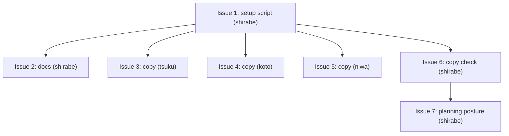

# PLAN: sr8-workspace-engine

## Status

Active

## Scope Summary

Deliver shirabe's pre-commit hook into every product repository clone during
`niwa apply` by committing one guarded setup script,
`scripts/setup/shirabe-pre-commit.sh`, to shirabe, tsuku, koto and niwa, and
point contributors at `tsuku install tsukumogami/shirabe`. Each product
repository the private overlay adds takes the same file in its own pull
request, outside this plan. The reusable `lifecycle.yml` then fails any pull
request whose copy differs from shirabe's (Issue 6), and gains a `posture`
input, with draft posture accepting a ROADMAP that roots its own chain at
`Draft`, so a planning repository whose default branch holds open plans can
call it (Issue 7). That repository's own caller, and the interim comparison job
it runs until then, land in its own pull requests, outside this plan.

## Decomposition Strategy

Horizontal. Issue 1 builds and proves the canonical script in shirabe,
including an isolated niwa demonstration with the script copied into each
product clone of a throwaway instance. Issue 2 lands the README install line and
the contract guide section in the same shirabe pull request. Issues 3 to 5 copy
the settled script, byte for byte, into tsuku, koto and niwa, one pull request
per repository. Issue 6 adds the copy comparison to `lifecycle.yml` in its own
shirabe pull request once Issue 1 has landed. Issue 7 adds the `posture` input
and the Draft ROADMAP acceptance in another shirabe pull request after Issue 6,
since both touch `lifecycle.yml` and the copy script. The shirabe pull request
for Issues 1 and 2 lands first; the three copies follow in any order, then
Issue 6, then Issue 7.

## Issue Outlines

### Issue 1: feat(setup): add the guarded pre-commit setup script for niwa apply

**Repo**: tsukumogami/shirabe

**Group**: default

**Type**: code

**Complexity**: testable

**Goal**: Add the guarded `scripts/setup/shirabe-pre-commit.sh` (mode 0755) to
shirabe, with a `_test.sh` that asserts every case in the design's output table,
CI wiring for that test, and a recorded niwa 0.40.0 demonstration in the pull
request description.

**Context**: niwa 0.40.0 runs every executable file in a repository's
`scripts/setup/` on each create, apply and provisioning run. The script wraps
`shirabe install-hooks`, which can't change, and decides each case before calling
it. The test lives at `scripts/shirabe-pre-commit_test.sh`, outside
`scripts/setup/`, because niwa runs every executable file in that directory.
`.github/workflows/build-and-test.yml` already builds `target/release` and runs
a hook test against it, so the new test runs there; `scripts/check-mktemp-guards.sh`
(CI: `.github/workflows/check-mktemp-guards.yml`) checks every `mktemp` use.
Design: `docs/designs/DESIGN-sr8-workspace-engine.md`; requirements:
`docs/prds/PRD-sr8-workspace-engine.md`.

**Acceptance Criteria**:

The script and its file:
- [ ] `scripts/setup/shirabe-pre-commit.sh` exists, `git ls-files -s` shows
      `100755`, it starts with `#!/usr/bin/env bash` and sets `set -euo pipefail`.
- [ ] It unsets `GIT_DIR`, `GIT_WORK_TREE`, `GIT_COMMON_DIR` and `GIT_INDEX_FILE`
      before any git call.
- [ ] The checks run in the design's order: shirabe lookup, hooks-directory
      comparison, foreign-hook test, no-hook install, refresh comparison.
- [ ] Every `install-hooks` call runs the resolved `"$bin"`, never `shirabe` by
      name.
- [ ] The script reads no `NIWA_*` variable and nothing that identifies the
      repository it runs in, so the same bytes work in every product repository.
- [ ] `bash scripts/check-mktemp-guards_test.sh` exits 0 and
      `scripts/check-mktemp-guards.sh` passes on the script and its test.
- [ ] `scripts/setup/` holds only `shirabe-pre-commit.sh`; the test and any helper
      live elsewhere.

Output cases. Each asserts the exact stdout line, the exit status, empty stderr
unless stated, and the bytes (`cmp`) of every file involved before and after:
- [ ] shirabe not on PATH: stdout is exactly
      `shirabe not on PATH; pre-commit hook not installed (install it with: tsuku install tsukumogami/shirabe)`,
      exit 0, no `pre-commit` created.
- [ ] `shirabe` found only through an in-clone PATH directory, and separately
      through a relative or empty PATH entry resolving into the clone: the same
      line, exit 0, no `pre-commit` created, and the in-clone `shirabe` is never
      executed.
- [ ] Absolute `core.hooksPath` outside the clone: stdout is exactly
      `hooks directory <resolved path> is not this clone's own hooks directory; shirabe pre-commit hook not installed`,
      exit 0, nothing written in that directory or in `.git/hooks`.
- [ ] In-tree `core.hooksPath` (`.githooks`): the same line naming the resolved
      directory, exit 0, nothing written in it.
- [ ] Symlinked hooks directory: the same line, exit 0, nothing written through
      the link.
- [ ] Symlinked `pre-commit` pointing at a tracked file (the tsuku and koto
      layout): stdout is exactly
      `a pre-commit hook is already present; shirabe pre-commit hook not installed`,
      exit 0, the symlink and the tracked target byte-unchanged, `git status`
      clean.
- [ ] Dangling symlink `pre-commit`: the foreign-hook line, exit 0, the link
      unchanged and nothing created at its target.
- [ ] Symlink whose target contains the `shirabe install-hooks` marker: the
      foreign-hook line, exit 0, link and target byte-unchanged.
- [ ] Regular foreign hook without the header line, and one that mentions
      `shirabe install-hooks` but lacks the exact header line: the foreign-hook
      line, exit 0, bytes unchanged, in each case.
- [ ] Pre-commit framework hook: the foreign-hook line, exit 0, bytes unchanged.
- [ ] `pre-commit` that is not a regular file (a directory or a FIFO): the
      foreign-hook line, exit 0, nothing read or written.
- [ ] No hook: stdout is exactly `installed shirabe pre-commit hook`, exit 0, and
      `.git/hooks/pre-commit` is executable and byte-identical to the hook
      `shirabe install-hooks` writes in a scratch repository.
- [ ] Stale shirabe hook (regular file with the exact header line and a
      different body): stdout is exactly `refreshed shirabe pre-commit hook`,
      exit 0, and the file is byte-identical to the current generated body.
- [ ] Current shirabe hook: two runs both print nothing and exit 0; the file's
      bytes and mtime are unchanged after the second run.
- [ ] Inherited `GIT_DIR` pointing at another repository: that repository's hooks
      and config are byte-unchanged and the clone gets the result it gets without
      the variable.
- [ ] Linked worktree of the clone: run from the worktree, the script installs
      once into the clone's shared `<common dir>/hooks` and creates no `hooks`
      entry under the worktree's private git directory; committing a valid design
      doc in the worktree succeeds and a doc with `status: Bogus` is refused.
- [ ] Install error: with the hooks directory read-only, the script exits
      non-zero, passes `install-hooks`' stderr through, and prints nothing on
      stdout. The case skips itself, saying so, when the test runs as root.
- [ ] Every case prints at most one line on stdout.

The test and CI:
- [ ] `scripts/shirabe-pre-commit_test.sh` runs each case in throwaway
      repositories under a checked `mktemp -d`, with the `shirabe` built from the
      same commit on PATH, and exits 0 only when every case passes.
- [ ] The test never touches the caller's repository or global git config (it
      pins `HOME`, `GIT_CONFIG_GLOBAL` and `GIT_CONFIG_NOSYSTEM`).
- [ ] `.github/workflows/build-and-test.yml` runs it after the release build as
      `PATH="$PWD/target/release:$PATH" bash scripts/shirabe-pre-commit_test.sh`,
      and that job passes on the pull request.

Demonstration, recorded in the pull request description. Run an isolated
`niwa create` of the tsukumogami workspace into a new temporary workspace root
with niwa 0.40.0 (quote `niwa --version`), leaving other instances untouched.
Copy the script into each of the shirabe, tsuku, koto and niwa clones (or check
out a pull request branch only after reading its `scripts/setup/` diff), then run
`niwa apply`:
- [ ] With `shirabe` on PATH, each of the four clones has an executable
      `.git/hooks/pre-commit` byte-identical to the current hook body (record the
      `cmp` results and modes), and apply reports no setup failure.
- [ ] In one clone, committing a valid design doc succeeds and committing one with
      `status: Bogus` is refused; both results are recorded.
- [ ] The workspace configuration clone and the org health-files clone have no
      `.git/hooks/pre-commit`, and no setup notice names them.
- [ ] Missing-shirabe run: niwa invoked by absolute path with a PATH that leaves
      shirabe out prints one setup notice per product repository containing
      `tsuku install tsukumogami/shirabe`, writes no `pre-commit`, and reports no
      setup failure; with `shirabe` back on PATH, the next `niwa apply` installs
      the hook in each clone.
- [ ] Re-apply silence: a second `niwa apply` right after a successful one leaves
      every product clone's `pre-commit` byte-identical (hash and mtime recorded)
      and adds no setup output line.
- [ ] Apply output shows each line prefixed `[<repo>/shirabe-pre-commit.sh]` and at
      most one setup line per product repository in every recorded run.
- [ ] Neither the pull request text nor the diff names a private repository.

Downstream deliverables:
- [ ] Must deliver: the final script at `scripts/setup/shirabe-pre-commit.sh`,
      mode 0755, with its test passing in CI, for the copies (required by
      Issue 3, Issue 4, Issue 5).
- [ ] Must deliver: the canonical path and the exact notice wording, for the
      contract guide (required by Issue 2).

**Dependencies**: None

### Issue 2: docs: point contributors at tsuku and document apply-time hook delivery

**Repo**: tsukumogami/shirabe

**Group**: default

**Type**: docs

**Complexity**: simple

**Goal**: Make `tsuku install tsukumogami/shirabe` the README's first install
route and document, in the contract guide, how the pre-commit hook is delivered
at apply time and what each skip case means.

**Context**: The hook only works with `shirabe` on PATH, and the README's only
install route today (`install.sh`, into `$HOME/.shirabe/bin`) puts the binary where
the hook doesn't look. The README "Requirements" bullet for the `shirabe` binary
already links to `#local-install`; that link stays. Files: `README.md`
("## Requirements", "### Local install") and
`docs/guides/multi-consumer-cli-contract.md` ("## Installing the local hook").
Design: `docs/designs/DESIGN-sr8-workspace-engine.md`.

**Acceptance Criteria**:
- [ ] The first fenced command block under "### Local install" is
      `tsuku install tsukumogami/shirabe`.
- [ ] The `install.sh` curl command stays in "### Local install" as the second
      fenced command.
- [ ] "### Local install" says the pre-commit hook resolves `shirabe` on PATH
      only (not `$HOME/.shirabe/bin` unless that directory is on PATH).
- [ ] The "## Requirements" bullet for the `shirabe` binary links to
      `#local-install`.
- [ ] Under "## Installing the local hook", one paragraph covers apply-time
      delivery: niwa's setup runs `scripts/setup/shirabe-pre-commit.sh` on every
      apply, that path is the canonical copy other repositories must match byte
      for byte, and git 2.31 is the minimum.
- [ ] One paragraph covers the missing-shirabe case: a notice naming
      `tsuku install tsukumogami/shirabe`, no setup failure, and the next apply
      installs the hook.
- [ ] One paragraph covers the foreign-hook case: a pre-commit hook without
      shirabe's header line, or a symlink, is left unchanged and reported, and
      removing the header line is how a contributor keeps a customized hook.
- [ ] One paragraph covers a hooks directory that isn't the clone's own (a
      global, local or in-tree `core.hooksPath`, or a symlinked hooks directory):
      nothing is written and the resolved directory is reported.
- [ ] `shirabe validate` exits 0 on `README.md` and
      `docs/guides/multi-consumer-cli-contract.md`.
- [ ] Neither file names a private repository.

**Dependencies**: Blocked by Issue 1

### Issue 3: chore(setup): install shirabe's pre-commit hook during niwa apply (tsuku)

**Repo**: tsukumogami/tsuku

**Group**: default

**Type**: code

**Complexity**: testable

**Goal**: Add shirabe's pre-commit setup script, byte-identical to the canonical
copy, at `scripts/setup/shirabe-pre-commit.sh` in tsuku so niwa installs the hook
during apply.

**Context**: tsuku has no `scripts/setup/` directory today, so the pull request
creates it. `scripts/install-hooks.sh` symlinks `.git/hooks/pre-commit` to the
tracked formatter hook `scripts/pre-commit`; the script treats that symlink as a
foreign hook. Copy only after Issue 1's test passes in CI.
Design: `docs/designs/DESIGN-sr8-workspace-engine.md`.

**Acceptance Criteria**:
- [ ] `cmp scripts/setup/shirabe-pre-commit.sh <shirabe's scripts/setup/shirabe-pre-commit.sh at Issue 1's commit>`
      returns 0.
- [ ] `git ls-files -s scripts/setup/shirabe-pre-commit.sh` shows mode `100755`.
- [ ] `git diff --name-only <base>...HEAD` lists only
      `scripts/setup/shirabe-pre-commit.sh`.
- [ ] Run from the clone root with `shirabe` on PATH and no pre-commit hook, the
      script prints `installed shirabe pre-commit hook` and exits 0.
- [ ] After `scripts/install-hooks.sh` has run, the script prints
      `a pre-commit hook is already present; shirabe pre-commit hook not installed`,
      exits 0, and leaves the symlink and `scripts/pre-commit` byte-unchanged.
- [ ] Repository CI passes on the pull request.

**Dependencies**: Blocked by Issue 1

### Issue 4: chore(setup): install shirabe's pre-commit hook during niwa apply (koto)

**Repo**: tsukumogami/koto

**Group**: default

**Type**: code

**Complexity**: testable

**Goal**: Add shirabe's pre-commit setup script, byte-identical to the canonical
copy, at `scripts/setup/shirabe-pre-commit.sh` in koto so niwa installs the hook
during apply.

**Context**: koto has no `scripts/setup/` directory today, so the pull request
creates it. `scripts/install-hooks.sh` symlinks `.git/hooks/pre-commit` to the
tracked formatter hook `scripts/pre-commit`; the script treats that symlink as a
foreign hook. Copy only after Issue 1's test passes in CI.
Design: `docs/designs/DESIGN-sr8-workspace-engine.md`.

**Acceptance Criteria**:
- [ ] `cmp scripts/setup/shirabe-pre-commit.sh <shirabe's scripts/setup/shirabe-pre-commit.sh at Issue 1's commit>`
      returns 0.
- [ ] `git ls-files -s scripts/setup/shirabe-pre-commit.sh` shows mode `100755`.
- [ ] `git diff --name-only <base>...HEAD` lists only
      `scripts/setup/shirabe-pre-commit.sh`.
- [ ] Run from the clone root with `shirabe` on PATH and no pre-commit hook, the
      script prints `installed shirabe pre-commit hook` and exits 0.
- [ ] After `scripts/install-hooks.sh` has run, the script prints
      `a pre-commit hook is already present; shirabe pre-commit hook not installed`,
      exits 0, and leaves the symlink and `scripts/pre-commit` byte-unchanged.
- [ ] Repository CI passes on the pull request.

**Dependencies**: Blocked by Issue 1

### Issue 5: chore(setup): install shirabe's pre-commit hook during niwa apply (niwa)

**Repo**: tsukumogami/niwa

**Group**: default

**Type**: code

**Complexity**: testable

**Goal**: Add shirabe's pre-commit setup script, byte-identical to the canonical
copy, at `scripts/setup/shirabe-pre-commit.sh` in niwa so niwa installs the hook
during apply.

**Context**: niwa has no `scripts/setup/` directory today (its `scripts/` holds
only `docker-test.sh`), so the pull request creates it. It has no repository
hook installer, so there is no formatter-symlink case here. Copy only after
Issue 1's test passes in CI. Design: `docs/designs/DESIGN-sr8-workspace-engine.md`.

**Acceptance Criteria**:
- [ ] `cmp scripts/setup/shirabe-pre-commit.sh <shirabe's scripts/setup/shirabe-pre-commit.sh at Issue 1's commit>`
      returns 0.
- [ ] `git ls-files -s scripts/setup/shirabe-pre-commit.sh` shows mode `100755`.
- [ ] `git diff --name-only <base>...HEAD` lists only
      `scripts/setup/shirabe-pre-commit.sh`.
- [ ] Run from the clone root with `shirabe` on PATH and no pre-commit hook, the
      script prints `installed shirabe pre-commit hook` and exits 0.
- [ ] Repository CI passes on the pull request.

**Dependencies**: Blocked by Issue 1

### Issue 6: ci(lifecycle): fail a pull request whose setup-script copy differs from shirabe's

**Repo**: tsukumogami/shirabe

**Group**: copy-check

**Type**: code

**Complexity**: testable

**Goal**: Make a drifted copy of `scripts/setup/shirabe-pre-commit.sh` turn its
repository's pull request red, through the reusable `lifecycle.yml` every
public product repository already calls (Decision 3).

**Context**: `lifecycle.yml` already checks out shirabe at the called ref. A new
`setup-script-copy` job compares the caller's copy with that checkout's
canonical one through `scripts/check-setup-script-copy.sh`. The script's
three-argument interface is also called, for a while, from a repository that
doesn't call `lifecycle.yml` yet (Decision 4), so its header documents it.
Design: `docs/designs/DESIGN-sr8-workspace-engine.md`.

**Acceptance Criteria**:
- [ ] With no copy in the caller, the check exits 0 and says there's nothing to
      compare.
- [ ] With an identical, executable copy, it exits 0.
- [ ] With differing bytes, a missing exec bit, a symlink or a directory at the
      path, it exits 1 with one `::error` line naming the command that fixes it,
      and that command, run in the caller, makes the check pass.
- [ ] A missing canonical file or wrong argument count exits 2.
- [ ] `build-and-test.yml` runs the check's test suite.
- [ ] `lifecycle.yml` runs the job on shirabe's own pull requests, comparing the
      canonical copy with itself.
- [ ] The contract guide says the workflow enforces the byte-for-byte rule.

**Dependencies**: Blocked by Issue 1

### Issue 7: feat(lifecycle): let a planning repository run the lifecycle check in draft posture

**Repo**: tsukumogami/shirabe

**Group**: planning-posture

**Type**: code

**Complexity**: testable

**Goal**: Give `lifecycle.yml` a `posture` input whose `draft` value holds the
check at draft posture on every pull request, and let a ROADMAP root at `Draft`
pass under draft posture (Decision 5).

**Context**: Ready posture reads every single-pr chain in the tree as merging
now, which a repository holding open plans on its default branch can never
pass. The ROADMAP row is in the passing-state reading in
`crates/shirabe-validate/src/lifecycle.rs`: `required_state` takes the review
posture and returns a new Draft-or-Active passing state for a ROADMAP that
roots its own chain at `MultiPrInFlight`, under draft posture only; a ROADMAP
root at `Done` (`MultiPrWorkCompleting`) keeps its current expectation. Today no
chain member passes at `Draft` under either posture, so this is a new
acceptance, not an extension of the mid-PR case. The coordination merge-last
gate step in `lifecycle.yml` keys on the pull request's own draft state and is
left as it is. Issue 6 has merged, and its script header doesn't yet say that a
repository may run the script from its own workflow, so this pull request
corrects that header. Prerequisite: this issue changes the shirabe binary that
skills call, so a baseline of that binary's current behavior is recorded before
implementation starts. Build on current `main`. Design:
`docs/designs/DESIGN-sr8-workspace-engine.md`.

**Acceptance Criteria**:
- [ ] `lifecycle.yml` declares an optional string input `posture`, default
      `auto`; with `auto` the lifecycle step picks the same mode as before on
      draft and ready pull requests (it passes `--mode=ready` only on a ready
      one) and exits with the same status.
- [ ] With `posture: draft`, the lifecycle step never passes `--mode=ready`,
      on a draft or a ready pull request.
- [ ] The posture-to-mode resolution lives in one script under `scripts/`,
      shaped like `scripts/coordination-gate-refs.sh` with a `_test.sh` beside
      it. Its contract: it reads `POSTURE` and the pull request's draft state
      (`PR_DRAFT`, `true` or `false`) from the environment; it holds the only
      `case "$POSTURE" in auto|draft)` allowlist; on success it prints the mode
      flag to stdout (empty or `--mode=ready`) and exits 0.
- [ ] The lifecycle step passes `POSTURE: ${{ inputs.posture }}` and the draft
      state to the script only through `env:`, runs it as
      `bash .shirabe-src/scripts/<name>.sh` (the checkout at the called ref, as
      the gate step runs `coordination-gate-refs.sh`), passes the flag it prints
      to `shirabe validate`, and writes the posture it ran in to the job summary
      (`$GITHUB_STEP_SUMMARY`) and the log under both values.
      `${{ inputs.posture }}` appears in no `run:` block.
- [ ] Any other `posture` value fails the job: the script's `case` fallthrough
      prints an `::error::` naming `auto` and `draft`, without echoing the
      rejected value, and exits 1.
- [ ] The `_test.sh` is wired into `build-and-test.yml` the way
      `scripts/check-setup-script-copy_test.sh` is. It covers `auto` and `draft`
      against a draft and a ready pull request, and rejects `''`, `ready`, and
      values such as `draft; touch "$T/x"` and `$(touch "$T/x")`, asserting
      `$T/x` is never created and the error doesn't contain the value. It fails
      if `draft` on a ready pull request yields `--mode=ready`.
- [ ] The diff leaves the coordination merge-last gate step unchanged, so under
      `posture: draft` it still runs on a ready coordination pull request and
      still passes `--mode=ready`.
- [ ] A tree whose only chain is a ROADMAP at `Draft` exits 0 under draft
      posture and exits 2 with L01 under `--mode=ready`.
- [ ] A ROADMAP at `Active` passes and one at `Done` still fails L01 under both
      postures, the `Done` one with a message that still expects it deleted;
      the existing lifecycle tests pass unchanged.
- [ ] A PLAN at `Draft` still fails L01 under draft posture.
- [ ] A ROADMAP at `Draft` with an `Active` single-pr PLAN whose upstream is the
      ROADMAP: under draft posture the only finding in the tree is one L01 on
      the ROADMAP, with no L08.
- [ ] An `Accepted` PRD whose only upstream is a ROADMAP at `Draft` still gets
      the L02 orphan finding, a notice under draft posture and an error under
      `--mode=ready`, with the same text as with no upstream.
- [ ] Each validator case above is a test in
      `crates/shirabe-validate/src/lifecycle.rs`; the Draft-ROADMAP
      draft-posture test fails on `main`.
- [ ] The header of `scripts/check-setup-script-copy.sh`, and the comment on the
      `setup-script-copy` job in `lifecycle.yml`, say that a repository may run
      the script from its own workflow instead of through `lifecycle.yml`, so
      its three-argument interface stays stable; neither still says that every
      product repository calls `lifecycle.yml`.
      `bash scripts/check-setup-script-copy_test.sh` still exits 0.
- [ ] `docs/guides/lifecycle-posture.md` names the Draft ROADMAP root in its
      posture-model list and in its L01 paragraph, and its `lifecycle.yml`
      bullet says `posture: draft` never passes `--mode=ready`. The workflow
      header names the `posture` input, and the lifecycle step's comment no
      longer calls the `draft == false` gating the whole point.
      `docs/designs/current/DESIGN-lifecycle-draft-ready-discipline.md` gets a
      one-line note pointing at this design's Decision 5; the doc comments on
      `required_state` and `run_lifecycle_check` cite it, and the latter no
      longer says multi-pr postures never change with the posture.
- [ ] In both modes, `shirabe validate --lifecycle .` on the pull request's tree
      gives identical output with the base binary and with the pull request's
      binary.
- [ ] Neither the pull request text nor the diff names a private repository.

**Dependencies**: Blocked by Issue 6

## Dependency Graph

## Implementation Sequence

Issues 1 to 6 have merged; Issue 7 is what remains. Critical path: Issue 1,
Issue 6, Issue 7. Issues 1 and 2 share the
shirabe `default` group and land as one pull request, which merges first. Once
Issue 1's test passes in CI, Issues 3, 4 and 5 run in parallel, one pull request
each in tsuku, koto and niwa. Issue 6 follows Issue 1 in its own shirabe pull
request. Issue 7 follows Issue 6, since both touch `lifecycle.yml` and the copy
script, and lands in its own shirabe pull request built on current `main`. A repository that adopts the check
through Issue 7's input does so in its own pull request, outside this plan. The
coordination pull request merges last.
