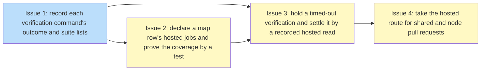

# PLAN: Verification cap route

## Status

Active

## Scope Summary

One verification route for shirabe#1876 (a map command that can't finish inside the 3,600 s row maximum) and shirabe#1930 (a load timeout inside a command): a per-command outcome in the verification result, a hosted-job declaration on map rows, an exit-5 hold at verification shared with shirabe#1881, a recorded hosted_of_record route, and a hosted_record state after ci_monitor that reads each declared job's latest attempt at the head before the pull request is marked ready.

## Decomposition Strategy

**Horizontal decomposition.** The design fixes a four-phase order whose interfaces are stable and written down (the per-command result record and the map row's hosted and timeout_form fields), and each phase is consumed by the next, so each issue builds one layer fully.

Issues follow the design's Implementation Approach phases in order. Issue 1 changes the verification result and no routing. Issue 2 adds the map row's hosted declaration and a coverage test. Issue 3 adds the exit-5 hold, the recorded route and the hosted read, which land together. Issue 4 extends the route to /execute.

The criterion moved from shirabe#1934 to shirabe#1876 (#1934's example diff, selecting only the suites it can reach, gets through verification within the 3,600 s cap on a loaded host, or through a recorded route that doesn't depend on that cap) is covered by Issue 3, through the recorded route, with a routing case over a fixture result shaped like that diff's selection. Issue 1 carries the suite counts that case reads.

## Issue Outlines

### Issue 1: feat(work-on): record each verification command's outcome and suite lists

**Repo**: tsukumogami/shirabe

**Group**: suite-outcome

**Goal**: Make each verification command's record say whether it passed, failed, timed out at its limit or timed out inside the command, and carry check-skill.sh's passed, failed, running and not-started suite lists, without changing any verdict exit.

**Acceptance Criteria**:

Outcomes, in `skills/work-on/scripts/run-verification_test.sh` over fixture map commands:

- [ ] A command that exits 0 inside its limit is recorded with `outcome: "passed"`.
- [ ] A command that exits nonzero inside its limit, from a row with no `timeout_form`, is recorded as `"failed"`, even when its log prints a line that looks like a timeout.
- [ ] A command the supervisor stops at its `timeout_secs` is recorded as `"timed-out-limit"` with `timed_out: true`, when its suite summary lists no failed suite or it writes no summary.
- [ ] A command stopped at its limit whose summary lists one finished-failed suite is recorded as `"failed"`, not `"timed-out-limit"`.
- [ ] A command from a row declaring `timeout_form` that exits nonzero with failure lines that all match the form is recorded as `"timed-out-inside"`; the same log plus one failure line that doesn't match is recorded as `"failed"`; the same log from a row with no `timeout_form` is recorded as `"failed"`.
- [ ] A command from a row declaring `timeout_form` that exits nonzero with no failure line in its log is recorded as `"failed"` (an empty set of failures never reads as a timeout).
- [ ] Not-started and runaway records keep their existing `not_started` and `runaway` flags, and neither is ever recorded as `"timed-out-limit"` or `"timed-out-inside"`.

Suite summary, in `scripts/check-skill_test.sh` (using `CHECK_SKILL_ROOT` and `CHECK_SKILL_CHANGED` over a throwaway skills tree) and `run-verification_test.sh`:

- [ ] A `check-skill.sh --changed` run with `SHIRABE_SUITE_SUMMARY` set, stopped by TERM partway through, leaves a summary listing finished-passed, finished-failed, running and not-started suites, using the suite names `--changed --list` prints; no suite appears in two lists, and the four counts add up to the number of suites `--changed --list` prints for the same changed paths.
- [ ] A run that finishes leaves a summary with empty `running` and `not_started` lists and the same total.
- [ ] A suite fixture that tries to write to `$SHIRABE_SUITE_SUMMARY` finds it unset, and the summary the script leaves is its own.
- [ ] A run killed with no chance to run its TERM handler leaves the last summary it renamed into place, which still parses as JSON (write-then-rename, never a half-written file).
- [ ] With `SHIRABE_SUITE_SUMMARY` unset, `check-skill.sh` writes no summary file and its output and exit codes are as today (existing `check-skill_test.sh` cases pass unchanged).
- [ ] The supervisor copies the summary into the command's record as `suites`; a command that writes no summary is recorded with `suites: null`, and a summary file left at that path by an earlier run is never copied into a new record.

Loader and schema:

- [ ] The map loader accepts a row with a string `timeout_form` that compiles as a regular expression and carries it on that row's invocations; a non-string or uncompilable `timeout_form` settles the result as `bad-map` naming the command (new cases in `skills/work-on/scripts/verification-map-schema_test.sh` or `run-verification_test.sh`).
- [ ] The loader still refuses a `timeout_secs` above 3,600 and the whole-run budget is still 7,200 s (existing cases pass unchanged).
- [ ] `skills/work-on/references/verification-map.md` documents `timeout_form`, and the `outcome` and `suites` record fields, and `verification-map-schema_test.sh`'s field list includes `timeout_form`.

No routing change:

- [ ] `check-verification.sh --verdict` gives the same exit as before for every fixture: a `"timed-out-limit"` record exits 4, a limit-stopped record whose outcome is `"failed"` still exits 4, and a `"timed-out-inside"` record (`timed_out: false`, nonzero `exit_status`) still exits 1. The existing cases in `run-verification_test.sh` and `skills/work-on/scripts/output-gates-routing_test.sh` pass unchanged.

Downstream:

- [ ] Must deliver: the loader's `command_ok` validating `timeout_form` and carrying it into each invocation, so a `hosted` field can be added beside it in the same pattern (required by Issue 2).
- [ ] Must deliver: per-command `outcome` with exactly the four values `passed`, `failed`, `timed-out-limit`, `timed-out-inside`, and `suites` with the keys `passed`, `failed`, `running`, `not_started` as arrays of suite names whose counts add up to the `--changed --list` selection, so a fixture shaped like shirabe#1934's example diff (121 of 127 coordinate suites selected, stopped at the limit) can be built from a real record (required by Issue 3).

**Dependencies**: None

### Issue 2: feat(work-on): declare a map row's hosted jobs and prove the coverage by a test

**Repo**: tsukumogami/shirabe

**Group**: hosted-declaration

**Goal**: Let a verification map row declare the hosted jobs that run its suites, refuse a malformed declaration as `bad-map`, declare `skill-gate (ubuntu-latest)` on the `check-skill` row, and prove with a test that the declared job runs every suite the row can select.

**Acceptance Criteria**:

Loader (`skills/work-on/scripts/run-verification.sh`), carried by new cases in `skills/work-on/scripts/run-verification_test.sh`:

- [ ] A map whose row declares a well-formed `hosted` array (a non-empty array of objects, each with non-empty string `workflow`, `job` and `runs`, and `workflow` a path under `.github/workflows/`) runs that row exactly as the same map without `hosted` does: the same invocations, the same exit and the same result status.
- [ ] Each of these settles as exit 3 with rule `verification/bad-map`, starts no command, and the detail names the command id: `hosted` that isn't an array; an empty `hosted` array; an entry that isn't an object; an entry missing `workflow`, `job` or `runs`; any of the three that's empty or not a string; a `workflow` outside `.github/workflows/`.
- [ ] The loader's selection carries each invocation's validated `hosted` (`[]` when the row declares none), so later scripts read the declaration from one validated place instead of parsing the map again.
- [ ] The loader still rejects a `timeout_secs` above 3,600, and the `timeout_form` field added by Issue 1 still validates alongside `hosted` on the same row.

Schema doc and committed map, carried by `skills/work-on/scripts/verification-map-schema_test.sh`:

- [ ] `skills/work-on/references/verification-map.md` documents `hosted` in its command fields table (its entry fields, that `runs` is the plan line the job runs with `{skill}` standing for the `each` directory's last component, and that the job name is the one GitHub reports, matrix leg included), and its list of what makes a map not parse includes a malformed `hosted`. The schema test's every-field check includes `hosted` and fails on a copy of the reference with that row removed.
- [ ] The committed `check-skill` row declares exactly the single entry shown in the design's Key Interfaces. A schema-test query asserts it, and the same query fails on altered copies of the map that drop the entry, change the job to `skill-gate (macos-latest)`, or change `runs` to carry `--changed`.

Coverage, carried by a new `skills/work-on/scripts/verification-hosted-coverage_test.sh`:

- [ ] The job's suite set comes from the job's own command, not from a hand-kept list. `scripts/check-skill.sh --list <skill>` (without `--changed`) prints every suite `check-skill.sh <skill>` would launch, in the same format as `--changed --list`, and runs nothing. A new case in `scripts/check-skill_test.sh` shows that list equals the skill's `scripts/*_test.sh` files on disk.
- [ ] For each declared entry, the test confirms the workflow file exists, that it has a job `skill-gate` whose `ubuntu-latest` leg runs `scripts/skill-gate.sh`, and that the reported name `skill-gate (ubuntu-latest)` equals the declared `job`. A copy of the declaration naming a job the workflow doesn't have fails the test.
- [ ] The test confirms the workflow's `pull_request` paths list covers every path glob of a map entry that selects the row (today `skills/**`), so a change that selects the row can't have the job skipped by a path filter. A copy of the workflow with `skills/**` removed from that list fails the test.
- [ ] Over fixture diffs in a throwaway git repository (a change under one skill's `scripts/`, changes under two skills, a nested `scripts/testdata/` path, a root `scripts/` change together with a skill change, and a change to `skills/coordinate/` that selects all of coordinate's suites), every `check-skill <skill>` invocation the loader selects for the row has a matching line in `skill-gate.sh --list`'s plan for the same base and head, where the matching line is the declared `runs` with `{skill}` replaced. A plan with one selected skill's line removed fails the test.
- [ ] For each of those diffs and each selected skill, every suite `check-skill.sh --changed --list <skill>` prints (with `CHECK_SKILL_CHANGED` set to the diff's paths) is in that skill's full suite set. With one suite dropped from the coordinate set, the test fails and names the missing suite. Run against the real tree, it passes, and the coordinate set covers every coordinate suite on disk at that moment.
- [ ] A fixture that deletes a skill is handled explicitly: the row selects the deleted skill and the plan doesn't. The test accepts that gap only because `check-skill.sh` refuses a skill missing at HEAD with exit 2, which is a failed check and never a timed-out one, and it asserts that exit 2. No other gap passes.
- [ ] A declaration whose `runs` carries `--changed`, or whose plan line isn't run as `scripts/check-skill.sh <skill>` with no other flags, fails the test.
- [ ] The new suite runs in CI. `.github/workflows/check-work-on-scripts.yml` gets a step for it, and both of its paths lists add `scripts/skill-gate.sh`, `scripts/check-skill.sh`, `.github/workflows/check-skill-gate.yml` and `skills/*/check-skill.tsv`, so a change to any file the coverage depends on reruns it. It's listed in `scripts/bash-floor/work-on.list` with a comment saying what it needs.
- [ ] The existing suites `run-verification_test.sh`, `verification-map-schema_test.sh`, `output-gates-routing_test.sh`, `check-skill_test.sh` and `skill-gate_test.sh` pass with their existing cases unchanged.
- [ ] Must deliver: the loader's per-invocation `hosted` value, the committed `check-skill` declaration, and the coverage test at the fixed path `skills/work-on/scripts/verification-hosted-coverage_test.sh` (required by Issue 3, whose `--open`, `--record` and `--check-record` read each timed-out row's declaration, and whose route closes when a diff touches the map or this test).

**Dependencies**: Issue 1

### Issue 3: feat(work-on): hold a timed-out verification and settle it by a recorded hosted read

**Repo**: tsukumogami/shirabe

**Group**: hosted-route

**Goal**: Give a `/work-on` run whose verification timed out with no failed check a hold at exit 5 where the agent may take the hosted-of-record route with a reason, record that route in place, open the pull request as a draft carrying one script-written line per recorded check, and settle the record against each declared job's latest attempt at the head before the pull request can be marked ready.

**Acceptance Criteria**:

The verdict and the open gate:

- [ ] 1. `check-verification.sh --verdict` ranks the new outcomes: a result whose checks are all `passed` or timed out (`timed-out-limit` or `timed-out-inside`), with at least one timed out and the route open, exits 5; the same result with the route closed exits 4 and routes to `done_blocked` as today; a result with one timed-out and one `failed` check exits 1 and reaches `implementation`; a stopped `check-skill` command recorded `failed` because a suite finished failed exits 1; not-started, runaway, attended and dirty-tree results still exit 4. `check-verification.sh` reads `--open` by sourcing, not by a second process. Covered in `skills/work-on/scripts/run-verification_test.sh`.
- [ ] 2. `verification-route.sh --open` exits 0 only when R1 holds for the stored result and the merge-base's map (every timed-out check's row declares `hosted` jobs) and the diff from the merge-base touches none of the files that decide what the hosted job runs. It exits 1 and prints the closing cause for each of: a timed-out check whose row declares no hosted jobs; a failed check; a not-started command; a supervisor error; a dirty tree; a missing or bad map; a diff touching any path under `.github/`, `scripts/skill-gate.sh`, `scripts/check-skill.sh`, a library either sources or a helper either executes, the verification map, or the coverage test from Issue 2; and any edit to a `check-skill.tsv` other than added rows. A fixture whose only `check-skill.tsv` change adds a row stays open. The sourced-library and helper list is taken from the merge-base's copies, so a fixture that adds a new sourced helper and edits it in the same diff is still closed. Covered in a new `skills/work-on/scripts/verification-route_test.sh`.
- [ ] 3. `--open` exits 1, naming `/execute` as the cause, for a run launched as a child of `/execute` (a `SHARED_BRANCH` run, or a child session `/execute` started), so such a run's timed-out result still exits 4 to `done_blocked` exactly as today. Covered in `verification-route_test.sh` and `run-verification_test.sh`.
- [ ] 4. Covers the criterion moved from shirabe#1934 to shirabe#1876 ("#1934's example diff, selecting only the suites it can reach, gets through verification within the 3,600 s cap on a loaded host, or through a recorded route that doesn't depend on that cap"). A routing case uses a fixture result shaped like that diff's selection: the `check-skill:coordinate` check has outcome `timed-out-limit`, no check failed, and its `suites` lists (passed, failed empty, running, not started) add up to 121 of the skill's 127 suites; the fixture diff touches only `skills/coordinate/scripts/state-holding.sh`, `skills/coordinate/scripts/teardown-pass.sh`, `skills/coordinate/koto-templates/coordinate.md`, `skills/coordinate/references/teardown-agent.md`, `skills/coordinate/scripts/state-holding_test.sh` and `skills/coordinate/scripts/teardown-pass_test.sh`. On that fixture `--open` exits 0, the verdict exits 5 and `verification` holds, a `hosted_of_record` submission with a reason reaches `verification_hosted`, and `--check-record` exits 0 on the key `--record` wrote. Covered in `verification-route_test.sh` and `skills/work-on/scripts/output-gates-routing_test.sh`.

The hold and the recording step:

- [ ] 5. At `verification` with the verdict at 5, no tick moves the run: with no submitted value the state holds. `verification_status: hosted_of_record` with a non-empty `detail` reaches `verification_hosted` only when the `verification_route` gate exits 0; with an empty or all-space `detail` it is refused; with the route gate at 1 (a result held at 5 for another reason) it is refused. `fix` reaches `implementation` and `blocked` reaches `done_blocked` at the hold. Covered in `output-gates-routing_test.sh` driving real `koto next` over the shipped state blocks.
- [ ] 6. A session started with `VERIFICATION=local` takes the route at `verification` without being re-initialized, and a `VERIFICATION=hosted-ci` session still never enters `verification`. Covered in `output-gates-routing_test.sh`.
- [ ] 7. Re-entering `verification` at the same head and merge-base reuses the stored timed-out result without starting any check (the fake launcher records no start), holds at 5 again and offers the route again. Covered in `output-gates-routing_test.sh` and `run-verification_test.sh`.
- [ ] 8. `--record --reason <text>` writes the koto key `hosted_of_record` with `head`, `taken_at`, `reason` and a `checks` array listing exactly the result's timed-out checks, each with the jobs the merge-base's map declares for its row and `run_id` and `conclusion` null. A check that passed locally is absent from the record and stays local; a result with two timed-out checks lists both. The reason is passed with `jq --arg`, stripped of control characters and backticks, capped in length, and never interpolated into a shell command: a fixture reason containing `$(touch <marker>)` and `;` leaves no marker file and is stored as text. Covered in `verification-route_test.sh`.
- [ ] 9. `--check-record` exits 0 for the key `--record` wrote; exits 1 for a key with an empty reason, a head other than the current one, a check missing from or added to the result's timed-out set, a job list that differs from the map's declaration, or a `taken_at` in the future or before the result finished; exits 2 when the key can't be read. In the template, `verification_hosted` goes on to `pass_counting` on 0, back to `verification` on 1, and holds on 2. Covered in `verification-route_test.sh` and `output-gates-routing_test.sh`.

The draft and the body line:

- [ ] 10. When the record exists, `pr_creation` accepts `pr_status: created` only for a draft pull request whose body carries one `Hosted of record:` line per recorded check, written by the script from the record, naming the check id, the head and the declared job names. `check-pr-output.sh --hosted-record` exits 1 for a body missing a recorded check's line, a line with the wrong head or check id, and a non-draft pull request; it exits 0 with the lines present. A run with no record goes through `pr_creation` as today. Covered in `skills/work-on/scripts/check-pr-output_test.sh` and `output-gates-routing_test.sh`.
- [ ] 11. The reason reaches the body as one line inside a code span, with backticks stripped and `@`, `#`, link and HTML characters neutralized. A fixture reason that contains a newline followed by `Hosted of record: check-skill:coordinate at <head>: https://...`, an `@` mention, a `#123` reference, a Markdown link and an HTML tag produces no second `Hosted of record:` line, mentions nobody and links nothing; the body check matches only lines that start with the prefix and compares check id, head and run id against the record, so the reason can't satisfy or forge a line. The body is passed to `gh` by file. Covered in `check-pr-output_test.sh` and `verification-route_test.sh`.

The hosted read and the ready step:

- [ ] 12. `--read` over fixture `actions/runs?head_sha=<head>` and jobs responses, with the clock set by the test: exits 0 and fills each job's `run_id` and `conclusion` when every declared job's latest attempt at the head concluded `success`; accepts a job whose first attempt failed and whose highest `run_attempt` succeeded, and refuses the reverse; exits 1 naming every refusing job and the commit for a latest attempt concluded `cancelled`, `failure`, `skipped`, `timed_out`, `neutral`, `action_required` or `stale`, for an unreadable response, for zero or two jobs matching the declared name, and when the pull request's head isn't the record's head (two refusing jobs are both named); exits 75 while a job is pending, queued or absent at 119 minutes after `taken_at`; exits 3 naming the pending jobs and the commit once more than 120 minutes have passed. It ignores runs for another workflow path, another event than `pull_request`, another pull request number, a head repository other than the base repository, and another commit, so hosted success at an older commit is refused; it follows pagination to find the newest matching run. It takes the repository and pull request number from the pull request object, not the branch. Covered in `verification-route_test.sh`.
- [ ] 13. `ci_monitor`'s passing edge goes to `hosted_record` whenever the record exists and `--settled` exits 1, whether or not the pull request is still a draft, so a pull request marked ready by hand still gets the read; with no record, or with `--settled` at 0, it goes to `ci_pass_counting` as today. Covered in `output-gates-routing_test.sh`.
- [ ] 14. In `hosted_record`: on `--read` 0 the script rewrites each body line with run URLs built from the numeric run ids, by `gh pr edit --body-file`, and the state's ready gate passes only when the pull request is no longer a draft, its head re-read just before `gh pr ready` is still the record's, and every line carries its run links; the run then returns to `ci_monitor`, which waits for the non-draft legs and, with `--settled` at 0, goes on to `ci_pass_counting`. On 1 the run returns to `verification`, where the reused result holds at 5 and still accepts `blocked`. On 3 it ends at `done_blocked` with a `failure_reason` naming the pending jobs and the commit. On 75 it holds. While any job is pending, the ready step refuses and the run can't reach `ci_pass_counting` or `done`. Covered in `output-gates-routing_test.sh` and `verification-route_test.sh`.
- [ ] 15. A record whose `run_id` and `conclusion` fields were filled by hand, without `--read`, fails `--settled` and the ready gate: each check re-runs `--check-record` and re-reads every filled run id, refusing a run that names another workflow, another job, another head or a conclusion other than `success`. Such a run goes to `hosted_record` and performs the read. Covered in `verification-route_test.sh` and `output-gates-routing_test.sh`.
- [ ] 16. A new commit after the route was taken voids it: `--read` and `--settled` refuse on the head mismatch, the hosted runs at the earlier head record no pass for the new head, and the new head enters `verification` afresh. Covered in `verification-route_test.sh` and `output-gates-routing_test.sh`.
- [ ] 17. A stale key doesn't change a run at the new head: with a `hosted_of_record` key left from an earlier head, `--start` at the new head removes it before the map runs; a result that then passes locally goes through `pr_creation` as today (no draft or `Hosted of record:` line required) and `ci_monitor`'s passing edge goes to `ci_pass_counting`, never `hosted_record`; and a second timeout at the new head has `--record` write a fresh key naming the new head that replaces the earlier one. Covered in `verification-route_test.sh` and `output-gates-routing_test.sh`.

Beside shirabe#1881 and unchanged outcomes:

- [ ] 18. Coexistence with shirabe#1881's rerun at the one shared hold. If shirabe#1881 has already landed when this merges, this issue adds `hosted_of_record` to its exit-5 hold, conforms that hold to the rule that a result with any failed check exits 1 (never 5), and carries a test in `output-gates-routing_test.sh` that a timed-out result accepts either value first: `rerun` first and, on a second timeout at the same head, `hosted_of_record`; and `hosted_of_record` first and, after a refusal back at `verification`, `rerun`; neither value is a precondition for the other. If this issue lands first, it introduces the hold with exit 5 reserved for a timed-out result with no failed check, and the either-first test is shirabe#1881's to add. Either way, a result held at 5 with the route gate at 1 can't take `hosted_of_record`.
- [ ] 19. In-budget passes, failed checks and `VERIFICATION=hosted-ci` runs behave exactly as today: the existing cases in `output-gates-routing_test.sh`, `verification-deferral_test.sh`, `run-verification_test.sh` and `check-pr-output_test.sh` pass unchanged, the map loader still rejects a `timeout_secs` above 3,600, and the whole-run budget is still 7,200 s; the hosted wait is not charged to it.
- [ ] 20. The `verification` and `hosted_record` directives in `work-on.md` tell the agent what each exit means, when `hosted_of_record` is offered and that the reason is public text; `skills/work-on/evals/evals.json` gains scenarios for the hold, the recording step and the hosted read; and `scripts/check-skill.sh --changed work-on` passes.

For the downstream issue:

- [ ] 21. Must deliver: `verification-route.sh --record`, `--check-record` and `--read` usable over a record whose `head` is a shared or node pull request's head and whose `checks` come from several child records, with `--check-record` able to validate each check against a named child's stored result and map, and the `/execute` refusal in `--open` isolated to one check the downstream issue can remove (required by Issue 4).

**Dependencies**: Issue 1, Issue 2

### Issue 4: feat(execute): take the hosted route for shared and node pull requests

**Repo**: tsukumogami/shirabe

**Group**: execute-parity

**Goal**: Let an `/execute` run take the hosted route for its shared pull request (`single-pr`) and for each coordinated node pull request: `plan_completion` collects the children's `hosted_of_record` keys into the parent's own record for the shared head, `node-push.sh` writes the node's own record for the node's pushed head, and the same read and body check `/work-on` uses gate the ready step (`plan_completion`'s ready step for the shared pull request, and `coordinated-next.sh`'s `evaluate:<node>` for a node pull request). Then remove the `/execute` refusal in `verification-route.sh --open`.

**Acceptance Criteria**:

Single-pr shared pull request (tests in `skills/execute/scripts/execute-output-gates-routing_test.sh` and `skills/execute/scripts/shared-deferral-record_test.sh`, fixture child results and fixture hosted-job responses, clock set by the test):

- [ ] Two shared-branch children each recorded `hosted_of_record` at their own heads: at `plan_completion` the parent writes its own `hosted_of_record` key whose `head` is the shared pull request's head (not either child's), whose `checks` are the union of both children's recorded checks with their declared jobs, whose reasons are the children's, and whose `taken_at` is the parent's own time, later than both children's.
- [ ] With every declared job's latest attempt at the shared head concluded success, `--read` fills each `run_id` and `conclusion`, the shared pull request body's `Hosted of record:` lines carry the run links, the pull request is marked ready and the run reaches `ci_monitor`.
- [ ] A declared job that concluded success at a child's head but has no successful latest attempt at the shared head is refused: the pull request is not marked ready, the run doesn't reach `ci_monitor`, and the refusal names the job and the shared head.
- [ ] A declared job concluded cancelled, failure or skipped at the shared head is refused, naming that job and the commit; with two such jobs it names both. Nothing is marked ready.
- [ ] While a declared job is pending, `plan_completion` holds: no `gh pr ready`, no edge to `ci_monitor`. A child record whose `taken_at` is 130 minutes old with a parent `taken_at` 10 minutes old still holds (the child's time doesn't start the wait); a parent `taken_at` 119 minutes old holds, and one more than 120 minutes old ends the run at `done_blocked` naming the pending jobs and the shared head.
- [ ] The parent's `--check-record` validates each child's part against that child's own stored result and map: a child part naming a check that didn't time out in that child's result, a job the map doesn't declare for the check, or a child whose stored result has a failed check fails the record, and the pull request is not marked ready. A parent key edited by hand to fill run ids without a read fails the ready gate.
- [ ] `--open`'s diff check runs over the shared pull request's whole diff from its merge-base: when each child's own diff passes `--open` but another child's commit on the shared branch touches a file under `.github/` (or `scripts/check-skill.sh`, or edits a `check-skill.tsv` other than adding rows), the parent refuses the route, prints the closing cause, and marks nothing ready.
- [ ] A shared pull request body missing the `Hosted of record:` line for a check the parent record names is refused by the body check before ready; with the line, carrying the check id, the shared head and one run link per declared job, it passes. Reason text containing a forged `Hosted of record:` line or backticks doesn't produce a line the check accepts.
- [ ] A run whose children carry no `hosted_of_record` key writes no parent key, reads no hosted jobs, and `plan_completion` behaves as today; the existing `plan_completion`, `pr_finalization` and `shared-deferral-record_test.sh` cases pass unchanged (R16).

Coordinated node pull requests (tests in `skills/execute/scripts/node-push_test.sh` and `skills/execute/scripts/coordinated-next_test.sh`):

- [ ] For a node whose work-item children carry `hosted_of_record` keys, `node-push.sh node` writes the node's own record for the node's pushed head with its own `taken_at`, built from the children's checks and validated against each child's stored result and map, and runs `--open`'s diff check over the node branch's whole diff against the default branch.
- [ ] `coordinated-next.sh` prints neither `evaluate:<node>` with the ready call allowed nor `merge:<node>` for that node until `--read` over the node record exits 0 and the node pull request body carries its `Hosted of record:` lines with run links; a refused job yields an `error:` line naming the job and the node head, and a job still pending more than 120 minutes after the node record's `taken_at` yields an error naming the pending jobs and the commit.
- [ ] A node whose children carry no record behaves exactly as today, and the existing `node-push_test.sh` and `coordinated-next_test.sh` cases pass unchanged.

The `--open` refusal and parity (tests in `skills/work-on/scripts/verification-route_test.sh` and `skills/work-on/scripts/output-gates-routing_test.sh`):

- [ ] The `/execute` refusal is gone: a child session launched by `/execute` (single-pr shared-branch child and coordinated work-item child) with a timed-out result, no failed check and declared jobs gets `--open` at 0, holds `verification` at exit 5, accepts `hosted_of_record` with a reason, and still refuses it with an empty reason.
- [ ] Parity: on the same fixture result and map, an issue run launched by `/execute` in `single-pr`, `coordinated` and `multi-pr` modes reaches the same next state after `hosted_of_record` as a standalone `/work-on` run, and writes a `hosted_of_record` key with the same fields (`head`, `taken_at`, `reason`, `checks`, and per check the same `jobs`). The `multi-pr` case runs through `/work-on` with no `/execute`-specific step.

**Dependencies**: Issue 3

## Dependency Graph

**Legend**: Green = done, Blue = ready, Yellow = blocked

## Implementation Sequence

**Critical path**: Issue 1 -> Issue 2 -> Issue 3 -> Issue 4. The chain is serial by the design: each phase reads what the one before it adds. Length: 4 issues.

**Order**:

1. Issue 1 starts immediately; it has no dependencies.
2. Issue 2 follows Issue 1. The design calls Phase 2 independent of Phase 1 except for the loader edit; the edge orders the two loader changes so neither lands on a stale copy of the other.
3. Issue 3 follows Issues 1 and 2. The hold and the hosted read land together, because a route that could be taken before the read exists would skip local verification with nothing in its place.
4. Issue 4 follows Issue 3 and removes the `/execute` refusal that Issue 3 puts in `--open`.

**Parallelization**: none. Each issue waits on the one before it.
